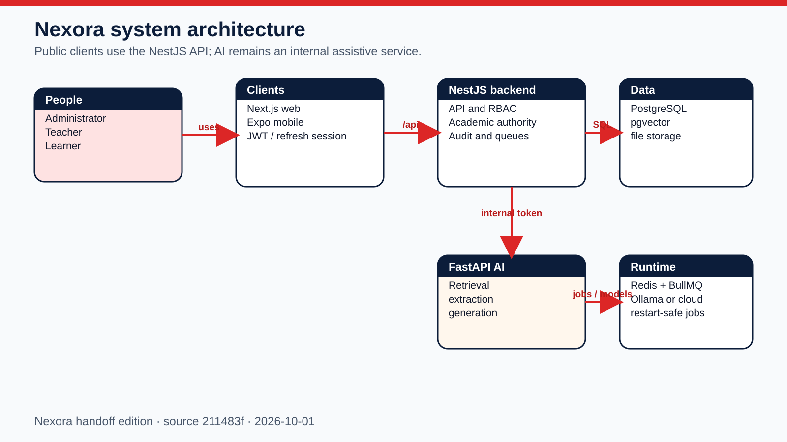
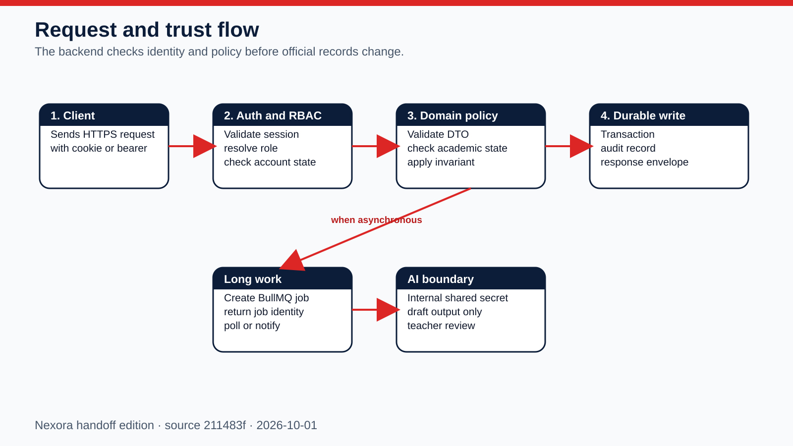
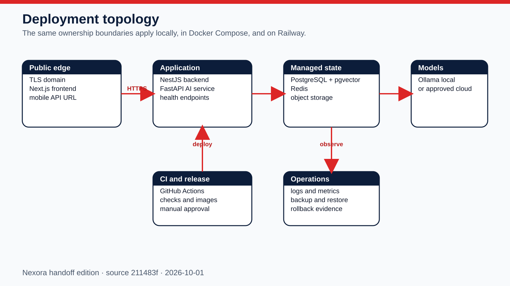
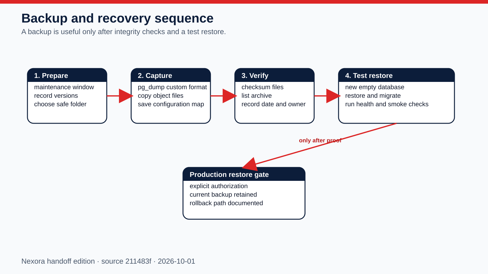

# Nexora System Manual

**Handoff edition:** 2026-10-01  
**Application snapshot:** `211483f07b901299b48ae42eda318c7448f1cbfd`

This book is the source-of-truth reference for architecture, setup, local execution, deployment, configuration, security boundaries, backup/recovery, modules, APIs, queues, database objects, clients, and troubleshooting.

## System at a glance

- 43 backend modules and 485 HTTP handlers
- 63 AI service handlers
- 116 database tables, 55 enums, and 37 migrations
- 114 web pages and 100 mobile screen files
- 9 queue processors and 98 configuration keys

## First run from the external drive

1. Copy the whole `NEXORA_HANDOFF_2026-10-01` folder to a local SSD; do not run databases directly from removable media.
2. Install Git, Docker Desktop or Docker Engine with Compose, Node.js 22 LTS, Python 3.11+, and Android Studio only if rebuilding the APK.
3. Read `README-FIRST.txt`, then open `START-HERE.html`.
4. Copy the supplied environment templates into a private working folder and replace every placeholder secret.
5. From the source folder run `docker compose up -d --build` and wait until PostgreSQL, Redis, AI, backend, and frontend are healthy.
6. Verify backend health, open the frontend, sign in with a real authorized account, and complete the smoke checklist before importing real data.

## Security and trust boundary

Public clients call only the NestJS `/api` boundary. The backend owns authentication, role checks, official academic state, audit evidence, database writes, and durable job orchestration. The AI service is internal and assistive; it cannot become the public authentication or academic authority.

## Deployment

Local and self-hosted deployments use the same ownership boundaries. Railway uses the repository service definitions and GitHub Actions workflow; secrets are configured in the target environment, never committed.

## Backup and recovery

A backup is not considered valid until its checksum is recorded and a restore into an empty test environment passes migrations, health checks, authentication, and role smoke tests.

## Backend module catalog

### Academic Grading

Calculates and records official period and annual grading evidence, including revisions, remediation, and source selection.

- **Authority:** NestJS backend; clients must use its `/api` contract.
- **Inputs:** authenticated requests, validated DTOs, policy state, and durable records relevant to this capability.
- **Outputs:** role-scoped response data, auditable state changes, or a durable job identity for long work.
- **Controllers in folder:** 3. **HTTP handlers:** 28.
- **Failure check:** inspect the HTTP status and request ID, backend log, dependency health, and audit event before retrying.
- **Verify:** exercise one permitted read and one permitted write or preview using synthetic data; confirm persistence and role isolation.
- **Source:** `backend/src/modules/academic-state/academic-grading.module.ts`

### Academic Policy

Owns the school-year and grading-period rules that decide whether academic work may be prepared, edited, released, or finalized.

- **Authority:** NestJS backend; clients must use its `/api` contract.
- **Inputs:** authenticated requests, validated DTOs, policy state, and durable records relevant to this capability.
- **Outputs:** role-scoped response data, auditable state changes, or a durable job identity for long work.
- **Controllers in folder:** 3. **HTTP handlers:** 28.
- **Failure check:** inspect the HTTP status and request ID, backend log, dependency health, and audit event before retrying.
- **Verify:** exercise one permitted read and one permitted write or preview using synthetic data; confirm persistence and role isolation.
- **Source:** `backend/src/modules/academic-state/academic-policy.module.ts`

### Academic Readiness

Evaluates learner and class evidence before release, completion, transition, or remediation decisions.

- **Authority:** NestJS backend; clients must use its `/api` contract.
- **Inputs:** authenticated requests, validated DTOs, policy state, and durable records relevant to this capability.
- **Outputs:** role-scoped response data, auditable state changes, or a durable job identity for long work.
- **Controllers in folder:** 3. **HTTP handlers:** 28.
- **Failure check:** inspect the HTTP status and request ID, backend log, dependency health, and audit event before retrying.
- **Verify:** exercise one permitted read and one permitted write or preview using synthetic data; confirm persistence and role isolation.
- **Source:** `backend/src/modules/academic-state/academic-readiness.module.ts`

### Academic State

Publishes the backend-authoritative current school year, period, lifecycle state, and related capability decisions.

- **Authority:** NestJS backend; clients must use its `/api` contract.
- **Inputs:** authenticated requests, validated DTOs, policy state, and durable records relevant to this capability.
- **Outputs:** role-scoped response data, auditable state changes, or a durable job identity for long work.
- **Controllers in folder:** 3. **HTTP handlers:** 28.
- **Failure check:** inspect the HTTP status and request ID, backend log, dependency health, and audit event before retrying.
- **Verify:** exercise one permitted read and one permitted write or preview using synthetic data; confirm persistence and role isolation.
- **Source:** `backend/src/modules/academic-state/academic-state.module.ts`

### Admin Demo Mode

Provides a controlled demonstration state for administrators without turning demonstration behavior into production authority.

- **Authority:** NestJS backend; clients must use its `/api` contract.
- **Inputs:** authenticated requests, validated DTOs, policy state, and durable records relevant to this capability.
- **Outputs:** role-scoped response data, auditable state changes, or a durable job identity for long work.
- **Controllers in folder:** 1. **HTTP handlers:** 3.
- **Failure check:** inspect the HTTP status and request ID, backend log, dependency health, and audit event before retrying.
- **Verify:** exercise one permitted read and one permitted write or preview using synthetic data; confirm persistence and role isolation.
- **Source:** `backend/src/modules/admin-demo-mode/admin-demo-mode.module.ts`

### Admin Lifecycle

Previews and executes governed archive, cleanup, and lifecycle actions while preserving impact and audit evidence.

- **Authority:** NestJS backend; clients must use its `/api` contract.
- **Inputs:** authenticated requests, validated DTOs, policy state, and durable records relevant to this capability.
- **Outputs:** role-scoped response data, auditable state changes, or a durable job identity for long work.
- **Controllers in folder:** 2. **HTTP handlers:** 21.
- **Failure check:** inspect the HTTP status and request ID, backend log, dependency health, and audit event before retrying.
- **Verify:** exercise one permitted read and one permitted write or preview using synthetic data; confirm persistence and role isolation.
- **Source:** `backend/src/modules/admin-lifecycle/admin-lifecycle.module.ts`

### Admin Maintenance

Controls reauthenticated maintenance sessions and high-impact administrator operations.

- **Authority:** NestJS backend; clients must use its `/api` contract.
- **Inputs:** authenticated requests, validated DTOs, policy state, and durable records relevant to this capability.
- **Outputs:** role-scoped response data, auditable state changes, or a durable job identity for long work.
- **Controllers in folder:** 1. **HTTP handlers:** 3.
- **Failure check:** inspect the HTTP status and request ID, backend log, dependency health, and audit event before retrying.
- **Verify:** exercise one permitted read and one permitted write or preview using synthetic data; confirm persistence and role isolation.
- **Source:** `backend/src/modules/admin-maintenance/admin-maintenance.module.ts`

### Admin

Aggregates administrator-facing capabilities, summaries, and management endpoints.

- **Authority:** NestJS backend; clients must use its `/api` contract.
- **Inputs:** authenticated requests, validated DTOs, policy state, and durable records relevant to this capability.
- **Outputs:** role-scoped response data, auditable state changes, or a durable job identity for long work.
- **Controllers in folder:** 1. **HTTP handlers:** 5.
- **Failure check:** inspect the HTTP status and request ID, backend log, dependency health, and audit event before retrying.
- **Verify:** exercise one permitted read and one permitted write or preview using synthetic data; confirm persistence and role isolation.
- **Source:** `backend/src/modules/admin/admin.module.ts`

### Ai Mentor

Accepts authenticated AI-assistance requests, creates durable jobs where needed, and proxies only to the internal AI service.

- **Authority:** NestJS backend; clients must use its `/api` contract.
- **Inputs:** authenticated requests, validated DTOs, policy state, and durable records relevant to this capability.
- **Outputs:** role-scoped response data, auditable state changes, or a durable job identity for long work.
- **Controllers in folder:** 1. **HTTP handlers:** 46.
- **Failure check:** inspect the HTTP status and request ID, backend log, dependency health, and audit event before retrying.
- **Verify:** exercise one permitted read and one permitted write or preview using synthetic data; confirm persistence and role isolation.
- **Source:** `backend/src/modules/ai-mentor/ai-mentor.module.ts`

### Analytics

Builds role-scoped usage, learning, and operational summaries from authoritative backend data.

- **Authority:** NestJS backend; clients must use its `/api` contract.
- **Inputs:** authenticated requests, validated DTOs, policy state, and durable records relevant to this capability.
- **Outputs:** role-scoped response data, auditable state changes, or a durable job identity for long work.
- **Controllers in folder:** 1. **HTTP handlers:** 4.
- **Failure check:** inspect the HTTP status and request ID, backend log, dependency health, and audit event before retrying.
- **Verify:** exercise one permitted read and one permitted write or preview using synthetic data; confirm persistence and role isolation.
- **Source:** `backend/src/modules/analytics/analytics.module.ts`

### Announcements

Creates, targets, schedules, publishes, and tracks school or class announcements.

- **Authority:** NestJS backend; clients must use its `/api` contract.
- **Inputs:** authenticated requests, validated DTOs, policy state, and durable records relevant to this capability.
- **Outputs:** role-scoped response data, auditable state changes, or a durable job identity for long work.
- **Controllers in folder:** 3. **HTTP handlers:** 8.
- **Failure check:** inspect the HTTP status and request ID, backend log, dependency health, and audit event before retrying.
- **Verify:** exercise one permitted read and one permitted write or preview using synthetic data; confirm persistence and role isolation.
- **Source:** `backend/src/modules/announcements/announcements.module.ts`

### App Version

Publishes mobile build policy, update eligibility, download metadata, and integrity requirements.

- **Authority:** NestJS backend; clients must use its `/api` contract.
- **Inputs:** authenticated requests, validated DTOs, policy state, and durable records relevant to this capability.
- **Outputs:** role-scoped response data, auditable state changes, or a durable job identity for long work.
- **Controllers in folder:** 1. **HTTP handlers:** 2.
- **Failure check:** inspect the HTTP status and request ID, backend log, dependency health, and audit event before retrying.
- **Verify:** exercise one permitted read and one permitted write or preview using synthetic data; confirm persistence and role isolation.
- **Source:** `backend/src/modules/app-version/app-version.module.ts`

### Assessments

Owns assessment authoring, assignment, attempts, scoring, review, release, and result history.

- **Authority:** NestJS backend; clients must use its `/api` contract.
- **Inputs:** authenticated requests, validated DTOs, policy state, and durable records relevant to this capability.
- **Outputs:** role-scoped response data, auditable state changes, or a durable job identity for long work.
- **Controllers in folder:** 2. **HTTP handlers:** 41.
- **Failure check:** inspect the HTTP status and request ID, backend log, dependency health, and audit event before retrying.
- **Verify:** exercise one permitted read and one permitted write or preview using synthetic data; confirm persistence and role isolation.
- **Source:** `backend/src/modules/assessments/assessments.module.ts`

### Audit

Stores and retrieves immutable evidence of consequential actions and security-relevant events.

- **Authority:** NestJS backend; clients must use its `/api` contract.
- **Inputs:** authenticated requests, validated DTOs, policy state, and durable records relevant to this capability.
- **Outputs:** role-scoped response data, auditable state changes, or a durable job identity for long work.
- **Controllers in folder:** 0. **HTTP handlers:** 0.
- **Failure check:** inspect the HTTP status and request ID, backend log, dependency health, and audit event before retrying.
- **Verify:** exercise one permitted read and one permitted write or preview using synthetic data; confirm persistence and role isolation.
- **Source:** `backend/src/modules/audit/audit.module.ts`

### Auth

Validates credentials, issues and rotates sessions, applies account-state rules, and supports secure recovery.

- **Authority:** NestJS backend; clients must use its `/api` contract.
- **Inputs:** authenticated requests, validated DTOs, policy state, and durable records relevant to this capability.
- **Outputs:** role-scoped response data, auditable state changes, or a durable job identity for long work.
- **Controllers in folder:** 1. **HTTP handlers:** 15.
- **Failure check:** inspect the HTTP status and request ID, backend log, dependency health, and audit event before retrying.
- **Verify:** exercise one permitted read and one permitted write or preview using synthetic data; confirm persistence and role isolation.
- **Source:** `backend/src/modules/auth/auth.module.ts`

### Class Record

Maintains the official class workbook, score evidence, exceptions, calculations, and release readiness.

- **Authority:** NestJS backend; clients must use its `/api` contract.
- **Inputs:** authenticated requests, validated DTOs, policy state, and durable records relevant to this capability.
- **Outputs:** role-scoped response data, auditable state changes, or a durable job identity for long work.
- **Controllers in folder:** 1. **HTTP handlers:** 30.
- **Failure check:** inspect the HTTP status and request ID, backend log, dependency health, and audit event before retrying.
- **Verify:** exercise one permitted read and one permitted write or preview using synthetic data; confirm persistence and role isolation.
- **Source:** `backend/src/modules/class-record/class-record.module.ts`

### Class Templates

Lets authorized staff prepare reusable class structures and import or export template definitions.

- **Authority:** NestJS backend; clients must use its `/api` contract.
- **Inputs:** authenticated requests, validated DTOs, policy state, and durable records relevant to this capability.
- **Outputs:** role-scoped response data, auditable state changes, or a durable job identity for long work.
- **Controllers in folder:** 1. **HTTP handlers:** 14.
- **Failure check:** inspect the HTTP status and request ID, backend log, dependency health, and audit event before retrying.
- **Verify:** exercise one permitted read and one permitted write or preview using synthetic data; confirm persistence and role isolation.
- **Source:** `backend/src/modules/class-templates/class-templates.module.ts`

### Classes

Owns class identity, membership, teacher assignment, status, and class-level views.

- **Authority:** NestJS backend; clients must use its `/api` contract.
- **Inputs:** authenticated requests, validated DTOs, policy state, and durable records relevant to this capability.
- **Outputs:** role-scoped response data, auditable state changes, or a durable job identity for long work.
- **Controllers in folder:** 1. **HTTP handlers:** 29.
- **Failure check:** inspect the HTTP status and request ID, backend log, dependency health, and audit event before retrying.
- **Verify:** exercise one permitted read and one permitted write or preview using synthetic data; confirm persistence and role isolation.
- **Source:** `backend/src/modules/classes/classes.module.ts`

### Content Modules

Organizes course modules, ordering, publication state, and lesson relationships.

- **Authority:** NestJS backend; clients must use its `/api` contract.
- **Inputs:** authenticated requests, validated DTOs, policy state, and durable records relevant to this capability.
- **Outputs:** role-scoped response data, auditable state changes, or a durable job identity for long work.
- **Controllers in folder:** 1. **HTTP handlers:** 20.
- **Failure check:** inspect the HTTP status and request ID, backend log, dependency health, and audit event before retrying.
- **Verify:** exercise one permitted read and one permitted write or preview using synthetic data; confirm persistence and role isolation.
- **Source:** `backend/src/modules/content-modules/content-modules.module.ts`

### Discussion Board

Runs moderated class discussions, comments, attachments, reactions, reports, and publication state.

- **Authority:** NestJS backend; clients must use its `/api` contract.
- **Inputs:** authenticated requests, validated DTOs, policy state, and durable records relevant to this capability.
- **Outputs:** role-scoped response data, auditable state changes, or a durable job identity for long work.
- **Controllers in folder:** 1. **HTTP handlers:** 19.
- **Failure check:** inspect the HTTP status and request ID, backend log, dependency health, and audit event before retrying.
- **Verify:** exercise one permitted read and one permitted write or preview using synthetic data; confirm persistence and role isolation.
- **Source:** `backend/src/modules/discussion-board/discussion-board.module.ts`

### File Upload

Validates uploaded teaching files, records ownership, and schedules extraction or indexing work.

- **Authority:** NestJS backend; clients must use its `/api` contract.
- **Inputs:** authenticated requests, validated DTOs, policy state, and durable records relevant to this capability.
- **Outputs:** role-scoped response data, auditable state changes, or a durable job identity for long work.
- **Controllers in folder:** 2. **HTTP handlers:** 14.
- **Failure check:** inspect the HTTP status and request ID, backend log, dependency health, and audit event before retrying.
- **Verify:** exercise one permitted read and one permitted write or preview using synthetic data; confirm persistence and role isolation.
- **Source:** `backend/src/modules/file-upload/file-upload.module.ts`

### Storage

Provides the storage-driver boundary for local files or S3-compatible object storage.

- **Authority:** NestJS backend; clients must use its `/api` contract.
- **Inputs:** authenticated requests, validated DTOs, policy state, and durable records relevant to this capability.
- **Outputs:** role-scoped response data, auditable state changes, or a durable job identity for long work.
- **Controllers in folder:** 0. **HTTP handlers:** 0.
- **Failure check:** inspect the HTTP status and request ID, backend log, dependency health, and audit event before retrying.
- **Verify:** exercise one permitted read and one permitted write or preview using synthetic data; confirm persistence and role isolation.
- **Source:** `backend/src/modules/file-upload/storage/storage.module.ts`

### Health

Reports liveness, readiness, dependency status, and operational diagnostics.

- **Authority:** NestJS backend; clients must use its `/api` contract.
- **Inputs:** authenticated requests, validated DTOs, policy state, and durable records relevant to this capability.
- **Outputs:** role-scoped response data, auditable state changes, or a durable job identity for long work.
- **Controllers in folder:** 2. **HTTP handlers:** 4.
- **Failure check:** inspect the HTTP status and request ID, backend log, dependency health, and audit event before retrying.
- **Verify:** exercise one permitted read and one permitted write or preview using synthetic data; confirm persistence and role isolation.
- **Source:** `backend/src/modules/health/health.module.ts`

### Ja

Coordinates JA guidance, review, learner support, and AI-assisted study interactions.

- **Authority:** NestJS backend; clients must use its `/api` contract.
- **Inputs:** authenticated requests, validated DTOs, policy state, and durable records relevant to this capability.
- **Outputs:** role-scoped response data, auditable state changes, or a durable job identity for long work.
- **Controllers in folder:** 2. **HTTP handlers:** 19.
- **Failure check:** inspect the HTTP status and request ID, backend log, dependency health, and audit event before retrying.
- **Verify:** exercise one permitted read and one permitted write or preview using synthetic data; confirm persistence and role isolation.
- **Source:** `backend/src/modules/ja/ja.module.ts`

### Lessons

Owns lesson content, publication, preview access, completion evidence, and delivery metadata.

- **Authority:** NestJS backend; clients must use its `/api` contract.
- **Inputs:** authenticated requests, validated DTOs, policy state, and durable records relevant to this capability.
- **Outputs:** role-scoped response data, auditable state changes, or a durable job identity for long work.
- **Controllers in folder:** 1. **HTTP handlers:** 25.
- **Failure check:** inspect the HTTP status and request ID, backend log, dependency health, and audit event before retrying.
- **Verify:** exercise one permitted read and one permitted write or preview using synthetic data; confirm persistence and role isolation.
- **Source:** `backend/src/modules/lessons/lessons.module.ts`

### Lxp

Builds personalized learning paths and learner-facing experience data from approved content and evidence.

- **Authority:** NestJS backend; clients must use its `/api` contract.
- **Inputs:** authenticated requests, validated DTOs, policy state, and durable records relevant to this capability.
- **Outputs:** role-scoped response data, auditable state changes, or a durable job identity for long work.
- **Controllers in folder:** 1. **HTTP handlers:** 32.
- **Failure check:** inspect the HTTP status and request ID, backend log, dependency health, and audit event before retrying.
- **Verify:** exercise one permitted read and one permitted write or preview using synthetic data; confirm persistence and role isolation.
- **Source:** `backend/src/modules/lxp/lxp.module.ts`

### Mail

Sends account, recovery, verification, and workflow email through the configured mail transport.

- **Authority:** NestJS backend; clients must use its `/api` contract.
- **Inputs:** authenticated requests, validated DTOs, policy state, and durable records relevant to this capability.
- **Outputs:** role-scoped response data, auditable state changes, or a durable job identity for long work.
- **Controllers in folder:** 0. **HTTP handlers:** 0.
- **Failure check:** inspect the HTTP status and request ID, backend log, dependency health, and audit event before retrying.
- **Verify:** exercise one permitted read and one permitted write or preview using synthetic data; confirm persistence and role isolation.
- **Source:** `backend/src/modules/mail/mail.module.ts`

### Mobile Workspace

Returns compact, role-specific mobile dashboard, calendar, and library projections.

- **Authority:** NestJS backend; clients must use its `/api` contract.
- **Inputs:** authenticated requests, validated DTOs, policy state, and durable records relevant to this capability.
- **Outputs:** role-scoped response data, auditable state changes, or a durable job identity for long work.
- **Controllers in folder:** 1. **HTTP handlers:** 5.
- **Failure check:** inspect the HTTP status and request ID, backend log, dependency health, and audit event before retrying.
- **Verify:** exercise one permitted read and one permitted write or preview using synthetic data; confirm persistence and role isolation.
- **Source:** `backend/src/modules/mobile-workspace/mobile-workspace.module.ts`

### Notifications

Creates in-app notifications and safely fans out push or workflow alerts.

- **Authority:** NestJS backend; clients must use its `/api` contract.
- **Inputs:** authenticated requests, validated DTOs, policy state, and durable records relevant to this capability.
- **Outputs:** role-scoped response data, auditable state changes, or a durable job identity for long work.
- **Controllers in folder:** 1. **HTTP handlers:** 8.
- **Failure check:** inspect the HTTP status and request ID, backend log, dependency health, and audit event before retrying.
- **Verify:** exercise one permitted read and one permitted write or preview using synthetic data; confirm persistence and role isolation.
- **Source:** `backend/src/modules/notifications/notifications.module.ts`

### Otp

Issues and validates short-lived verification codes with rate and expiry controls.

- **Authority:** NestJS backend; clients must use its `/api` contract.
- **Inputs:** authenticated requests, validated DTOs, policy state, and durable records relevant to this capability.
- **Outputs:** role-scoped response data, auditable state changes, or a durable job identity for long work.
- **Controllers in folder:** 1. **HTTP handlers:** 2.
- **Failure check:** inspect the HTTP status and request ID, backend log, dependency health, and audit event before retrying.
- **Verify:** exercise one permitted read and one permitted write or preview using synthetic data; confirm persistence and role isolation.
- **Source:** `backend/src/modules/otp/otp.module.ts`

### Performance

Computes learner performance signals, intervention candidates, and restart-safe recomputation jobs.

- **Authority:** NestJS backend; clients must use its `/api` contract.
- **Inputs:** authenticated requests, validated DTOs, policy state, and durable records relevant to this capability.
- **Outputs:** role-scoped response data, auditable state changes, or a durable job identity for long work.
- **Controllers in folder:** 1. **HTTP handlers:** 11.
- **Failure check:** inspect the HTTP status and request ID, backend log, dependency health, and audit event before retrying.
- **Verify:** exercise one permitted read and one permitted write or preview using synthetic data; confirm persistence and role isolation.
- **Source:** `backend/src/modules/performance/performance.module.ts`

### Profiles

Owns user profile completion, personal data, and role-safe self-service updates.

- **Authority:** NestJS backend; clients must use its `/api` contract.
- **Inputs:** authenticated requests, validated DTOs, policy state, and durable records relevant to this capability.
- **Outputs:** role-scoped response data, auditable state changes, or a durable job identity for long work.
- **Controllers in folder:** 1. **HTTP handlers:** 9.
- **Failure check:** inspect the HTTP status and request ID, backend log, dependency health, and audit event before retrying.
- **Verify:** exercise one permitted read and one permitted write or preview using synthetic data; confirm persistence and role isolation.
- **Source:** `backend/src/modules/profiles/profiles.module.ts`

### Rag

Coordinates retrieval indexing and source-grounded context used by assistive AI flows.

- **Authority:** NestJS backend; clients must use its `/api` contract.
- **Inputs:** authenticated requests, validated DTOs, policy state, and durable records relevant to this capability.
- **Outputs:** role-scoped response data, auditable state changes, or a durable job identity for long work.
- **Controllers in folder:** 0. **HTTP handlers:** 0.
- **Failure check:** inspect the HTTP status and request ID, backend log, dependency health, and audit event before retrying.
- **Verify:** exercise one permitted read and one permitted write or preview using synthetic data; confirm persistence and role isolation.
- **Source:** `backend/src/modules/rag/rag.module.ts`

### Reports

Builds authorized operational and academic reports for review or export.

- **Authority:** NestJS backend; clients must use its `/api` contract.
- **Inputs:** authenticated requests, validated DTOs, policy state, and durable records relevant to this capability.
- **Outputs:** role-scoped response data, auditable state changes, or a durable job identity for long work.
- **Controllers in folder:** 1. **HTTP handlers:** 6.
- **Failure check:** inspect the HTTP status and request ID, backend log, dependency health, and audit event before retrying.
- **Verify:** exercise one permitted read and one permitted write or preview using synthetic data; confirm persistence and role isolation.
- **Source:** `backend/src/modules/reports/reports.module.ts`

### Roles

Defines and resolves role records used by backend authorization.

- **Authority:** NestJS backend; clients must use its `/api` contract.
- **Inputs:** authenticated requests, validated DTOs, policy state, and durable records relevant to this capability.
- **Outputs:** role-scoped response data, auditable state changes, or a durable job identity for long work.
- **Controllers in folder:** 0. **HTTP handlers:** 0.
- **Failure check:** inspect the HTTP status and request ID, backend log, dependency health, and audit event before retrying.
- **Verify:** exercise one permitted read and one permitted write or preview using synthetic data; confirm persistence and role isolation.
- **Source:** `backend/src/modules/roles/roles.module.ts`

### Roster Import

Validates roster files, previews impact, and performs controlled account or enrollment imports.

- **Authority:** NestJS backend; clients must use its `/api` contract.
- **Inputs:** authenticated requests, validated DTOs, policy state, and durable records relevant to this capability.
- **Outputs:** role-scoped response data, auditable state changes, or a durable job identity for long work.
- **Controllers in folder:** 1. **HTTP handlers:** 4.
- **Failure check:** inspect the HTTP status and request ID, backend log, dependency health, and audit event before retrying.
- **Verify:** exercise one permitted read and one permitted write or preview using synthetic data; confirm persistence and role isolation.
- **Source:** `backend/src/modules/roster-import/roster-import.module.ts`

### School Events

Stores and delivers school calendar events and role-scoped schedules.

- **Authority:** NestJS backend; clients must use its `/api` contract.
- **Inputs:** authenticated requests, validated DTOs, policy state, and durable records relevant to this capability.
- **Outputs:** role-scoped response data, auditable state changes, or a durable job identity for long work.
- **Controllers in folder:** 1. **HTTP handlers:** 4.
- **Failure check:** inspect the HTTP status and request ID, backend log, dependency health, and audit event before retrying.
- **Verify:** exercise one permitted read and one permitted write or preview using synthetic data; confirm persistence and role isolation.
- **Source:** `backend/src/modules/school-events/school-events.module.ts`

### Sections

Owns section identity, membership, advisers, schedules, and class relationships.

- **Authority:** NestJS backend; clients must use its `/api` contract.
- **Inputs:** authenticated requests, validated DTOs, policy state, and durable records relevant to this capability.
- **Outputs:** role-scoped response data, auditable state changes, or a durable job identity for long work.
- **Controllers in folder:** 1. **HTTP handlers:** 26.
- **Failure check:** inspect the HTTP status and request ID, backend log, dependency health, and audit event before retrying.
- **Verify:** exercise one permitted read and one permitted write or preview using synthetic data; confirm persistence and role isolation.
- **Source:** `backend/src/modules/sections/sections.module.ts`

### System Capabilities

Consolidates backend-owned feature availability and dependency readiness for clients.

- **Authority:** NestJS backend; clients must use its `/api` contract.
- **Inputs:** authenticated requests, validated DTOs, policy state, and durable records relevant to this capability.
- **Outputs:** role-scoped response data, auditable state changes, or a durable job identity for long work.
- **Controllers in folder:** 1. **HTTP handlers:** 1.
- **Failure check:** inspect the HTTP status and request ID, backend log, dependency health, and audit event before retrying.
- **Verify:** exercise one permitted read and one permitted write or preview using synthetic data; confirm persistence and role isolation.
- **Source:** `backend/src/modules/system-capabilities/system-capabilities.module.ts`

### System Reset

Previews and coordinates protected reset workflows with allowlists, reauthentication, queues, and audit evidence.

- **Authority:** NestJS backend; clients must use its `/api` contract.
- **Inputs:** authenticated requests, validated DTOs, policy state, and durable records relevant to this capability.
- **Outputs:** role-scoped response data, auditable state changes, or a durable job identity for long work.
- **Controllers in folder:** 1. **HTTP handlers:** 6.
- **Failure check:** inspect the HTTP status and request ID, backend log, dependency health, and audit event before retrying.
- **Verify:** exercise one permitted read and one permitted write or preview using synthetic data; confirm persistence and role isolation.
- **Source:** `backend/src/modules/system-reset/system-reset.module.ts`

### Teacher Profiles

Stores teacher-specific professional profile data and assignments.

- **Authority:** NestJS backend; clients must use its `/api` contract.
- **Inputs:** authenticated requests, validated DTOs, policy state, and durable records relevant to this capability.
- **Outputs:** role-scoped response data, auditable state changes, or a durable job identity for long work.
- **Controllers in folder:** 1. **HTTP handlers:** 4.
- **Failure check:** inspect the HTTP status and request ID, backend log, dependency health, and audit event before retrying.
- **Verify:** exercise one permitted read and one permitted write or preview using synthetic data; confirm persistence and role isolation.
- **Source:** `backend/src/modules/teacher-profiles/teacher-profiles.module.ts`

### Teacher

Provides teacher dashboard, class, learner, and workflow projections.

- **Authority:** NestJS backend; clients must use its `/api` contract.
- **Inputs:** authenticated requests, validated DTOs, policy state, and durable records relevant to this capability.
- **Outputs:** role-scoped response data, auditable state changes, or a durable job identity for long work.
- **Controllers in folder:** 1. **HTTP handlers:** 3.
- **Failure check:** inspect the HTTP status and request ID, backend log, dependency health, and audit event before retrying.
- **Verify:** exercise one permitted read and one permitted write or preview using synthetic data; confirm persistence and role isolation.
- **Source:** `backend/src/modules/teacher/teacher.module.ts`

### Users

Creates, reads, updates, archives, and searches user accounts under role and lifecycle policy.

- **Authority:** NestJS backend; clients must use its `/api` contract.
- **Inputs:** authenticated requests, validated DTOs, policy state, and durable records relevant to this capability.
- **Outputs:** role-scoped response data, auditable state changes, or a durable job identity for long work.
- **Controllers in folder:** 1. **HTTP handlers:** 13.
- **Failure check:** inspect the HTTP status and request ID, backend log, dependency health, and audit event before retrying.
- **Verify:** exercise one permitted read and one permitted write or preview using synthetic data; confirm persistence and role isolation.
- **Source:** `backend/src/modules/users/users.module.ts`

## Backend HTTP handler index

### backend/src/modules/academic-state/academic-grading.controller.ts

- POST at source line 32
- POST at source line 49
- POST at source line 66
- GET at source line 83
- POST at source line 91
- GET at source line 103
- POST at source line 119
- POST at source line 136

### backend/src/modules/academic-state/academic-repair.controller.ts

- GET at source line 38
- POST at source line 46
- POST at source line 61
- POST at source line 78
- POST at source line 90
- POST at source line 107
- POST at source line 124
- POST at source line 141
- POST at source line 158
- POST at source line 175
- POST at source line 184
- POST at source line 193

### backend/src/modules/academic-state/academic-state.controller.ts

- GET at source line 28
- GET at source line 38
- GET at source line 48
- POST at source line 64
- GET at source line 77
- GET at source line 87
- POST at source line 100
- POST at source line 113

### backend/src/modules/admin-demo-mode/admin-demo-mode.controller.ts

- GET at source line 42
- POST at source line 48
- POST at source line 56

### backend/src/modules/admin-lifecycle/admin-lifecycle.controller.ts

- POST at source line 38
- POST at source line 47
- POST at source line 59
- POST at source line 68
- POST at source line 80
- POST at source line 89
- POST at source line 101
- POST at source line 110
- GET at source line 122

### backend/src/modules/admin-lifecycle/admin-maintenance-lifecycle.controller.ts

- POST at source line 40
- POST at source line 52
- POST at source line 66
- POST at source line 75
- POST at source line 89
- POST at source line 101
- POST at source line 115
- POST at source line 124
- POST at source line 138
- POST at source line 150
- POST at source line 162
- GET at source line 174

### backend/src/modules/admin-maintenance/admin-maintenance.controller.ts

- GET at source line 21
- POST at source line 30
- DELETE at source line 42

### backend/src/modules/admin/admin.controller.ts

- GET at source line 18
- GET at source line 29
- GET at source line 40
- GET at source line 62
- GET at source line 76

### backend/src/modules/ai-mentor/ai-mentor.controller.ts

- POST at source line 963
- POST at source line 976
- GET at source line 997
- PATCH at source line 1012
- GET at source line 1091
- POST at source line 1163
- GET at source line 1231
- POST at source line 1298
- POST at source line 1352
- GET at source line 1409
- POST at source line 1435
- POST at source line 1587
- GET at source line 1671
- GET at source line 1734
- GET at source line 1802
- PATCH at source line 1873
- POST at source line 1925
- POST at source line 1972
- POST at source line 2079
- POST at source line 2127
- DELETE at source line 2208
- GET at source line 2252
- POST at source line 2273
- GET at source line 2285
- GET at source line 2295
- PATCH at source line 2309
- DELETE at source line 2324
- POST at source line 2338
- POST at source line 2367
- POST at source line 2414
- POST at source line 2446
- POST at source line 2491
- PATCH at source line 2536
- PATCH at source line 2562
- GET at source line 2586
- PATCH at source line 2595
- POST at source line 2616
- POST at source line 2640
- POST at source line 2676
- POST at source line 2712
- GET at source line 2747
- GET at source line 2763
- GET at source line 2844
- DELETE at source line 2986
- GET at source line 3028
- POST at source line 3041

### backend/src/modules/analytics/analytics.controller.ts

- GET at source line 15
- GET at source line 29
- GET at source line 43
- GET at source line 56

### backend/src/modules/announcements/admin-announcements.controller.ts

- GET at source line 18

### backend/src/modules/announcements/announcements.controller.ts

- POST at source line 43
- GET at source line 63
- GET at source line 83
- PATCH at source line 104
- PATCH at source line 125
- DELETE at source line 150

### backend/src/modules/announcements/teacher-announcements.controller.ts

- GET at source line 18

### backend/src/modules/app-version/app-version.controller.ts

- GET at source line 28
- POST at source line 47

### backend/src/modules/assessments/assessments-public.controller.ts

- GET at source line 18

### backend/src/modules/assessments/assessments.controller.ts

- GET at source line 102
- POST at source line 139
- GET at source line 152
- PUT at source line 165
- GET at source line 183
- GET at source line 230
- POST at source line 254
- PUT at source line 277
- PATCH at source line 297
- DELETE at source line 321
- POST at source line 337
- PUT at source line 360
- DELETE at source line 384
- POST at source line 400
- POST at source line 449
- GET at source line 502
- POST at source line 519
- POST at source line 569
- DELETE at source line 616
- GET at source line 639
- GET at source line 667
- GET at source line 692
- POST at source line 723
- GET at source line 742
- GET at source line 762
- PATCH at source line 777
- POST at source line 801
- POST at source line 820
- PUT at source line 875
- POST at source line 895
- GET at source line 918
- GET at source line 945
- GET at source line 969
- GET at source line 992
- GET at source line 1014
- GET at source line 1040
- POST at source line 1062
- POST at source line 1083
- POST at source line 1099
- POST at source line 1122

### backend/src/modules/auth/auth.controller.ts

- POST at source line 103
- POST at source line 137
- POST at source line 170
- POST at source line 209
- POST at source line 243
- POST at source line 268
- POST at source line 287
- POST at source line 316
- POST at source line 333
- POST at source line 348
- GET at source line 373
- POST at source line 390
- POST at source line 418
- POST at source line 442
- PATCH at source line 469

### backend/src/modules/class-record/class-record.controller.ts

- GET at source line 47
- GET at source line 54
- POST at source line 61
- POST at source line 76
- POST at source line 92
- POST at source line 107
- GET at source line 121
- GET at source line 135
- GET at source line 151
- POST at source line 167
- POST at source line 183
- PATCH at source line 203
- POST at source line 219
- POST at source line 235
- GET at source line 251
- GET at source line 268
- POST at source line 281
- GET at source line 295
- POST at source line 312
- GET at source line 329
- POST at source line 343
- POST at source line 357
- GET at source line 373
- GET at source line 392
- GET at source line 406
- GET at source line 423
- GET at source line 441
- GET at source line 457
- GET at source line 471
- GET at source line 485

### backend/src/modules/class-templates/class-templates.controller.ts

- GET at source line 68
- GET at source line 82
- POST at source line 95
- GET at source line 106
- PATCH at source line 113
- DELETE at source line 129
- POST at source line 140
- GET at source line 156
- PUT at source line 163
- POST at source line 179
- GET at source line 223
- GET at source line 236
- POST at source line 243
- POST at source line 256

### backend/src/modules/classes/classes.controller.ts

- GET at source line 85
- GET at source line 117
- GET at source line 160
- GET at source line 191
- GET at source line 208
- GET at source line 224
- GET at source line 251
- PUT at source line 271
- GET at source line 293
- PUT at source line 312
- GET at source line 336
- POST at source line 356
- PUT at source line 401
- PATCH at source line 422
- POST at source line 443
- PUT at source line 481
- POST at source line 497
- DELETE at source line 520
- DELETE at source line 535
- PATCH at source line 550
- PATCH at source line 567
- GET at source line 584
- GET at source line 601
- GET at source line 626
- GET at source line 651
- GET at source line 706
- POST at source line 724
- DELETE at source line 751
- GET at source line 777

### backend/src/modules/content-modules/content-modules.controller.ts

- GET at source line 82
- GET at source line 103
- POST at source line 125
- PATCH at source line 141
- PATCH at source line 162
- DELETE at source line 183
- PUT at source line 199
- POST at source line 221
- PATCH at source line 242
- DELETE at source line 263
- PUT at source line 282
- POST at source line 304
- PATCH at source line 325
- PATCH at source line 346
- DELETE at source line 367
- GET at source line 383
- PUT at source line 425
- PUT at source line 447
- POST at source line 469
- GET at source line 505

### backend/src/modules/discussion-board/discussion-board.controller.ts

- POST at source line 138
- POST at source line 165
- POST at source line 194
- GET at source line 216
- GET at source line 235
- PATCH at source line 256
- POST at source line 279
- POST at source line 300
- POST at source line 321
- DELETE at source line 342
- POST at source line 363
- DELETE at source line 387
- POST at source line 410
- PUT at source line 435
- DELETE at source line 460
- GET at source line 483
- GET at source line 503
- GET at source line 523
- GET at source line 545

### backend/src/modules/file-upload/file-upload.controller.ts

- POST at source line 107
- GET at source line 152
- GET at source line 172
- POST at source line 188
- PATCH at source line 206
- DELETE at source line 226
- GET at source line 241
- GET at source line 253
- PATCH at source line 271
- GET at source line 291
- POST at source line 328
- POST at source line 339
- DELETE at source line 357

### backend/src/modules/file-upload/internal-uploads.controller.ts

- GET at source line 37

### backend/src/modules/health/health.controller.ts

- GET at source line 12
- GET at source line 28
- GET at source line 37

### backend/src/modules/health/workflow-diagnostics.controller.ts

- GET at source line 14

### backend/src/modules/ja/ja-hub.controller.ts

- GET at source line 39
- GET at source line 54
- GET at source line 69
- POST at source line 84
- GET at source line 99
- POST at source line 115
- GET at source line 131
- POST at source line 146
- GET at source line 161
- POST at source line 176
- POST at source line 197
- POST at source line 213

### backend/src/modules/ja/ja.controller.ts

- GET at source line 34
- POST at source line 49
- GET at source line 64
- POST at source line 79
- POST at source line 100
- POST at source line 123
- DELETE at source line 143

### backend/src/modules/lessons/lessons.controller.ts

- GET at source line 62
- GET at source line 109
- GET at source line 122
- GET at source line 144
- POST at source line 161
- PUT at source line 184
- PUT at source line 208
- GET at source line 224
- POST at source line 244
- GET at source line 265
- POST at source line 285
- GET at source line 303
- GET at source line 315
- POST at source line 333
- PUT at source line 358
- POST at source line 386
- PUT at source line 411
- DELETE at source line 437
- POST at source line 453
- PUT at source line 477
- DELETE at source line 502
- PUT at source line 523
- POST at source line 547
- GET at source line 568
- GET at source line 588

### backend/src/modules/lxp/lxp.controller.ts

- GET at source line 37
- GET at source line 46
- GET at source line 57
- GET at source line 67
- POST at source line 77
- GET at source line 92
- POST at source line 107
- PATCH at source line 124
- POST at source line 141
- GET at source line 158
- GET at source line 173
- POST at source line 184
- GET at source line 194
- GET at source line 204
- GET at source line 217
- POST at source line 226
- POST at source line 237
- POST at source line 248
- POST at source line 258
- GET at source line 268
- GET at source line 278
- GET at source line 291
- POST at source line 301
- GET at source line 311
- GET at source line 321
- POST at source line 330
- POST at source line 345
- GET at source line 358
- PATCH at source line 371
- POST at source line 386
- POST at source line 401
- GET at source line 416

### backend/src/modules/mobile-workspace/mobile-workspace.controller.ts

- GET at source line 15
- GET at source line 25
- GET at source line 35
- GET at source line 45
- GET at source line 58

### backend/src/modules/notifications/notifications.controller.ts

- PUT at source line 41
- DELETE at source line 64
- GET at source line 86
- GET at source line 110
- PATCH at source line 124
- PATCH at source line 139
- DELETE at source line 152
- DELETE at source line 163

### backend/src/modules/otp/otp.controller.ts

- POST at source line 21
- POST at source line 38

### backend/src/modules/performance/performance.controller.ts

- POST at source line 23
- GET at source line 37
- GET at source line 51
- GET at source line 65
- GET at source line 79
- POST at source line 95
- GET at source line 111
- GET at source line 125
- GET at source line 139
- GET at source line 153
- GET at source line 165

### backend/src/modules/profiles/profiles.controller.ts

- GET at source line 49
- GET at source line 59
- GET at source line 69
- GET at source line 90
- GET at source line 112
- GET at source line 128
- POST at source line 148
- PUT at source line 169
- POST at source line 196

### backend/src/modules/reports/reports.controller.ts

- GET at source line 100
- GET at source line 126
- GET at source line 152
- GET at source line 178
- GET at source line 205
- GET at source line 231

### backend/src/modules/roster-import/roster-import.controller.ts

- POST at source line 88
- POST at source line 118
- GET at source line 142
- PATCH at source line 165

### backend/src/modules/school-events/school-events.controller.ts

- GET at source line 32
- POST at source line 40
- PATCH at source line 51
- DELETE at source line 63

### backend/src/modules/sections/sections.controller.ts

- GET at source line 84
- GET at source line 119
- GET at source line 136
- GET at source line 145
- POST at source line 155
- POST at source line 177
- POST at source line 190
- POST at source line 203
- GET at source line 220
- POST at source line 235
- PUT at source line 258
- PATCH at source line 279
- POST at source line 300
- DELETE at source line 338
- POST at source line 356
- PATCH at source line 375
- PATCH at source line 395
- PUT at source line 419
- GET at source line 441
- GET at source line 456
- POST at source line 525
- DELETE at source line 550
- DELETE at source line 571
- GET at source line 590
- GET at source line 616
- GET at source line 632

### backend/src/modules/system-capabilities/system-capabilities.controller.ts

- GET at source line 10

### backend/src/modules/system-reset/system-reset.controller.ts

- GET at source line 35
- GET at source line 42
- POST at source line 49
- POST at source line 60
- GET at source line 72
- GET at source line 87

### backend/src/modules/teacher-profiles/teacher-profiles.controller.ts

- GET at source line 51
- GET at source line 58
- PUT at source line 73
- POST at source line 98

### backend/src/modules/teacher/teacher.controller.ts

- GET at source line 18
- GET at source line 35
- GET at source line 52

### backend/src/modules/users/users.controller.ts

- GET at source line 35
- GET at source line 69
- GET at source line 93
- POST at source line 106
- PUT at source line 124
- POST at source line 144
- DELETE at source line 159
- PATCH at source line 177
- PATCH at source line 190
- DELETE at source line 204
- GET at source line 217
- DELETE at source line 239
- POST at source line 247

### backend/src/monitoring/metrics.controller.ts

- GET at source line 30

## AI service handler index

### ai-service/app/main.py

- POST at source line 2418
- POST at source line 2542
- POST at source line 2668
- GET at source line 2694
- POST at source line 2708
- GET at source line 2730
- POST at source line 2744
- GET at source line 2773
- POST at source line 2787
- GET at source line 2814
- POST at source line 2828
- GET at source line 2848
- POST at source line 2862
- POST at source line 2886
- GET at source line 2915
- GET at source line 2949
- GET at source line 2954
- GET at source line 2968
- POST at source line 2985
- GET at source line 3135
- GET at source line 3171
- GET at source line 3216
- POST at source line 3247
- POST at source line 3273
- POST at source line 3291
- DELETE at source line 3309
- POST at source line 3323
- POST at source line 3340
- GET at source line 3936
- GET at source line 3989
- GET at source line 4054
- PATCH at source line 4099
- POST at source line 4304
- POST at source line 4344
- POST at source line 4841
- POST at source line 4872
- DELETE at source line 4923
- GET at source line 4964
- GET at source line 4985
- GET at source line 5013
- PATCH at source line 5046
- DELETE at source line 5080
- POST at source line 5114
- POST at source line 5172
- POST at source line 5244
- POST at source line 5304
- POST at source line 5372
- POST at source line 5497
- POST at source line 5619
- PATCH at source line 5725
- PATCH at source line 5767
- POST at source line 5809
- POST at source line 5828
- POST at source line 5845
- POST at source line 5882
- GET at source line 5896
- GET at source line 5926
- DELETE at source line 5975
- POST at source line 6022
- POST at source line 6047

### ai-service/app/routers/extractions.py

- POST at source line 150
- POST at source line 183
- POST at source line 314

## Queue processors

- `backend/src/modules/admin-lifecycle/admin-erasure-cleanup.processor.ts`
- `backend/src/modules/ai-mentor/processors/ai-generation.processor.ts`
- `backend/src/modules/discussion-board/discussion-board.processor.ts`
- `backend/src/modules/file-upload/processors/library-indexing.processor.ts`
- `backend/src/modules/notifications/processors/announcement-fan-out.processor.ts`
- `backend/src/modules/notifications/processors/assessment-notification.processor.ts`
- `backend/src/modules/notifications/processors/push-notification.processor.ts`
- `backend/src/modules/performance/performance-recompute.processor.ts`
- `backend/src/modules/rag/processors/rag-indexing.processor.ts`

## Database table catalog

- **academic_legacy_grade_evidence** — `backend/src/drizzle/schema/academic-grading.schema.ts:42`
- **academic_year_policies** — `backend/src/drizzle/schema/academic-grading.schema.ts:68`
- **class_record_participants** — `backend/src/drizzle/schema/academic-grading.schema.ts:77`
- **academic_period_grade_revisions** — `backend/src/drizzle/schema/academic-grading.schema.ts:116`
- **academic_external_period_grades** — `backend/src/drizzle/schema/academic-grading.schema.ts:165`
- **academic_annual_source_selections** — `backend/src/drizzle/schema/academic-grading.schema.ts:205`
- **subject_annual_grades** — `backend/src/drizzle/schema/academic-grading.schema.ts:239`
- **academic_remediation_results** — `backend/src/drizzle/schema/academic-grading.schema.ts:290`
- **academic_back_subjects** — `backend/src/drizzle/schema/academic-grading.schema.ts:324`
- **academic_back_subject_events** — `backend/src/drizzle/schema/academic-grading.schema.ts:380`
- **academic_student_year_outcomes** — `backend/src/drizzle/schema/academic-grading.schema.ts:399`
- **academic_reminder_runs** — `backend/src/drizzle/schema/academic-grading.schema.ts:426`
- **academic_student_completions** — `backend/src/drizzle/schema/academic-grading.schema.ts:449`
- **academic_system_states** — `backend/src/drizzle/schema/academic-state.schema.ts:11`
- **admin_demo_mode_states** — `backend/src/drizzle/schema/admin-demo-mode.schema.ts:15`
- **admin_lifecycle_operations** — `backend/src/drizzle/schema/admin-lifecycle.schema.ts:64`
- **admin_erasure_operations** — `backend/src/drizzle/schema/admin-lifecycle.schema.ts:123`
- **admin_erasure_items** — `backend/src/drizzle/schema/admin-lifecycle.schema.ts:188`
- **enrollment_lifecycle_events** — `backend/src/drizzle/schema/admin-lifecycle.schema.ts:235`
- **admin_maintenance_sessions** — `backend/src/drizzle/schema/admin-maintenance.schema.ts:28`
- **ai_interaction_logs** — `backend/src/drizzle/schema/ai-mentor.schema.ts:44`
- **extracted_modules** — `backend/src/drizzle/schema/ai-mentor.schema.ts:97`
- **announcements** — `backend/src/drizzle/schema/announcements-notifications.schema.ts:38`
- **notifications** — `backend/src/drizzle/schema/announcements-notifications.schema.ts:88`
- **notification_devices** — `backend/src/drizzle/schema/announcements-notifications.schema.ts:133`
- **app_versions** — `backend/src/drizzle/schema/app-version.schema.ts:11`
- **assessment_editor_receipts** — `backend/src/drizzle/schema/assessment-editor.schema.ts:11`
- **roles** — `backend/src/drizzle/schema/base.schema.ts:148`
- **users** — `backend/src/drizzle/schema/base.schema.ts:157`
- **user_roles** — `backend/src/drizzle/schema/base.schema.ts:184`
- **audit_logs** — `backend/src/drizzle/schema/base.schema.ts:203`
- **grade_score_repair_evidence** — `backend/src/drizzle/schema/base.schema.ts:224`
- **sections** — `backend/src/drizzle/schema/base.schema.ts:251`
- **classes** — `backend/src/drizzle/schema/base.schema.ts:285`
- **class_schedules** — `backend/src/drizzle/schema/base.schema.ts:341`
- **student_profiles** — `backend/src/drizzle/schema/base.schema.ts:360`
- **teacher_profiles** — `backend/src/drizzle/schema/base.schema.ts:394`
- **enrollments** — `backend/src/drizzle/schema/base.schema.ts:422`
- **lessons** — `backend/src/drizzle/schema/base.schema.ts:453`
- **lesson_content_blocks** — `backend/src/drizzle/schema/base.schema.ts:492`
- **lesson_completions** — `backend/src/drizzle/schema/base.schema.ts:517`
- **lesson_versions** — `backend/src/drizzle/schema/base.schema.ts:542`
- **assessments** — `backend/src/drizzle/schema/base.schema.ts:567`
- **assessment_questions** — `backend/src/drizzle/schema/base.schema.ts:621`
- **assessment_question_options** — `backend/src/drizzle/schema/base.schema.ts:648`
- **assessment_attempts** — `backend/src/drizzle/schema/base.schema.ts:669`
- **assessment_responses** — `backend/src/drizzle/schema/base.schema.ts:753`
- **archived_users** — `backend/src/drizzle/schema/base.schema.ts:790`
- **class_modules** — `backend/src/drizzle/schema/base.schema.ts:812`
- **module_sections** — `backend/src/drizzle/schema/base.schema.ts:852`
- **module_items** — `backend/src/drizzle/schema/base.schema.ts:874`
- **module_grading_scale_entries** — `backend/src/drizzle/schema/base.schema.ts:924`
- **uploaded_files** — `backend/src/drizzle/schema/base.schema.ts:1237`
- **class_visibility_preferences** — `backend/src/drizzle/schema/base.schema.ts:1302`
- **student_class_presentation_preferences** — `backend/src/drizzle/schema/base.schema.ts:1325`
- **student_course_view_preferences** — `backend/src/drizzle/schema/base.schema.ts:1355`
- **section_visibility_preferences** — `backend/src/drizzle/schema/base.schema.ts:1374`
- **library_folders** — `backend/src/drizzle/schema/base.schema.ts:1399`
- **pending_roster** — `backend/src/drizzle/schema/base.schema.ts:1515`
- **class_records** — `backend/src/drizzle/schema/class-record.schema.ts:44`
- **class_record_categories** — `backend/src/drizzle/schema/class-record.schema.ts:85`
- **class_record_items** — `backend/src/drizzle/schema/class-record.schema.ts:116`
- **class_record_scores** — `backend/src/drizzle/schema/class-record.schema.ts:153`
- **class_record_final_grades** — `backend/src/drizzle/schema/class-record.schema.ts:197`
- **class_templates** — `backend/src/drizzle/schema/class-templates.schema.ts:32`
- **class_template_modules** — `backend/src/drizzle/schema/class-templates.schema.ts:61`
- **class_template_module_sections** — `backend/src/drizzle/schema/class-templates.schema.ts:91`
- **class_template_assessments** — `backend/src/drizzle/schema/class-templates.schema.ts:112`
- **class_template_lessons** — `backend/src/drizzle/schema/class-templates.schema.ts:137`
- **class_template_lesson_blocks** — `backend/src/drizzle/schema/class-templates.schema.ts:158`
- **class_template_assessment_questions** — `backend/src/drizzle/schema/class-templates.schema.ts:180`
- **class_template_assessment_question_options** — `backend/src/drizzle/schema/class-templates.schema.ts:205`
- **class_template_engine_chunks** — `backend/src/drizzle/schema/class-templates.schema.ts:228`
- **class_template_module_items** — `backend/src/drizzle/schema/class-templates.schema.ts:255`
- **class_template_announcements** — `backend/src/drizzle/schema/class-templates.schema.ts:290`
- **discussion_threads** — `backend/src/drizzle/schema/discussion-board.schema.ts:34`
- **discussion_thread_attachments** — `backend/src/drizzle/schema/discussion-board.schema.ts:69`
- **discussion_comments** — `backend/src/drizzle/schema/discussion-board.schema.ts:92`
- **discussion_comment_attachments** — `backend/src/drizzle/schema/discussion-board.schema.ts:119`
- **discussion_comment_reactions** — `backend/src/drizzle/schema/discussion-board.schema.ts:142`
- **ja_sessions** — `backend/src/drizzle/schema/ja.schema.ts:54`
- **ja_session_items** — `backend/src/drizzle/schema/ja.schema.ts:90`
- **ja_session_responses** — `backend/src/drizzle/schema/ja.schema.ts:117`
- **ja_session_events** — `backend/src/drizzle/schema/ja.schema.ts:138`
- **ja_progress** — `backend/src/drizzle/schema/ja.schema.ts:157`
- **ja_xp_ledger** — `backend/src/drizzle/schema/ja.schema.ts:179`
- **ja_threads** — `backend/src/drizzle/schema/ja.schema.ts:211`
- **ja_thread_messages** — `backend/src/drizzle/schema/ja.schema.ts:239`
- **ja_guardrail_events** — `backend/src/drizzle/schema/ja.schema.ts:261`
- **intervention_cases** — `backend/src/drizzle/schema/lxp.schema.ts:92`
- **intervention_assignments** — `backend/src/drizzle/schema/lxp.schema.ts:132`
- **lxp_generated_remedial_lessons** — `backend/src/drizzle/schema/lxp.schema.ts:178`
- **lxp_generated_guided_assessments** — `backend/src/drizzle/schema/lxp.schema.ts:222`
- **lxp_generated_guided_assessment_attempts** — `backend/src/drizzle/schema/lxp.schema.ts:272`
- **lxp_progress** — `backend/src/drizzle/schema/lxp.schema.ts:328`
- **system_evaluations** — `backend/src/drizzle/schema/lxp.schema.ts:350`
- **system_evaluation_campaigns** — `backend/src/drizzle/schema/lxp.schema.ts:382`
- **system_evaluation_assignments** — `backend/src/drizzle/schema/lxp.schema.ts:417`
- **class_ai_policies** — `backend/src/drizzle/schema/lxp.schema.ts:454`
- **teacher_evaluation_windows** — `backend/src/drizzle/schema/lxp.schema.ts:480`
- **teacher_evaluation_submissions** — `backend/src/drizzle/schema/lxp.schema.ts:522`
- **otp_verifications** — `backend/src/drizzle/schema/otp.schema.ts:21`
- **performance_snapshots** — `backend/src/drizzle/schema/performance.schema.ts:16`
- **performance_logs** — `backend/src/drizzle/schema/performance.schema.ts:75`
- **content_chunks** — `backend/src/drizzle/schema/rag.schema.ts:65`
- **content_chunk_embeddings** — `backend/src/drizzle/schema/rag.schema.ts:122`
- **student_concept_mastery** — `backend/src/drizzle/schema/rag.schema.ts:139`
- **ai_generation_jobs** — `backend/src/drizzle/schema/rag.schema.ts:165`
- **ai_generation_outputs** — `backend/src/drizzle/schema/rag.schema.ts:189`
- **refresh_tokens** — `backend/src/drizzle/schema/refresh-tokens.schema.ts:12`
- **school_events** — `backend/src/drizzle/schema/school-events.schema.ts:16`
- **system_reset_state** — `backend/src/drizzle/schema/system-reset.schema.ts:12`
- **system_reset_operations** — `backend/src/drizzle/schema/system-reset.schema.ts:23`
- **system_reset_evidence** — `backend/src/drizzle/schema/system-reset.schema.ts:52`
- **system_reset_instances** — `backend/src/drizzle/schema/system-reset.schema.ts:65`
- **transmutation_tables** — `backend/src/drizzle/schema/transmutation.schema.ts:18`

## Database enum catalog

- **ai_session_type** — `backend/src/drizzle/schema/ai-mentor.schema.ts:20`
- **extraction_status** — `backend/src/drizzle/schema/ai-mentor.schema.ts:28`
- **notification_type** — `backend/src/drizzle/schema/announcements-notifications.schema.ts:22`
- **account_status** — `backend/src/drizzle/schema/base.schema.ts:24`
- **content_type** — `backend/src/drizzle/schema/base.schema.ts:31`
- **assessment_type** — `backend/src/drizzle/schema/base.schema.ts:38`
- **rubric_parse_status** — `backend/src/drizzle/schema/base.schema.ts:45`
- **class_record_category** — `backend/src/drizzle/schema/base.schema.ts:52`
- **grading_period** — `backend/src/drizzle/schema/base.schema.ts:58`
- **enrollment_status** — `backend/src/drizzle/schema/base.schema.ts:65`
- **grade_level** — `backend/src/drizzle/schema/base.schema.ts:71`
- **lesson_content_type** — `backend/src/drizzle/schema/base.schema.ts:73`
- **lesson_version_type** — `backend/src/drizzle/schema/base.schema.ts:82`
- **question_type** — `backend/src/drizzle/schema/base.schema.ts:88`
- **feedback_level** — `backend/src/drizzle/schema/base.schema.ts:97`
- **file_scope** — `backend/src/drizzle/schema/base.schema.ts:103`
- **library_subject_key** — `backend/src/drizzle/schema/base.schema.ts:104`
- **library_index_status** — `backend/src/drizzle/schema/base.schema.ts:114`
- **library_file_kind** — `backend/src/drizzle/schema/base.schema.ts:121`
- **module_item_type** — `backend/src/drizzle/schema/base.schema.ts:129`
- **student_presentation_mode** — `backend/src/drizzle/schema/base.schema.ts:134`
- **student_course_view_mode** — `backend/src/drizzle/schema/base.schema.ts:139`
- **class_record_status** — `backend/src/drizzle/schema/class-record.schema.ts:25`
- **class_record_remarks** — `backend/src/drizzle/schema/class-record.schema.ts:31`
- **class_template_status** — `backend/src/drizzle/schema/class-templates.schema.ts:21`
- **class_template_item_type** — `backend/src/drizzle/schema/class-templates.schema.ts:26`
- **discussion_thread_status** — `backend/src/drizzle/schema/discussion-board.schema.ts:16`
- **discussion_reaction_type** — `backend/src/drizzle/schema/discussion-board.schema.ts:23`
- **discussion_attachment_type** — `backend/src/drizzle/schema/discussion-board.schema.ts:29`
- **ja_session_mode** — `backend/src/drizzle/schema/ja.schema.ts:17`
- **ja_session_status** — `backend/src/drizzle/schema/ja.schema.ts:21`
- **ja_reward_state** — `backend/src/drizzle/schema/ja.schema.ts:26`
- **ja_session_event_type** — `backend/src/drizzle/schema/ja.schema.ts:30`
- **ja_xp_event_type** — `backend/src/drizzle/schema/ja.schema.ts:38`
- **ja_thread_status** — `backend/src/drizzle/schema/ja.schema.ts:41`
- **ja_thread_message_role** — `backend/src/drizzle/schema/ja.schema.ts:45`
- **ja_guardrail_event_type** — `backend/src/drizzle/schema/ja.schema.ts:50`
- **intervention_case_status** — `backend/src/drizzle/schema/lxp.schema.ts:24`
- **lxp_assignment_type** — `backend/src/drizzle/schema/lxp.schema.ts:31`
- **lxp_generated_artifact_status** — `backend/src/drizzle/schema/lxp.schema.ts:38`
- **lxp_guided_attempt_status** — `backend/src/drizzle/schema/lxp.schema.ts:43`
- **system_evaluation_target** — `backend/src/drizzle/schema/lxp.schema.ts:48`
- **system_evaluation_form_type** — `backend/src/drizzle/schema/lxp.schema.ts:56`
- **system_evaluation_audience_role** — `backend/src/drizzle/schema/lxp.schema.ts:61`
- **system_evaluation_campaign_status** — `backend/src/drizzle/schema/lxp.schema.ts:66`
- **system_evaluation_assignment_status** — `backend/src/drizzle/schema/lxp.schema.ts:71`
- **teacher_evaluation_type** — `backend/src/drizzle/schema/lxp.schema.ts:76`
- **teacher_evaluation_window_status** — `backend/src/drizzle/schema/lxp.schema.ts:82`
- **ai_policy_source_scope** — `backend/src/drizzle/schema/lxp.schema.ts:87`
- **otp_purpose** — `backend/src/drizzle/schema/otp.schema.ts:15`
- **content_source_type** — `backend/src/drizzle/schema/rag.schema.ts:32`
- **ai_generation_job_type** — `backend/src/drizzle/schema/rag.schema.ts:39`
- **ai_generation_output_type** — `backend/src/drizzle/schema/rag.schema.ts:48`
- **ai_generation_status** — `backend/src/drizzle/schema/rag.schema.ts:55`
- **school_event_type** — `backend/src/drizzle/schema/school-events.schema.ts:11`

## Migration catalog

- `0000_baseline_nexora.sql`
- `0001_mixed_morgan_stark.sql`
- `0002_small_photon.sql`
- `0003_enable_pgvector.sql`
- `0004_add_notification_metadata.sql`
- `0005_add_transmutation_tables.sql`
- `0006_clammy_micromacro.sql`
- `0007_add_assessment_missing_columns.sql`
- `0008_far_patch.sql`
- `0009_add_student_graduation_status.sql`
- `0010_repair_legacy_assessment_ai_columns.sql`
- `0011_academic_period_lifecycle.sql`
- `0012_academic_back_subject_evidence.sql`
- `0013_academic_back_subject_term_limit.sql`
- `0014_academic_legacy_evidence.sql`
- `0015_academic_grade10_completion.sql`
- `0016_assessment_editor.sql`
- `0017_grade_score_invariants.sql`
- `0018_governed_admin_lifecycle.sql`
- `0019_academic_lifecycle_notification.sql`
- `0020_lifecycle_audit_link.sql`
- `0021_admin_demo_mode.sql`
- `0022_system_reset.sql`
- `0023_system_reset_fences.sql`
- `0024_system_reset_participants.sql`
- `0025_system_reset_storage_generation.sql`
- `0026_system_reset_participant_retirement.sql`
- `0027_admin_maintenance_gateway.sql`
- `0028_admin_authority_cascade_erasure.sql`
- `0029_repair_legacy_class_record_teacher_constraint.sql`
- `0030_admin_maintenance_switch_mode.sql`
- `0031_retire_archived_teacher_notifications.sql`
- `0032_user_notification_dismissal.sql`
- `0033_class_record_excused_with_score.sql`
- `0034_platform_neutral_app_artifacts.sql`
- `0035_notification_devices.sql`
- `0036_mobile_release_reset_compatibility.sql`

## Configuration reference

### ADMIN_CASCADE_ERASE_ENABLED

High-impact administrator feature flag or safety control. Enable only with the documented preview and audit workflow.

Sources: `.env.compose.example`, `backend/.env.example`

### ADMIN_LIFECYCLE_ENABLED

High-impact administrator feature flag or safety control. Enable only with the documented preview and audit workflow.

Sources: `.env.compose.example`, `backend/.env.example`

### ADMIN_MAINTENANCE_ENABLED

High-impact administrator feature flag or safety control. Enable only with the documented preview and audit workflow.

Sources: `.env.compose.example`, `backend/.env.example`

### AI_CLOUD_FALLBACK_API_KEY

Secret credential. Generate a unique value, store it outside source control, and rotate it after exposure.

Sources: `ai-service/.env.example`

### AI_CLOUD_FALLBACK_BASE_URL

AI runtime, model, retrieval, or timeout setting. The backend remains the public boundary.

Sources: `ai-service/.env.example`

### AI_CLOUD_FALLBACK_ENABLED

AI runtime, model, retrieval, or timeout setting. The backend remains the public boundary.

Sources: `ai-service/.env.example`

### AI_CLOUD_FALLBACK_MODEL

AI runtime, model, retrieval, or timeout setting. The backend remains the public boundary.

Sources: `ai-service/.env.example`

### AI_CLOUD_FALLBACK_PROVIDER

AI runtime, model, retrieval, or timeout setting. The backend remains the public boundary.

Sources: `ai-service/.env.example`

### AI_DATABASE_URL

Database connection or database setting. Keep backend and AI database targets aligned with the intended environment.

Sources: `.env.compose.example`

### AI_DEGRADED_ALLOWED

AI runtime, model, retrieval, or timeout setting. The backend remains the public boundary.

Sources: `ai-service/.env.example`, `backend/.env.example`

### AI_EXTRACTION_BG_MAX_CONCURRENCY

AI runtime, model, retrieval, or timeout setting. The backend remains the public boundary.

Sources: `ai-service/.env.example`

### AI_RUNTIME_MODE

AI runtime, model, retrieval, or timeout setting. The backend remains the public boundary.

Sources: `ai-service/.env.example`

### AI_SERVICE_PORT

AI runtime, model, retrieval, or timeout setting. The backend remains the public boundary.

Sources: `.env.compose.example`

### AI_SERVICE_SHARED_SECRET

Secret credential. Generate a unique value, store it outside source control, and rotate it after exposure.

Sources: `.env.compose.example`, `ai-service/.env.example`, `backend/.env.example`

### AI_SERVICE_TIMEOUT_CHAT_MS

AI runtime, model, retrieval, or timeout setting. The backend remains the public boundary.

Sources: `backend/.env.example`

### AI_SERVICE_TIMEOUT_EXTRACTION_MS

AI runtime, model, retrieval, or timeout setting. The backend remains the public boundary.

Sources: `backend/.env.example`

### AI_SERVICE_TIMEOUT_INDEXING_MS

AI runtime, model, retrieval, or timeout setting. The backend remains the public boundary.

Sources: `backend/.env.example`

### AI_SERVICE_TIMEOUT_INTERNAL_EXTRACTION_MS

AI runtime, model, retrieval, or timeout setting. The backend remains the public boundary.

Sources: `backend/.env.example`

### AI_SERVICE_TIMEOUT_INTERNAL_INTERVENTION_MS

AI runtime, model, retrieval, or timeout setting. The backend remains the public boundary.

Sources: `backend/.env.example`

### AI_SERVICE_TIMEOUT_INTERNAL_QUIZ_MS

AI runtime, model, retrieval, or timeout setting. The backend remains the public boundary.

Sources: `backend/.env.example`

### AI_SERVICE_TIMEOUT_LESSON_PLAN_MS

AI runtime, model, retrieval, or timeout setting. The backend remains the public boundary.

Sources: `backend/.env.example`

### AI_SERVICE_TIMEOUT_QUIZ_MS

AI runtime, model, retrieval, or timeout setting. The backend remains the public boundary.

Sources: `backend/.env.example`

### AI_SERVICE_TIMEOUT_TUTOR_START_MS

AI runtime, model, retrieval, or timeout setting. The backend remains the public boundary.

Sources: `backend/.env.example`

### AI_SERVICE_URL

AI runtime, model, retrieval, or timeout setting. The backend remains the public boundary.

Sources: `backend/.env.example`

### AI_TEACHER_BG_MAX_CONCURRENCY

AI runtime, model, retrieval, or timeout setting. The backend remains the public boundary.

Sources: `ai-service/.env.example`

### AI_TUTOR_MAX_INFLIGHT

AI runtime, model, retrieval, or timeout setting. The backend remains the public boundary.

Sources: `ai-service/.env.example`

### AI_TUTOR_REJECT_STATUS

AI runtime, model, retrieval, or timeout setting. The backend remains the public boundary.

Sources: `ai-service/.env.example`

### AI_TUTOR_RETRY_AFTER_S

AI runtime, model, retrieval, or timeout setting. The backend remains the public boundary.

Sources: `ai-service/.env.example`

### BACKEND_DATABASE_URL

Database connection or database setting. Keep backend and AI database targets aligned with the intended environment.

Sources: `.env.compose.example`

### BACKEND_INTERNAL_URL

Public URL, browser origin, or client build-time setting. Confirm HTTPS and allowed origins in production.

Sources: `ai-service/.env.example`

### BACKEND_PUBLIC_URL

Public URL, browser origin, or client build-time setting. Confirm HTTPS and allowed origins in production.

Sources: `backend/.env.example`

### COOKIE_DOMAIN

Public URL, browser origin, or client build-time setting. Confirm HTTPS and allowed origins in production.

Sources: `backend/.env.example`

### CORS_ALLOWED_ORIGINS

Public URL, browser origin, or client build-time setting. Confirm HTTPS and allowed origins in production.

Sources: `backend/.env.example`

### DATABASE_URL

Database connection or database setting. Keep backend and AI database targets aligned with the intended environment.

Sources: `ai-service/.env.example`, `backend/.env.example`

### DB_CONNECT_TIMEOUT_MS

Database connection or database setting. Keep backend and AI database targets aligned with the intended environment.

Sources: `backend/.env.example`

### DB_IDLE_TIMEOUT_MS

Database connection or database setting. Keep backend and AI database targets aligned with the intended environment.

Sources: `backend/.env.example`

### DB_POOL_MAX

Database connection or database setting. Keep backend and AI database targets aligned with the intended environment.

Sources: `backend/.env.example`

### EMAIL_FROM

Email or verification delivery setting. Test delivery before onboarding real users.

Sources: `backend/.env.example`

### EMAIL_PASSWORD

Secret credential. Generate a unique value, store it outside source control, and rotate it after exposure.

Sources: `backend/.env.example`

### EMAIL_SERVICE

Email or verification delivery setting. Test delivery before onboarding real users.

Sources: `backend/.env.example`

### EMAIL_USER

Email or verification delivery setting. Test delivery before onboarding real users.

Sources: `backend/.env.example`

### EXPO_PUBLIC_API_URL

Public URL, browser origin, or client build-time setting. Confirm HTTPS and allowed origins in production.

Sources: `mobile/.env.example`

### FRONTEND_PORT

Public URL, browser origin, or client build-time setting. Confirm HTTPS and allowed origins in production.

Sources: `.env.compose.example`

### FRONTEND_URL

Public URL, browser origin, or client build-time setting. Confirm HTTPS and allowed origins in production.

Sources: `backend/.env.example`

### GF_SMTP_ENABLED

Email or verification delivery setting. Test delivery before onboarding real users.

Sources: `.env.compose.example`

### GF_SMTP_FROM_ADDRESS

Email or verification delivery setting. Test delivery before onboarding real users.

Sources: `.env.compose.example`

### GF_SMTP_HOST

Email or verification delivery setting. Test delivery before onboarding real users.

Sources: `.env.compose.example`

### GF_SMTP_PASSWORD

Secret credential. Generate a unique value, store it outside source control, and rotate it after exposure.

Sources: `.env.compose.example`

### GF_SMTP_USER

Email or verification delivery setting. Test delivery before onboarding real users.

Sources: `.env.compose.example`

### GRAFANA_ADMIN_PASSWORD

Secret credential. Generate a unique value, store it outside source control, and rotate it after exposure.

Sources: `.env.compose.example`

### GRAFANA_ADMIN_USER

High-impact administrator feature flag or safety control. Enable only with the documented preview and audit workflow.

Sources: `.env.compose.example`

### GRAFANA_ALERT_EMAIL

Email or verification delivery setting. Test delivery before onboarding real users.

Sources: `.env.compose.example`

### GRAFANA_ALERTING_ENABLED

Observability setting for logs, metrics, or traces. It is optional for core Compose unless stated otherwise.

Sources: `.env.compose.example`

### GRAFANA_PORT

Observability setting for logs, metrics, or traces. It is optional for core Compose unless stated otherwise.

Sources: `.env.compose.example`

### JWT_ACCESS_EXPIRY

Runtime configuration. Keep the value environment-specific and document who owns it.

Sources: `backend/.env.example`

### JWT_REFRESH_EXPIRY

Runtime configuration. Keep the value environment-specific and document who owns it.

Sources: `backend/.env.example`

### JWT_REFRESH_SECRET

Secret credential. Generate a unique value, store it outside source control, and rotate it after exposure.

Sources: `.env.compose.example`, `backend/.env.example`

### JWT_SECRET

Secret credential. Generate a unique value, store it outside source control, and rotate it after exposure.

Sources: `.env.compose.example`, `backend/.env.example`

### LESSON_PREVIEW_SECRET

Secret credential. Generate a unique value, store it outside source control, and rotate it after exposure.

Sources: `.env.compose.example`, `backend/.env.example`

### LOG_LEVEL

Observability setting for logs, metrics, or traces. It is optional for core Compose unless stated otherwise.

Sources: `ai-service/.env.example`

### LOKI_HOST

Observability setting for logs, metrics, or traces. It is optional for core Compose unless stated otherwise.

Sources: `.env.compose.example`, `backend/.env.example`

### LOKI_PORT

Observability setting for logs, metrics, or traces. It is optional for core Compose unless stated otherwise.

Sources: `.env.compose.example`

### MAX_RAW_TEXT

Runtime configuration. Keep the value environment-specific and document who owns it.

Sources: `ai-service/.env.example`

### MOBILE_URL

Public URL, browser origin, or client build-time setting. Confirm HTTPS and allowed origins in production.

Sources: `backend/.env.example`

### NEXT_FRONTEND_URL

Public URL, browser origin, or client build-time setting. Confirm HTTPS and allowed origins in production.

Sources: `backend/.env.example`

### NODE_ENV

Runtime configuration. Keep the value environment-specific and document who owns it.

Sources: `backend/.env.example`

### OLLAMA_BASE_URL

AI runtime, model, retrieval, or timeout setting. The backend remains the public boundary.

Sources: `ai-service/.env.example`, `backend/.env.example`

### OLLAMA_EMBED_MODEL

AI runtime, model, retrieval, or timeout setting. The backend remains the public boundary.

Sources: `.env.compose.example`, `ai-service/.env.example`

### OLLAMA_KEEP_ALIVE

AI runtime, model, retrieval, or timeout setting. The backend remains the public boundary.

Sources: `ai-service/.env.example`

### OLLAMA_TEXT_MODEL

AI runtime, model, retrieval, or timeout setting. The backend remains the public boundary.

Sources: `.env.compose.example`, `ai-service/.env.example`, `backend/.env.example`

### OLLAMA_TIMEOUT_CHAT_S

AI runtime, model, retrieval, or timeout setting. The backend remains the public boundary.

Sources: `ai-service/.env.example`

### OLLAMA_TIMEOUT_EXTRACTION_S

AI runtime, model, retrieval, or timeout setting. The backend remains the public boundary.

Sources: `ai-service/.env.example`

### OLLAMA_VISION_MODEL

AI runtime, model, retrieval, or timeout setting. The backend remains the public boundary.

Sources: `.env.compose.example`, `ai-service/.env.example`, `backend/.env.example`

### OPENROUTER_EMBEDDING_MODEL

AI runtime, model, retrieval, or timeout setting. The backend remains the public boundary.

Sources: `ai-service/.env.example`

### OPENROUTER_HTTP_REFERER

Runtime configuration. Keep the value environment-specific and document who owns it.

Sources: `ai-service/.env.example`

### OPENROUTER_VISION_MODEL

AI runtime, model, retrieval, or timeout setting. The backend remains the public boundary.

Sources: `ai-service/.env.example`

### OPENROUTER_X_TITLE

Runtime configuration. Keep the value environment-specific and document who owns it.

Sources: `ai-service/.env.example`

### OTEL_EXPORTER_OTLP_ENDPOINT

Observability setting for logs, metrics, or traces. It is optional for core Compose unless stated otherwise.

Sources: `.env.compose.example`, `backend/.env.example`

### OTP_PEPPER

Email or verification delivery setting. Test delivery before onboarding real users.

Sources: `.env.compose.example`, `backend/.env.example`

### PORT

Runtime configuration. Keep the value environment-specific and document who owns it.

Sources: `backend/.env.example`

### POSTGRES_HOST_PORT

Runtime configuration. Keep the value environment-specific and document who owns it.

Sources: `.env.compose.example`

### POSTGRES_PASSWORD

Secret credential. Generate a unique value, store it outside source control, and rotate it after exposure.

Sources: `.env.compose.example`

### PROMETHEUS_PORT

Observability setting for logs, metrics, or traces. It is optional for core Compose unless stated otherwise.

Sources: `.env.compose.example`

### REDIS_HOST_PORT

Redis or background-job setting. Required for restart-safe asynchronous work.

Sources: `.env.compose.example`

### REDIS_URL

Redis or background-job setting. Required for restart-safe asynchronous work.

Sources: `backend/.env.example`

### RETRIEVAL_AGGREGATE_TIMEOUT_SECONDS

Runtime configuration. Keep the value environment-specific and document who owns it.

Sources: `ai-service/.env.example`

### RUN_DB_MIGRATIONS

Database connection or database setting. Keep backend and AI database targets aligned with the intended environment.

Sources: `.env.compose.example`

### RUN_DB_SEED

Database connection or database setting. Keep backend and AI database targets aligned with the intended environment.

Sources: `.env.compose.example`

### SYSTEM_RESET_BACKEND_TOPOLOGY

High-impact administrator feature flag or safety control. Enable only with the documented preview and audit workflow.

Sources: `.env.compose.example`, `backend/.env.example`

### SYSTEM_RESET_ENABLED

High-impact administrator feature flag or safety control. Enable only with the documented preview and audit workflow.

Sources: `.env.compose.example`, `backend/.env.example`

### SYSTEM_RESET_ENVIRONMENT

High-impact administrator feature flag or safety control. Enable only with the documented preview and audit workflow.

Sources: `.env.compose.example`, `backend/.env.example`

### SYSTEM_RESET_REDIS_OWNERSHIP

Redis or background-job setting. Required for restart-safe asynchronous work.

Sources: `.env.compose.example`, `backend/.env.example`

### SYSTEM_RESET_STORAGE_ID

File/object-storage setting. Required when the selected storage driver uses S3-compatible storage.

Sources: `.env.compose.example`, `backend/.env.example`

### SYSTEM_RESET_STORAGE_OWNERSHIP

File/object-storage setting. Required when the selected storage driver uses S3-compatible storage.

Sources: `.env.compose.example`, `backend/.env.example`

### TEMPO_OTLP_HTTP_PORT

Observability setting for logs, metrics, or traces. It is optional for core Compose unless stated otherwise.

Sources: `.env.compose.example`

### TEMPO_PORT

Observability setting for logs, metrics, or traces. It is optional for core Compose unless stated otherwise.

Sources: `.env.compose.example`

### TRUST_PROXY_HOPS

Runtime configuration. Keep the value environment-specific and document who owns it.

Sources: `backend/.env.example`

### UPLOAD_DIR

Runtime configuration. Keep the value environment-specific and document who owns it.

Sources: `ai-service/.env.example`

## Web page source index

- `/` — `next-frontend/app/page.tsx`
- `/complete-profile` — `next-frontend/app/(auth)/complete-profile/page.tsx`
- `/dashboard` — `next-frontend/app/(dashboard)/dashboard/page.tsx`
- `/dashboard/admin` — `next-frontend/app/(dashboard)/dashboard/admin/page.tsx`
- `/dashboard/admin/academic-records/[classId]` — `next-frontend/app/(dashboard)/dashboard/admin/academic-records/[classId]/page.tsx`
- `/dashboard/admin/access-students` — `next-frontend/app/(dashboard)/dashboard/admin/access-students/page.tsx`
- `/dashboard/admin/announcements` — `next-frontend/app/(dashboard)/dashboard/admin/announcements/page.tsx`
- `/dashboard/admin/audit` — `next-frontend/app/(dashboard)/dashboard/admin/audit/page.tsx`
- `/dashboard/admin/calendar` — `next-frontend/app/(dashboard)/dashboard/admin/calendar/page.tsx`
- `/dashboard/admin/chatbot` — `next-frontend/app/(dashboard)/dashboard/admin/chatbot/page.tsx`
- `/dashboard/admin/class-record` — `next-frontend/app/(dashboard)/dashboard/admin/class-record/page.tsx`
- `/dashboard/admin/class-templates` — `next-frontend/app/(dashboard)/dashboard/admin/class-templates/page.tsx`
- `/dashboard/admin/class-templates/[id]` — `next-frontend/app/(dashboard)/dashboard/admin/class-templates/[id]/page.tsx`
- `/dashboard/admin/class-templates/[id]/announcements/[announcementKey]/edit` — `next-frontend/app/(dashboard)/dashboard/admin/class-templates/[id]/announcements/[announcementKey]/edit/page.tsx`
- `/dashboard/admin/class-templates/[id]/announcements/new` — `next-frontend/app/(dashboard)/dashboard/admin/class-templates/[id]/announcements/new/page.tsx`
- `/dashboard/admin/class-templates/[id]/assessments/[assessmentKey]/edit` — `next-frontend/app/(dashboard)/dashboard/admin/class-templates/[id]/assessments/[assessmentKey]/edit/page.tsx`
- `/dashboard/admin/class-templates/[id]/lessons/[lessonKey]/edit` — `next-frontend/app/(dashboard)/dashboard/admin/class-templates/[id]/lessons/[lessonKey]/edit/page.tsx`
- `/dashboard/admin/class-templates/[id]/modules/[moduleKey]` — `next-frontend/app/(dashboard)/dashboard/admin/class-templates/[id]/modules/[moduleKey]/page.tsx`
- `/dashboard/admin/classes` — `next-frontend/app/(dashboard)/dashboard/admin/classes/page.tsx`
- `/dashboard/admin/classes/[id]` — `next-frontend/app/(dashboard)/dashboard/admin/classes/[id]/page.tsx`
- `/dashboard/admin/classes/[id]/edit` — `next-frontend/app/(dashboard)/dashboard/admin/classes/[id]/edit/page.tsx`
- `/dashboard/admin/classes/[id]/students/add` — `next-frontend/app/(dashboard)/dashboard/admin/classes/[id]/students/add/page.tsx`
- `/dashboard/admin/classes/new` — `next-frontend/app/(dashboard)/dashboard/admin/classes/new/page.tsx`
- `/dashboard/admin/diagnostics` — `next-frontend/app/(dashboard)/dashboard/admin/diagnostics/page.tsx`
- `/dashboard/admin/evaluations` — `next-frontend/app/(dashboard)/dashboard/admin/evaluations/page.tsx`
- `/dashboard/admin/library` — `next-frontend/app/(dashboard)/dashboard/admin/library/page.tsx`
- `/dashboard/admin/profile` — `next-frontend/app/(dashboard)/dashboard/admin/profile/page.tsx`
- `/dashboard/admin/reports` — `next-frontend/app/(dashboard)/dashboard/admin/reports/page.tsx`
- `/dashboard/admin/roster-import` — `next-frontend/app/(dashboard)/dashboard/admin/roster-import/page.tsx`
- `/dashboard/admin/sections` — `next-frontend/app/(dashboard)/dashboard/admin/sections/page.tsx`
- `/dashboard/admin/sections/[id]/edit` — `next-frontend/app/(dashboard)/dashboard/admin/sections/[id]/edit/page.tsx`
- `/dashboard/admin/sections/[id]/roster` — `next-frontend/app/(dashboard)/dashboard/admin/sections/[id]/roster/page.tsx`
- `/dashboard/admin/sections/[id]/students` — `next-frontend/app/(dashboard)/dashboard/admin/sections/[id]/students/page.tsx`
- `/dashboard/admin/sections/[id]/students/add` — `next-frontend/app/(dashboard)/dashboard/admin/sections/[id]/students/add/page.tsx`
- `/dashboard/admin/sections/new` — `next-frontend/app/(dashboard)/dashboard/admin/sections/new/page.tsx`
- `/dashboard/admin/system-settings` — `next-frontend/app/(dashboard)/dashboard/admin/system-settings/page.tsx`
- `/dashboard/admin/system-settings/academic-year` — `next-frontend/app/(dashboard)/dashboard/admin/system-settings/academic-year/page.tsx`
- `/dashboard/admin/system-settings/assessments-grading` — `next-frontend/app/(dashboard)/dashboard/admin/system-settings/assessments-grading/page.tsx`
- `/dashboard/admin/system-settings/audit-recovery` — `next-frontend/app/(dashboard)/dashboard/admin/system-settings/audit-recovery/page.tsx`
- `/dashboard/admin/system-settings/demo-mode` — `next-frontend/app/(dashboard)/dashboard/admin/system-settings/demo-mode/page.tsx`
- `/dashboard/admin/system-settings/learner-completion` — `next-frontend/app/(dashboard)/dashboard/admin/system-settings/learner-completion/page.tsx`
- `/dashboard/admin/system-settings/maintenance-access` — `next-frontend/app/(dashboard)/dashboard/admin/system-settings/maintenance-access/page.tsx`
- `/dashboard/admin/system-settings/reset-school-data` — `next-frontend/app/(dashboard)/dashboard/admin/system-settings/reset-school-data/page.tsx`
- `/dashboard/admin/system-settings/year-transition` — `next-frontend/app/(dashboard)/dashboard/admin/system-settings/year-transition/page.tsx`
- `/dashboard/admin/user-reports` — `next-frontend/app/(dashboard)/dashboard/admin/user-reports/page.tsx`
- `/dashboard/admin/users` — `next-frontend/app/(dashboard)/dashboard/admin/users/page.tsx`
- `/dashboard/admin/users/[id]` — `next-frontend/app/(dashboard)/dashboard/admin/users/[id]/page.tsx`
- `/dashboard/admin/users/create` — `next-frontend/app/(dashboard)/dashboard/admin/users/create/page.tsx`
- `/dashboard/library` — `next-frontend/app/(dashboard)/dashboard/library/page.tsx`
- `/dashboard/notifications` — `next-frontend/app/(dashboard)/dashboard/notifications/page.tsx`
- `/dashboard/profile` — `next-frontend/app/(dashboard)/dashboard/profile/page.tsx`
- `/dashboard/student` — `next-frontend/app/(dashboard)/dashboard/student/page.tsx`
- `/dashboard/student/announcements` — `next-frontend/app/(dashboard)/dashboard/student/announcements/page.tsx`
- `/dashboard/student/assessment-history` — `next-frontend/app/(dashboard)/dashboard/student/assessment-history/page.tsx`
- `/dashboard/student/assessments` — `next-frontend/app/(dashboard)/dashboard/student/assessments/page.tsx`
- `/dashboard/student/assessments/[id]` — `next-frontend/app/(dashboard)/dashboard/student/assessments/[id]/page.tsx`
- `/dashboard/student/assessments/[id]/results/[attemptId]` — `next-frontend/app/(dashboard)/dashboard/student/assessments/[id]/results/[attemptId]/page.tsx`
- `/dashboard/student/assessments/[id]/take` — `next-frontend/app/(dashboard)/dashboard/student/assessments/[id]/take/page.tsx`
- `/dashboard/student/calendar` — `next-frontend/app/(dashboard)/dashboard/student/calendar/page.tsx`
- `/dashboard/student/chatbot` — `next-frontend/app/(dashboard)/dashboard/student/chatbot/page.tsx`
- `/dashboard/student/classes` — `next-frontend/app/(dashboard)/dashboard/student/classes/page.tsx`
- `/dashboard/student/classes/[id]` — `next-frontend/app/(dashboard)/dashboard/student/classes/[id]/page.tsx`
- `/dashboard/student/classes/[id]/modules/[moduleId]` — `next-frontend/app/(dashboard)/dashboard/student/classes/[id]/modules/[moduleId]/page.tsx`
- `/dashboard/student/courses` — `next-frontend/app/(dashboard)/dashboard/student/courses/page.tsx`
- `/dashboard/student/evaluations` — `next-frontend/app/(dashboard)/dashboard/student/evaluations/page.tsx`
- `/dashboard/student/ja` — `next-frontend/app/(dashboard)/dashboard/student/ja/page.tsx`
- `/dashboard/student/lessons` — `next-frontend/app/(dashboard)/dashboard/student/lessons/page.tsx`
- `/dashboard/student/lessons/[id]` — `next-frontend/app/(dashboard)/dashboard/student/lessons/[id]/page.tsx`
- `/dashboard/student/lxp` — `next-frontend/app/(dashboard)/dashboard/student/lxp/page.tsx`
- `/dashboard/student/lxp/[classId]` — `next-frontend/app/(dashboard)/dashboard/student/lxp/[classId]/page.tsx`
- `/dashboard/student/lxp/[classId]/generated-lessons/[assignmentId]` — `next-frontend/app/(dashboard)/dashboard/student/lxp/[classId]/generated-lessons/[assignmentId]/page.tsx`
- `/dashboard/student/lxp/[classId]/guided-assessment/[assignmentId]` — `next-frontend/app/(dashboard)/dashboard/student/lxp/[classId]/guided-assessment/[assignmentId]/page.tsx`
- `/dashboard/student/performance` — `next-frontend/app/(dashboard)/dashboard/student/performance/page.tsx`
- `/dashboard/student/profile` — `next-frontend/app/(dashboard)/dashboard/student/profile/page.tsx`
- `/dashboard/student/transcript` — `next-frontend/app/(dashboard)/dashboard/student/transcript/page.tsx`
- `/dashboard/teacher` — `next-frontend/app/(dashboard)/dashboard/teacher/page.tsx`
- `/dashboard/teacher/announcements` — `next-frontend/app/(dashboard)/dashboard/teacher/announcements/page.tsx`
- `/dashboard/teacher/assessments` — `next-frontend/app/(dashboard)/dashboard/teacher/assessments/page.tsx`
- `/dashboard/teacher/assessments/[id]` — `next-frontend/app/(dashboard)/dashboard/teacher/assessments/[id]/page.tsx`
- `/dashboard/teacher/assessments/[id]/edit` — `next-frontend/app/(dashboard)/dashboard/teacher/assessments/[id]/edit/page.tsx`
- `/dashboard/teacher/assessments/[id]/results/[attemptId]` — `next-frontend/app/(dashboard)/dashboard/teacher/assessments/[id]/results/[attemptId]/page.tsx`
- `/dashboard/teacher/calendar` — `next-frontend/app/(dashboard)/dashboard/teacher/calendar/page.tsx`
- `/dashboard/teacher/class-record` — `next-frontend/app/(dashboard)/dashboard/teacher/class-record/page.tsx`
- `/dashboard/teacher/classes` — `next-frontend/app/(dashboard)/dashboard/teacher/classes/page.tsx`
- `/dashboard/teacher/classes/[id]` — `next-frontend/app/(dashboard)/dashboard/teacher/classes/[id]/page.tsx`
- `/dashboard/teacher/classes/[id]/ai-draft` — `next-frontend/app/(dashboard)/dashboard/teacher/classes/[id]/ai-draft/page.tsx`
- `/dashboard/teacher/classes/[id]/modules/[moduleId]` — `next-frontend/app/(dashboard)/dashboard/teacher/classes/[id]/modules/[moduleId]/page.tsx`
- `/dashboard/teacher/classes/[id]/modules/[moduleId]/files/[fileId]` — `next-frontend/app/(dashboard)/dashboard/teacher/classes/[id]/modules/[moduleId]/files/[fileId]/page.tsx`
- `/dashboard/teacher/classes/[id]/students/[studentId]` — `next-frontend/app/(dashboard)/dashboard/teacher/classes/[id]/students/[studentId]/page.tsx`
- `/dashboard/teacher/classes/[id]/students/add` — `next-frontend/app/(dashboard)/dashboard/teacher/classes/[id]/students/add/page.tsx`
- `/dashboard/teacher/dashboard` — `next-frontend/app/(dashboard)/dashboard/teacher/dashboard/page.tsx`
- `/dashboard/teacher/evaluations` — `next-frontend/app/(dashboard)/dashboard/teacher/evaluations/page.tsx`
- `/dashboard/teacher/extractions/[id]` — `next-frontend/app/(dashboard)/dashboard/teacher/extractions/[id]/page.tsx`
- `/dashboard/teacher/interventions` — `next-frontend/app/(dashboard)/dashboard/teacher/interventions/page.tsx`
- `/dashboard/teacher/interventions/[caseId]` — `next-frontend/app/(dashboard)/dashboard/teacher/interventions/[caseId]/page.tsx`
- `/dashboard/teacher/lessons` — `next-frontend/app/(dashboard)/dashboard/teacher/lessons/page.tsx`
- `/dashboard/teacher/lessons/[id]/edit` — `next-frontend/app/(dashboard)/dashboard/teacher/lessons/[id]/edit/page.tsx`
- `/dashboard/teacher/lessons/[id]/view` — `next-frontend/app/(dashboard)/dashboard/teacher/lessons/[id]/view/page.tsx`
- `/dashboard/teacher/library` — `next-frontend/app/(dashboard)/dashboard/teacher/library/page.tsx`
- `/dashboard/teacher/modules` — `next-frontend/app/(dashboard)/dashboard/teacher/modules/page.tsx`
- `/dashboard/teacher/performance` — `next-frontend/app/(dashboard)/dashboard/teacher/performance/page.tsx`
- `/dashboard/teacher/profile` — `next-frontend/app/(dashboard)/dashboard/teacher/profile/page.tsx`
- `/dashboard/teacher/reports` — `next-frontend/app/(dashboard)/dashboard/teacher/reports/page.tsx`
- `/dashboard/teacher/sections` — `next-frontend/app/(dashboard)/dashboard/teacher/sections/page.tsx`
- `/dashboard/teacher/sections/[id]/roster` — `next-frontend/app/(dashboard)/dashboard/teacher/sections/[id]/roster/page.tsx`
- `/dashboard/teacher/sections/[id]/students/[studentId]` — `next-frontend/app/(dashboard)/dashboard/teacher/sections/[id]/students/[studentId]/page.tsx`
- `/dashboard/teacher/sections/[id]/students/add` — `next-frontend/app/(dashboard)/dashboard/teacher/sections/[id]/students/add/page.tsx`
- `/forgot-password` — `next-frontend/app/(auth)/forgot-password/page.tsx`
- `/lesson-preview/[token]` — `next-frontend/app/lesson-preview/[token]/page.tsx`
- `/login` — `next-frontend/app/(auth)/login/page.tsx`
- `/reset-password` — `next-frontend/app/(auth)/reset-password/page.tsx`
- `/set-initial-password` — `next-frontend/app/(auth)/set-initial-password/page.tsx`
- `/system-maintenance` — `next-frontend/app/system-maintenance/page.tsx`
- `/verify-email` — `next-frontend/app/(auth)/verify-email/page.tsx`

## Mobile screen source index

- `mobile/src/screens/AdminAcademicScreen.tsx`
- `mobile/src/screens/AdminAcademicYearSettingsScreen.tsx`
- `mobile/src/screens/AdminAnnouncementsScreen.tsx`
- `mobile/src/screens/AdminAssessmentsGradingSettingsScreen.tsx`
- `mobile/src/screens/AdminAssessmentsScreen.tsx`
- `mobile/src/screens/AdminAuditRecoverySettingsScreen.tsx`
- `mobile/src/screens/AdminAuditScreen.tsx`
- `mobile/src/screens/AdminCalendarScreen.tsx`
- `mobile/src/screens/AdminChatbotScreen.tsx`
- `mobile/src/screens/AdminClassRecordScreen.tsx`
- `mobile/src/screens/AdminClassesScreen.tsx`
- `mobile/src/screens/AdminClassesWorkspaceScreen.tsx`
- `mobile/src/screens/AdminCreateUserScreen.tsx`
- `mobile/src/screens/AdminDiagnosticsScreen.tsx`
- `mobile/src/screens/AdminEvaluationsScreen.tsx`
- `mobile/src/screens/AdminHomeScreen.tsx`
- `mobile/src/screens/AdminLearnerCompletionSettingsScreen.tsx`
- `mobile/src/screens/AdminLibraryScreen.tsx`
- `mobile/src/screens/AdminLifecycleReviewScreen.tsx`
- `mobile/src/screens/AdminMaintenanceSettingsScreen.tsx`
- `mobile/src/screens/AdminProfileScreen.tsx`
- `mobile/src/screens/AdminReportsScreen.tsx`
- `mobile/src/screens/AdminRosterScreen.tsx`
- `mobile/src/screens/AdminSectionDetailScreen.tsx`
- `mobile/src/screens/AdminSectionsScreen.tsx`
- `mobile/src/screens/AdminSettingsOverviewScreen.tsx`
- `mobile/src/screens/AdminStudentReadinessScreen.tsx`
- `mobile/src/screens/AdminSystemResetScreen.tsx`
- `mobile/src/screens/AdminTemplateDetailScreen.tsx`
- `mobile/src/screens/AdminTemplatesScreen.tsx`
- `mobile/src/screens/AdminToolsScreen.tsx`
- `mobile/src/screens/AdminUserDetailScreen.tsx`
- `mobile/src/screens/AdminUserReportsScreen.tsx`
- `mobile/src/screens/AdminUsersScreen.tsx`
- `mobile/src/screens/AdminYearTransitionSettingsScreen.tsx`
- `mobile/src/screens/AnnouncementsScreen.tsx`
- `mobile/src/screens/AssessmentDetailScreen.tsx`
- `mobile/src/screens/AssessmentHistoryScreen.tsx`
- `mobile/src/screens/AssessmentResultsScreen.tsx`
- `mobile/src/screens/AssessmentTakeScreen.tsx`
- `mobile/src/screens/AssessmentsScreen.tsx`
- `mobile/src/screens/CalendarScreen.tsx`
- `mobile/src/screens/ClassDetailScreen.tsx`
- `mobile/src/screens/CompleteProfileScreen.tsx`
- `mobile/src/screens/CoursesScreen.tsx`
- `mobile/src/screens/DashboardScreen.tsx`
- `mobile/src/screens/ForgotPasswordScreen.tsx`
- `mobile/src/screens/JaScreen.tsx`
- `mobile/src/screens/LessonDetailScreen.tsx`
- `mobile/src/screens/LessonsScreen.tsx`
- `mobile/src/screens/LoginScreen.tsx`
- `mobile/src/screens/ModuleDetailScreen.tsx`
- `mobile/src/screens/NotificationsInboxScreen.tsx`
- `mobile/src/screens/PerformanceScreen.tsx`
- `mobile/src/screens/ProfileScreen.tsx`
- `mobile/src/screens/ResetPasswordScreen.tsx`
- `mobile/src/screens/SetInitialPasswordScreen.tsx`
- `mobile/src/screens/StudentEvaluationsScreen.tsx`
- `mobile/src/screens/StudentGeneratedLessonScreen.tsx`
- `mobile/src/screens/StudentGuidedAssessmentScreen.tsx`
- `mobile/src/screens/StudentJaReviewAssessmentScreen.tsx`
- `mobile/src/screens/SubjectLessonsScreen.tsx`
- `mobile/src/screens/SystemResetProgressGate.tsx`
- `mobile/src/screens/TeacherAiDraftScreen.tsx`
- `mobile/src/screens/TeacherAnnouncementsScreen.tsx`
- `mobile/src/screens/TeacherAssessmentDetailScreen.tsx`
- `mobile/src/screens/TeacherAssessmentEditorScreen.tsx`
- `mobile/src/screens/TeacherAssessmentReviewScreen.tsx`
- `mobile/src/screens/TeacherAssessmentsScreen.tsx`
- `mobile/src/screens/TeacherCalendarScreen.tsx`
- `mobile/src/screens/TeacherClassDetailScreen.tsx`
- `mobile/src/screens/TeacherClassRecordScreen.tsx`
- `mobile/src/screens/TeacherClassesScreen.tsx`
- `mobile/src/screens/TeacherCreateAssessmentScreen.tsx`
- `mobile/src/screens/TeacherCreateModuleScreen.tsx`
- `mobile/src/screens/TeacherDeepParityScreens.tsx`
- `mobile/src/screens/TeacherEvaluationsScreen.tsx`
- `mobile/src/screens/TeacherExtractionDetailScreen.tsx`
- `mobile/src/screens/TeacherHomeScreen.tsx`
- `mobile/src/screens/TeacherInterventionsScreen.tsx`
- `mobile/src/screens/TeacherLessonDetailScreen.tsx`
- `mobile/src/screens/TeacherLessonEditorScreen.tsx`
- `mobile/src/screens/TeacherLessonsScreen.tsx`
- `mobile/src/screens/TeacherLibraryScreen.tsx`
- `mobile/src/screens/TeacherModuleDetailScreen.tsx`
- `mobile/src/screens/TeacherMoreScreen.tsx`
- `mobile/src/screens/TeacherPerformanceScreen.tsx`
- `mobile/src/screens/TeacherProfileScreen.tsx`
- `mobile/src/screens/TeacherReportsScreen.tsx`
- `mobile/src/screens/TeacherSectionDetailScreen.tsx`
- `mobile/src/screens/TeacherSectionsScreen.tsx`
- `mobile/src/screens/TranscriptScreen.tsx`
- `mobile/src/screens/VerifyEmailScreen.tsx`
- `mobile/src/screens/student-announcements/StudentAnnouncementsView.tsx`
- `mobile/src/screens/student-assessments/StudentAssessmentsView.tsx`
- `mobile/src/screens/student-classes/StudentClassCard.tsx`
- `mobile/src/screens/student-classes/StudentClassesView.tsx`
- `mobile/src/screens/student-home/StudentHomeView.tsx`
- `mobile/src/screens/teacher-ai-draft/TeacherAiDraftReviewPanel.tsx`
- `mobile/src/screens/teacher-assessments/TeacherAiJobsPanel.tsx`
