# Nexora User Manual

**Handoff edition:** 2026-10-01  
**Application snapshot:** `211483f07b901299b48ae42eda318c7448f1cbfd`  
**Audience:** first-year IT students, school administrators, teachers, learners, and future maintainers.

This book explains what every current web page and mobile route family is for, what to do, what success looks like, and where the implementation lives. All screenshots use synthetic documentation-only data.

## How to use this book

1. Start with the role chapter that matches the account you are using.
2. Follow the numbered steps beside the screenshot.
3. Stop on permission, policy, maintenance, or data-impact blockers; do not bypass them.
4. Use the system manual for installation, deployment, backup, architecture, and source-level ownership.

## Mobile workspace guide

## Everyone mobile screens

### Mobile sign-in and account recovery

**Role:** Everyone  
**Covers mobile routes:** `Login`, `VerifyEmail`, `ForgotPassword`, `ResetPassword`, `SetInitialPassword`

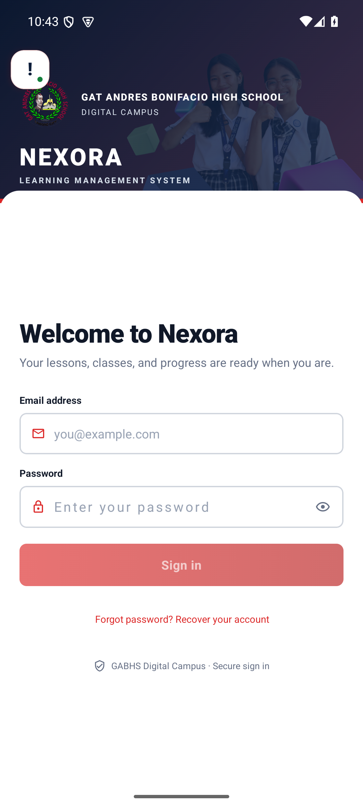

The public mobile entry point groups secure sign-in, verification, first-password setup, and account recovery.

**Read the screen in this order:** page title, current state, main card or form, primary action, then success/error feedback.

## Learner mobile screens

### Learner home

**Role:** Learner  
**Covers mobile routes:** `Dashboard`

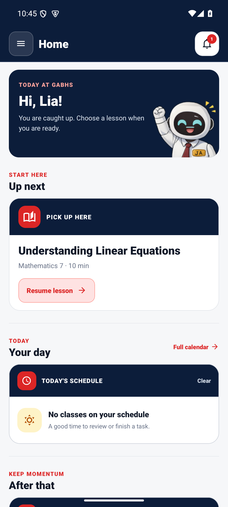

The learner home page summarizes the next useful actions without requiring the learner to understand the whole system.

**Read the screen in this order:** page title, current state, main card or form, primary action, then success/error feedback.

### Learner classes and lessons

**Role:** Learner  
**Covers mobile routes:** `Classes`, `ClassWorkspace`, `ClassDetail`, `ModuleDetail`, `Courses`, `Lessons`, `LessonDetail`

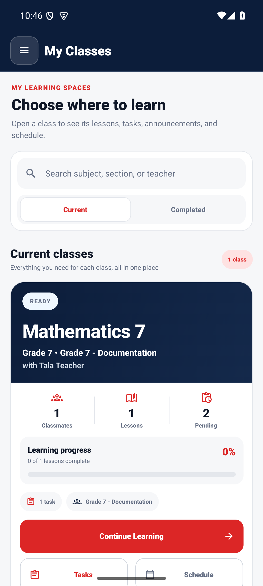

Class, module, course, and lesson routes use the same classroom workspace and evidence-backed learning content.

**Read the screen in this order:** page title, current state, main card or form, primary action, then success/error feedback.

### Learner assessments

**Role:** Learner  
**Covers mobile routes:** `Assessments`, `AssessmentDetail`, `AssessmentTake`, `AssessmentResults`, `AssessmentHistory`

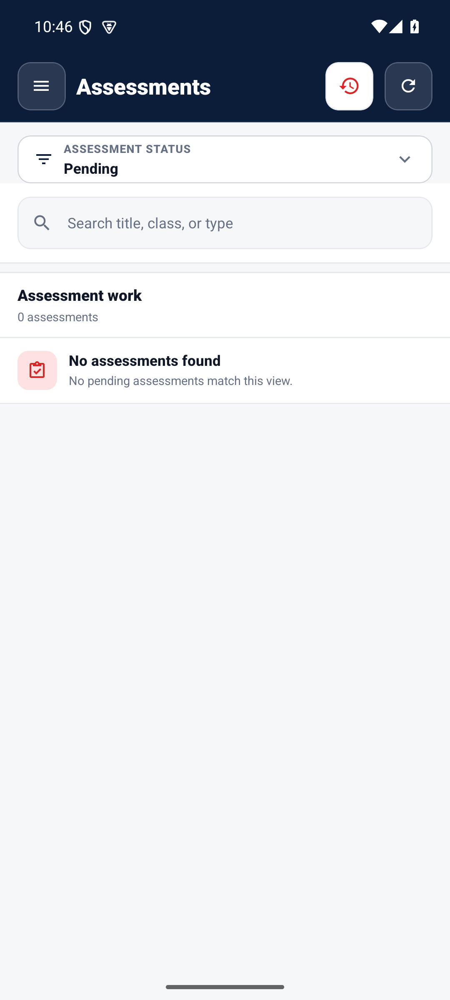

Assessment routes cover the work list, instructions, answer flow, returned results, and attempt history.

**Read the screen in this order:** page title, current state, main card or form, primary action, then success/error feedback.

### Learner JA support hub

**Role:** Learner  
**Covers mobile routes:** `JA`, `LXP`, `Chatbot`, `AiTutor`, `StudentGuidedAssessment`, `StudentGeneratedLesson`, `StudentJaReviewAssessment`

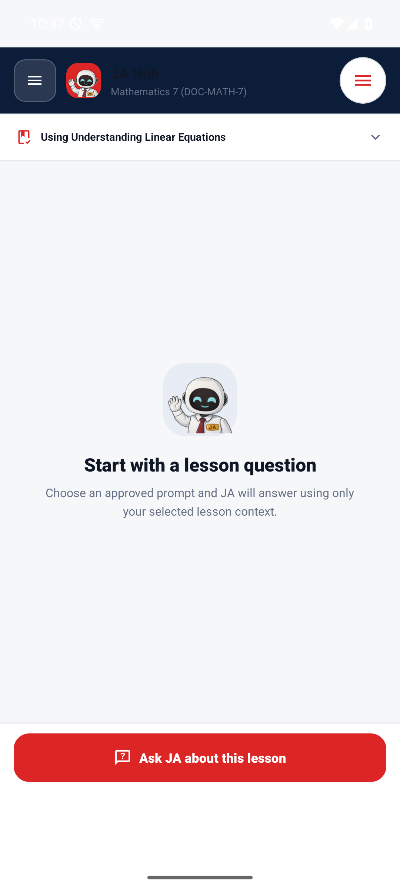

JA, guided checks, generated support lessons, and review routes remain assistive and do not replace official grades.

**Read the screen in this order:** page title, current state, main card or form, primary action, then success/error feedback.

### Learner schedule and announcements

**Role:** Learner  
**Covers mobile routes:** `StudentCalendar`, `Calendar`, `Announcements`, `StudentEvaluations`

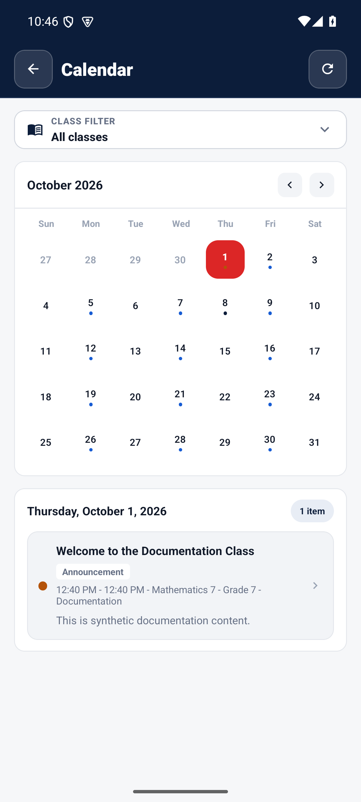

Calendar, announcements, and evaluation routes help learners organize school activity and respond to school requests.

**Read the screen in this order:** page title, current state, main card or form, primary action, then success/error feedback.

### Learner progress and account

**Role:** Learner  
**Covers mobile routes:** `Performance`, `Transcript`, `Profile`, `Notifications`, `CompleteProfile`

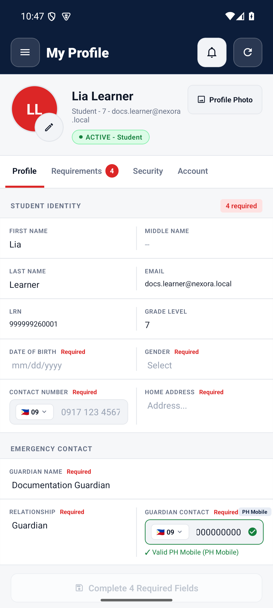

Progress, transcript, notification, and profile routes explain current evidence and account information in one family of screens.

**Read the screen in this order:** page title, current state, main card or form, primary action, then success/error feedback.

## Teacher mobile screens

### Teacher home

**Role:** Teacher  
**Covers mobile routes:** `Home`

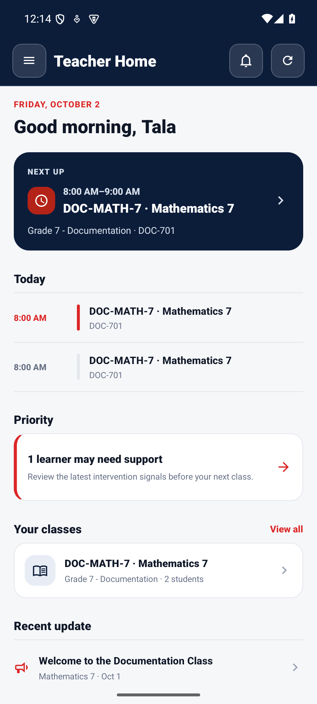

The teacher home page prioritizes classes, submissions, notices, and the next instructional actions.

**Read the screen in this order:** page title, current state, main card or form, primary action, then success/error feedback.

### Teacher classroom workspace

**Role:** Teacher  
**Covers mobile routes:** `Classes`, `Sections`, `TeacherClassDetail`, `TeacherModuleDetail`, `TeacherModuleFileDetail`, `TeacherLessonDetail`, `TeacherLessonEditor`, `TeacherCreateModule`, `TeacherClassAddStudents`, `TeacherClassStudentOverview`, `TeacherSectionDetail`, `TeacherSectionAddStudents`, `TeacherSectionStudentProfile`

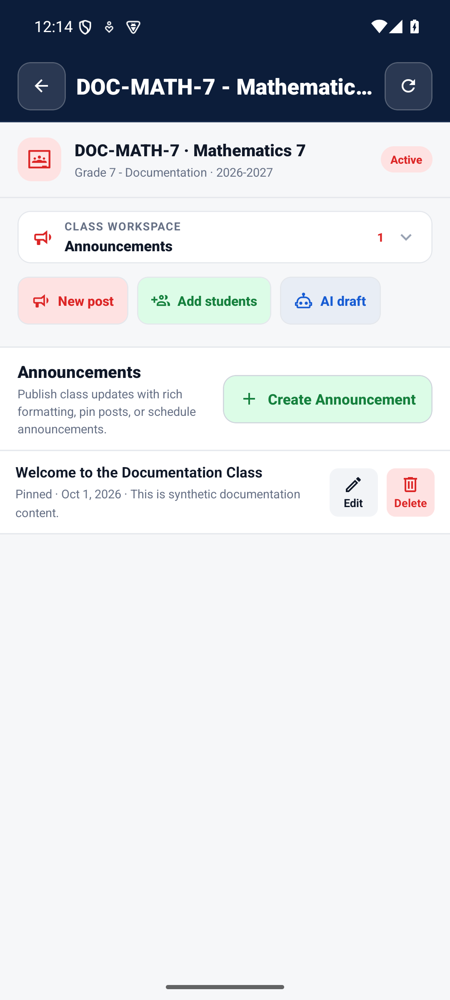

Class, section, module, lesson, file, roster, and learner-detail routes share the teacher classroom workspace.

**Read the screen in this order:** page title, current state, main card or form, primary action, then success/error feedback.

### Teacher assessment workflow

**Role:** Teacher  
**Covers mobile routes:** `Assessments`, `TeacherAssessmentDetail`, `TeacherAssessmentEditor`, `TeacherAssessmentReview`, `TeacherAssessmentAttemptResult`, `TeacherCreateAssessment`

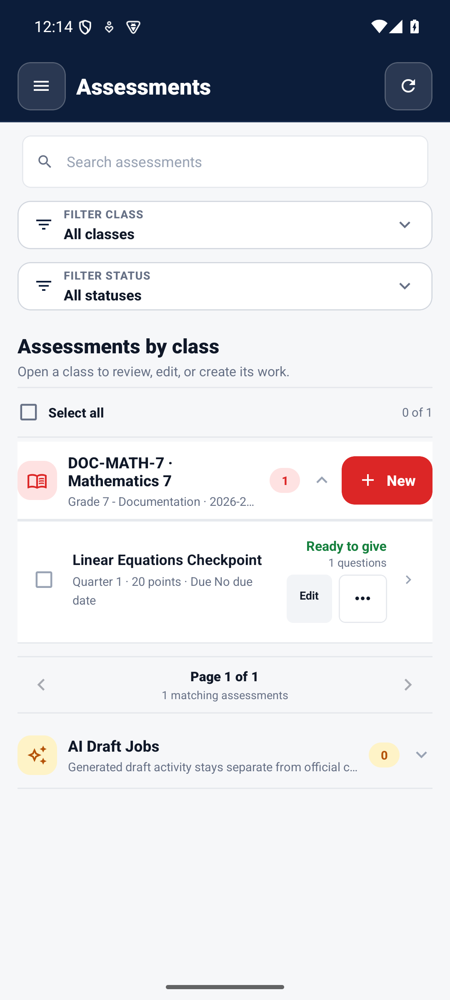

Teachers create, review, edit, release, inspect, and grade assessments through this connected route family.

**Read the screen in this order:** page title, current state, main card or form, primary action, then success/error feedback.

### Teacher content and communication

**Role:** Teacher  
**Covers mobile routes:** `TeacherCalendar`, `TeacherLessons`, `TeacherLibrary`, `TeacherAnnouncements`, `TeacherExtractionDetail`, `TeacherAiDraft`

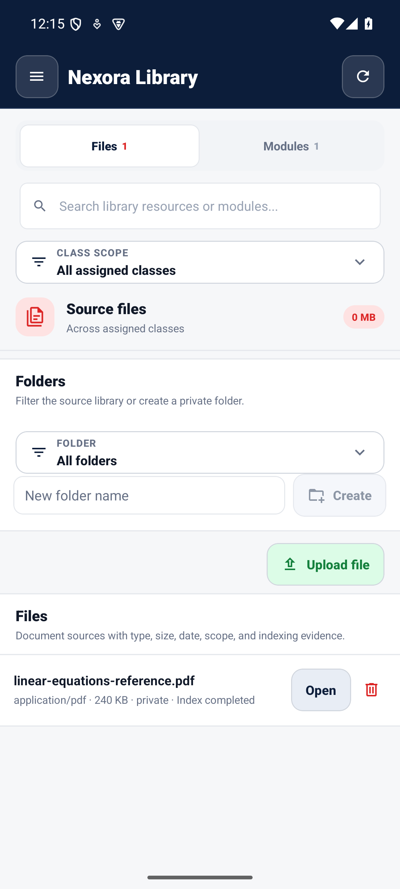

Calendar, lessons, library, announcements, extraction review, and AI draft routes support content preparation and delivery.

**Read the screen in this order:** page title, current state, main card or form, primary action, then success/error feedback.

### Teacher records and intervention

**Role:** Teacher  
**Covers mobile routes:** `TeacherClassRecord`, `TeacherReports`, `TeacherInterventions`, `TeacherInterventionDetail`, `TeacherPerformance`, `TeacherEvaluations`

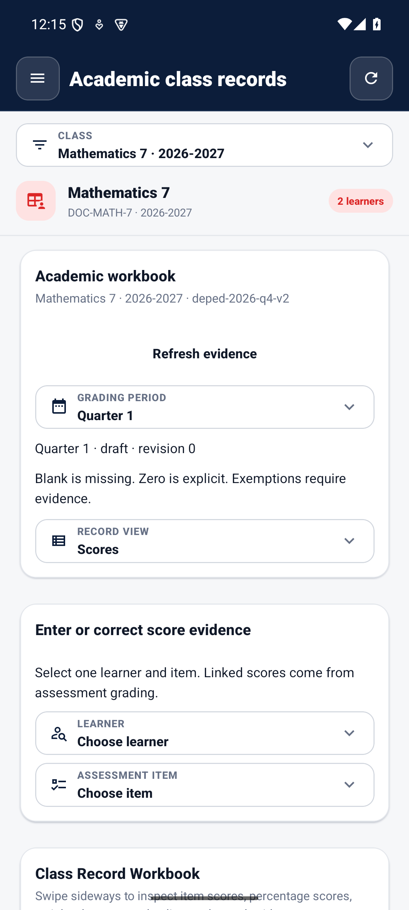

Class records, reports, performance, evaluations, and intervention routes preserve academic evidence and follow-up decisions.

**Read the screen in this order:** page title, current state, main card or form, primary action, then success/error feedback.

### Teacher profile and notifications

**Role:** Teacher  
**Covers mobile routes:** `Profile`, `Notifications`, `CompleteProfile`, `TeacherMore`

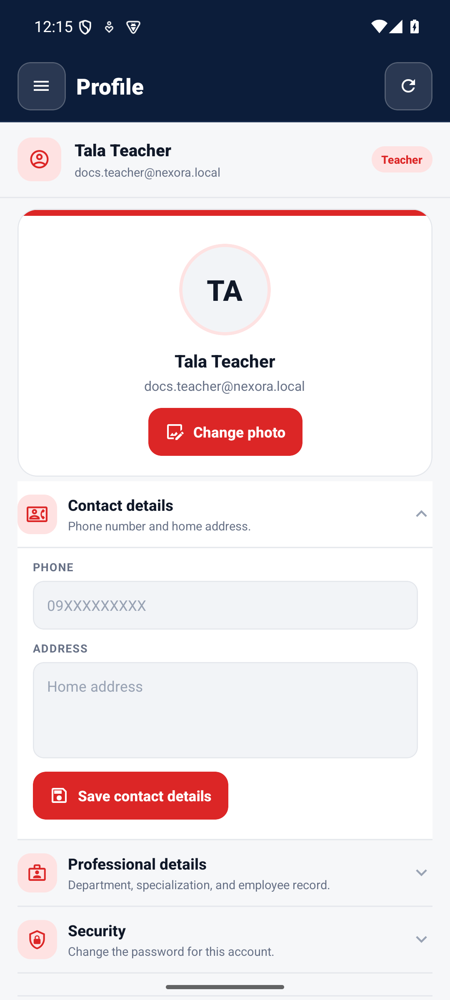

Teacher profile, completion, notifications, and overflow destinations keep account and supporting tools together.

**Read the screen in this order:** page title, current state, main card or form, primary action, then success/error feedback.

## Administrator mobile screens

### Administrator home

**Role:** Administrator  
**Covers mobile routes:** `Home`

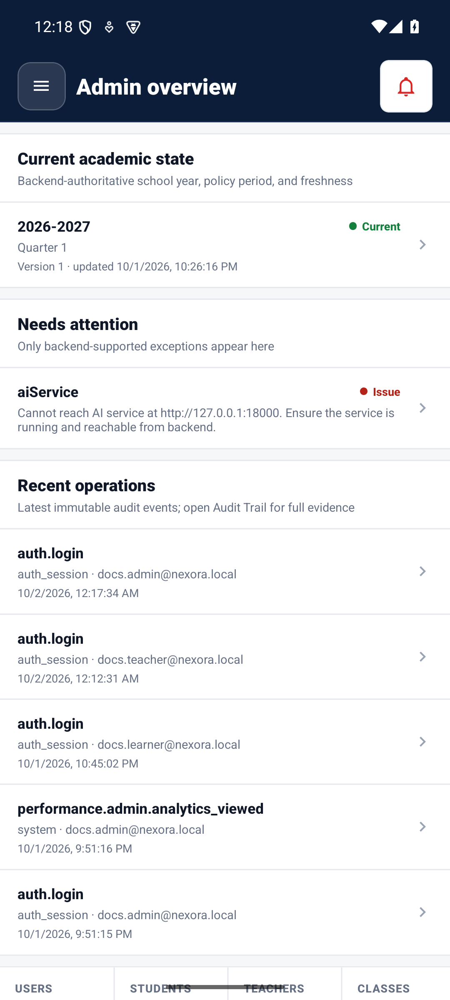

The administrator home page summarizes school operations, academic setup, safety, and the next required actions.

**Read the screen in this order:** page title, current state, main card or form, primary action, then success/error feedback.

### Administrator people and classes

**Role:** Administrator  
**Covers mobile routes:** `AdminUsers`, `AdminSections`, `AdminClasses`, `AdminRoster`, `Classes`, `AdminStudentReadiness`, `AdminLifecycleReview`, `AdminCreateUser`, `AdminUserDetail`, `AdminSectionDetail`, `TeacherClassDetail`, `TeacherSectionDetail`, `TeacherSectionAddStudents`, `TeacherSectionStudentProfile`, `TeacherClassAddStudents`, `TeacherClassStudentOverview`

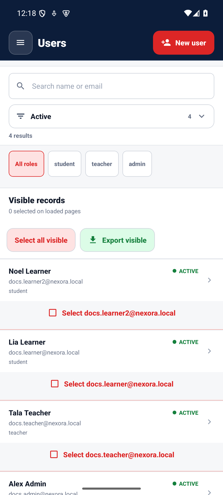

User, roster, section, class, readiness, and lifecycle routes provide governed people and enrollment administration.

**Read the screen in this order:** page title, current state, main card or form, primary action, then success/error feedback.

### Administrator academic governance

**Role:** Administrator  
**Covers mobile routes:** `Assessments`, `Academic`, `AdminTemplates`, `AdminAcademic`, `AdminSettingsAcademicYear`, `AdminSettingsAssessmentsGrading`, `AdminSettingsYearTransition`, `AdminSettingsLearnerCompletion`, `AdminClassRecord`, `AdminUserReports`, `AdminTemplateDetail`, `TeacherAssessmentDetail`, `TeacherAssessmentEditor`, `TeacherAssessmentReview`, `TeacherAssessmentAttemptResult`, `TeacherModuleDetail`, `TeacherLessonDetail`, `TeacherLessonEditor`, `TeacherLessons`, `TeacherCreateModule`, `TeacherCreateAssessment`, `TeacherModuleFileDetail`, `TeacherClassRecord`

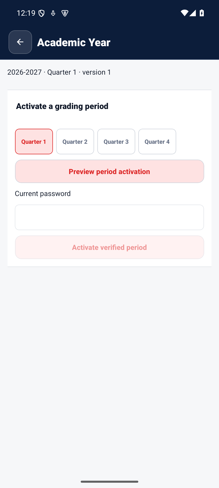

Academic year, assessment, template, record, module, and lesson routes let administrators review governed academic state.

**Read the screen in this order:** page title, current state, main card or form, primary action, then success/error feedback.

### Administrator content and reporting

**Role:** Administrator  
**Covers mobile routes:** `AdminCalendar`, `AdminLibrary`, `AdminAnnouncements`, `AdminReports`, `AdminEvaluations`, `AdminChatbot`, `TeacherCalendar`, `TeacherExtractionDetail`, `TeacherAiDraft`, `TeacherInterventionDetail`, `TeacherLibrary`, `TeacherReports`, `TeacherInterventions`, `TeacherPerformance`, `TeacherEvaluations`, `TeacherAnnouncements`

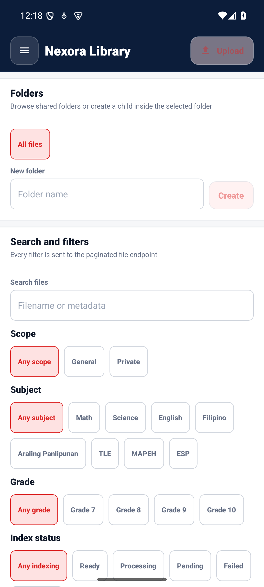

Calendar, library, communication, evaluation, reporting, and intervention routes support school-wide oversight.

**Read the screen in this order:** page title, current state, main card or form, primary action, then success/error feedback.

### Administrator safety and system tools

**Role:** Administrator  
**Covers mobile routes:** `AdminDiagnostics`, `AdminAudit`, `AdminSettings`, `AdminTools`, `AdminSettingsAuditRecovery`, `AdminSettingsMaintenance`, `AdminSettingsResetSchoolData`

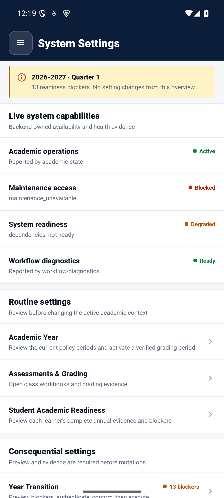

Diagnostics, audit, recovery, maintenance, and reset routes require explicit intent and protect school records.

**Read the screen in this order:** page title, current state, main card or form, primary action, then success/error feedback.

### Administrator profile and notifications

**Role:** Administrator  
**Covers mobile routes:** `Profile`, `Notifications`, `CompleteProfile`

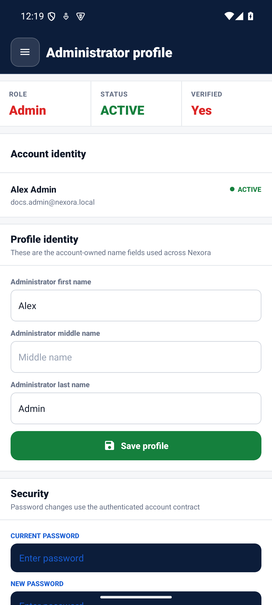

Administrator profile, completion, and notification routes keep account status and operational notices together.

**Read the screen in this order:** page title, current state, main card or form, primary action, then success/error feedback.

## All roles mobile screens

### Loading state

**Role:** All roles  
**Covers mobile routes:** `ComponentGallery:loading`

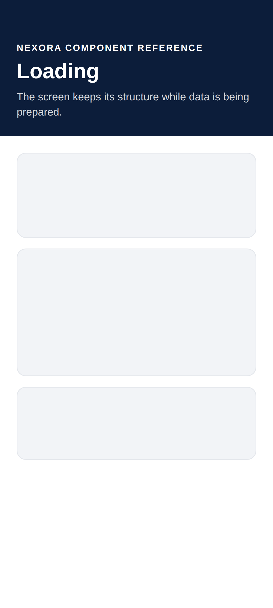

The current mobile loading components show stable placeholders while the requested data is still being prepared.

**Read the screen in this order:** page title, current state, main card or form, primary action, then success/error feedback.

### Empty state

**Role:** All roles  
**Covers mobile routes:** `ComponentGallery:empty`

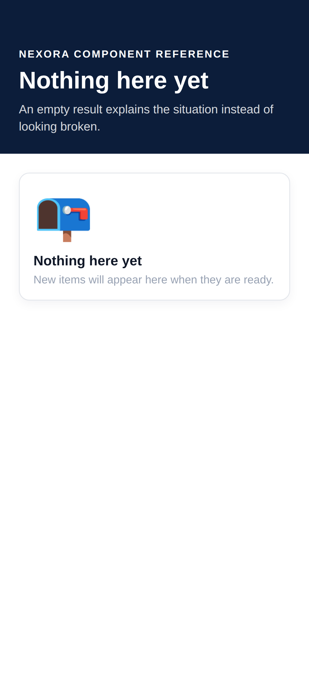

The current mobile empty-state component explains why a list is empty and gives a useful next action.

**Read the screen in this order:** page title, current state, main card or form, primary action, then success/error feedback.

### Error state

**Role:** All roles  
**Covers mobile routes:** `ComponentGallery:error`

The current error banner states what failed and directs the user toward a safe retry instead of a dead end.

**Read the screen in this order:** page title, current state, main card or form, primary action, then success/error feedback.

### Success state

**Role:** All roles  
**Covers mobile routes:** `ComponentGallery:success`

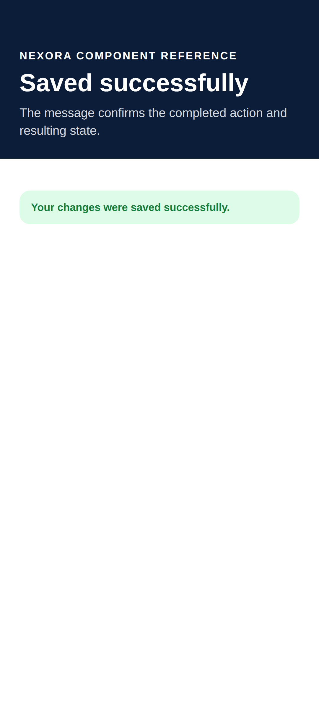

The current success banner confirms that the operation finished and makes the resulting state explicit.

**Read the screen in this order:** page title, current state, main card or form, primary action, then success/error feedback.

### Confirmation state

**Role:** All roles  
**Covers mobile routes:** `ComponentGallery:confirmation`

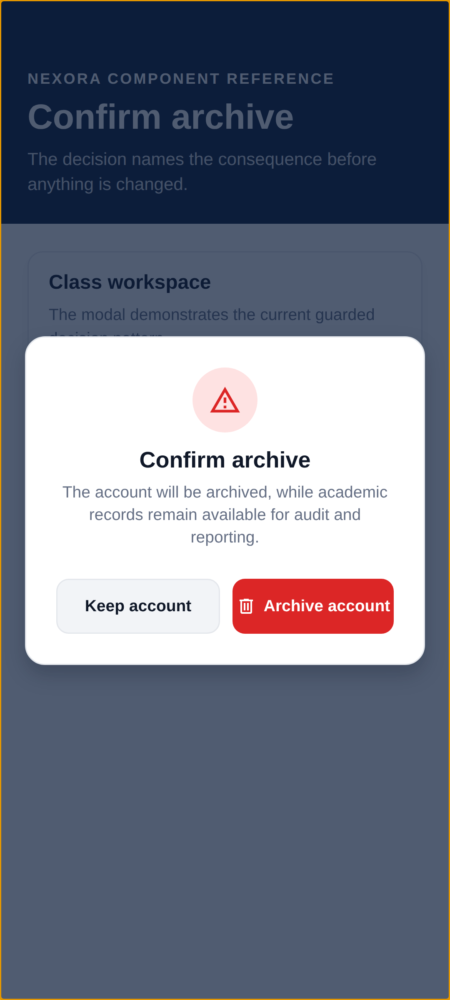

The current confirmation modal names the consequence and separates the cancel and confirm actions clearly.

**Read the screen in this order:** page title, current state, main card or form, primary action, then success/error feedback.

### Offline state

**Role:** All roles  
**Covers mobile routes:** `ComponentGallery:offline`

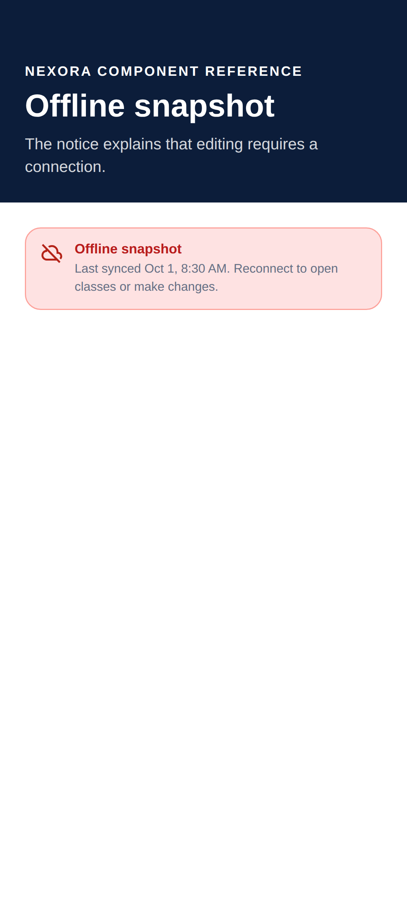

The current offline notice explains that the visible data is a snapshot and that editing requires reconnection.

**Read the screen in this order:** page title, current state, main card or form, primary action, then success/error feedback.

## Complete web screen guide

## Everyone web screens

## Access and account setup

### Public home

**Role:** Everyone  
**Web path:** `/`  
**Purpose:** Nexora landing page rendered from the locked application snapshot

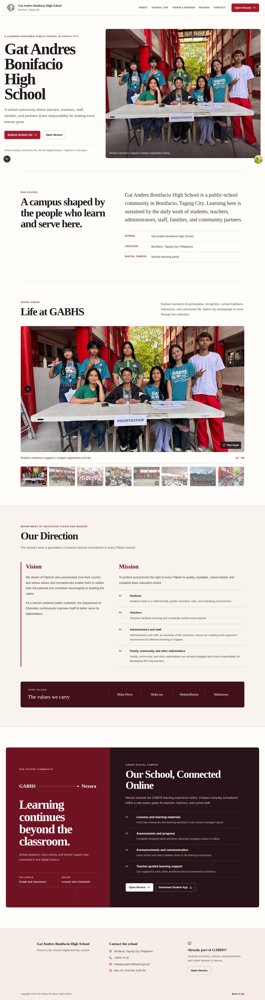

**Do this**

1. Open the Nexora address supplied by the school.
2. Open Public home from the visible navigation or its parent workspace.
3. Read the page heading and current state, choose the intended item, and use the primary action shown on screen.
4. Wait for the success state, then refresh once to confirm the saved result.

**Done when:** The expected page state or saved result remains correct after refresh.

**If stuck:** Check the account role, internet connection, selected school year/class, and visible error. Refresh once; do not repeat a write action blindly.

**Behind the screen:** `next-frontend/app/page.tsx` at application snapshot `211483f07b901299b48ae42eda318c7448f1cbfd`.

### Complete Profile

**Role:** Everyone  
**Web path:** `/complete-profile`  
**Purpose:** Complete Profile rendered from the locked application snapshot

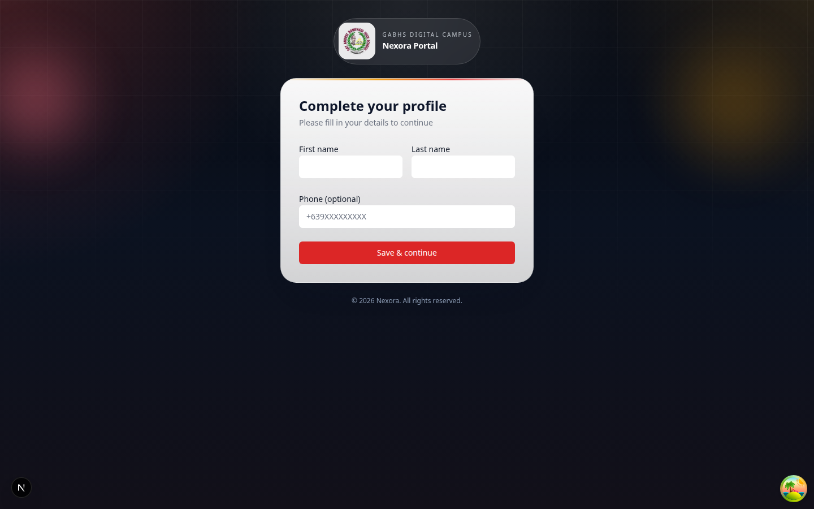

**Do this**

1. Open the Nexora address supplied by the school.
2. Open Complete Profile from the visible navigation or its parent workspace.
3. Read the page heading and current state, choose the intended item, and use the primary action shown on screen.
4. Wait for the success state, then refresh once to confirm the saved result.

**Done when:** The expected page state or saved result remains correct after refresh.

**If stuck:** Check the account role, internet connection, selected school year/class, and visible error. Refresh once; do not repeat a write action blindly.

**Behind the screen:** `next-frontend/app/(auth)/complete-profile/page.tsx` at application snapshot `211483f07b901299b48ae42eda318c7448f1cbfd`.

### Forgot Password

**Role:** Everyone  
**Web path:** `/forgot-password`  
**Purpose:** Forgot Password rendered from the locked application snapshot

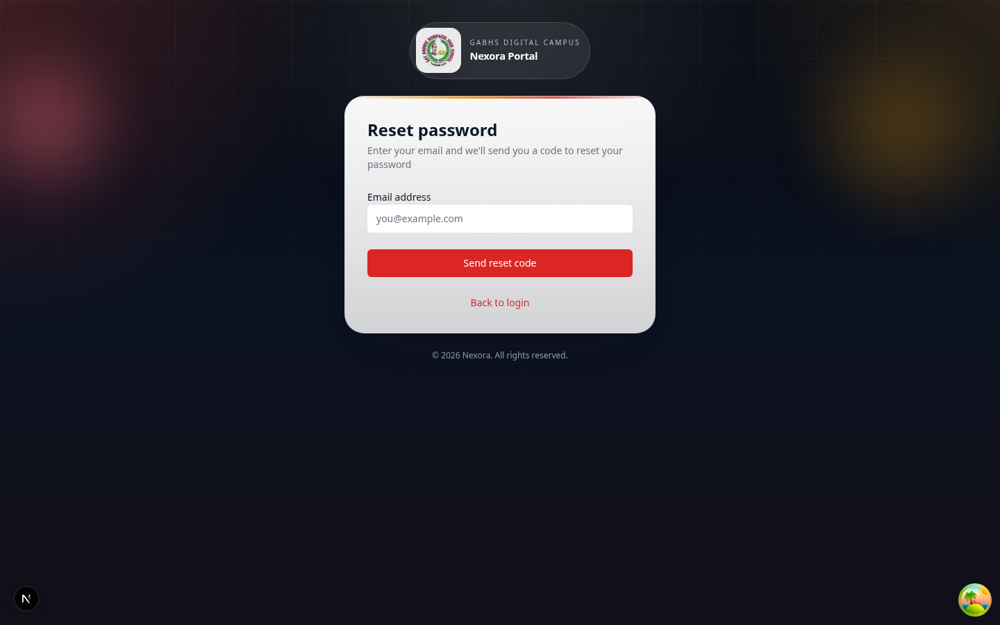

**Do this**

1. Open the Nexora address supplied by the school.
2. Open Forgot Password from the visible navigation or its parent workspace.
3. Read the page heading and current state, choose the intended item, and use the primary action shown on screen.
4. Wait for the success state, then refresh once to confirm the saved result.

**Done when:** The expected page state or saved result remains correct after refresh.

**If stuck:** Check the account role, internet connection, selected school year/class, and visible error. Refresh once; do not repeat a write action blindly.

**Behind the screen:** `next-frontend/app/(auth)/forgot-password/page.tsx` at application snapshot `211483f07b901299b48ae42eda318c7448f1cbfd`.

### Lesson Preview - selected item

**Role:** Everyone  
**Web path:** `/lesson-preview/[token]`  
**Purpose:** Record detail rendered from the locked application snapshot

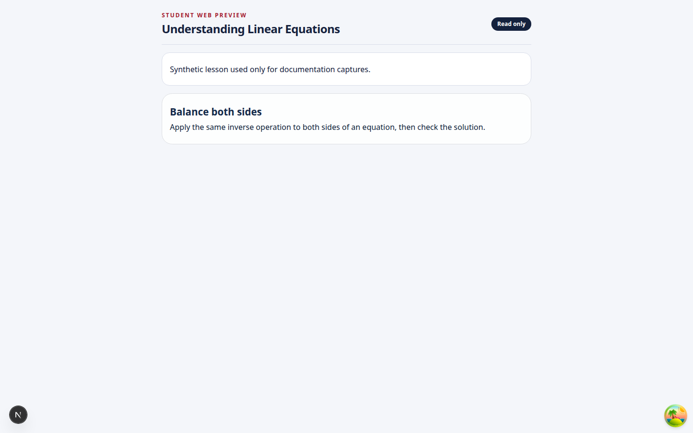

**Do this**

1. Open the Nexora address supplied by the school.
2. Open Lesson Preview - selected item from the visible navigation or its parent workspace.
3. Read the page heading and current state, choose the intended item, and use the primary action shown on screen.
4. Wait for the success state, then refresh once to confirm the saved result.

**Done when:** The expected page state or saved result remains correct after refresh.

**If stuck:** Check the account role, internet connection, selected school year/class, and visible error. Refresh once; do not repeat a write action blindly.

**Behind the screen:** `next-frontend/app/lesson-preview/[token]/page.tsx` at application snapshot `211483f07b901299b48ae42eda318c7448f1cbfd`.

### Login

**Role:** Everyone  
**Web path:** `/login`  
**Purpose:** Login rendered from the locked application snapshot

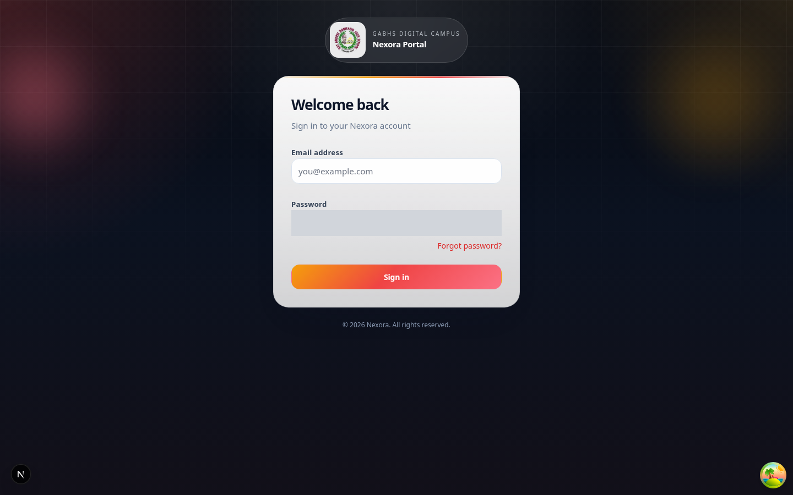

**Do this**

1. Open the Nexora address supplied by the school.
2. Open Login from the visible navigation or its parent workspace.
3. Read the page heading and current state, choose the intended item, and use the primary action shown on screen.
4. Wait for the success state, then refresh once to confirm the saved result.

**Done when:** The expected page state or saved result remains correct after refresh.

**If stuck:** Check the account role, internet connection, selected school year/class, and visible error. Refresh once; do not repeat a write action blindly.

**Behind the screen:** `next-frontend/app/(auth)/login/page.tsx` at application snapshot `211483f07b901299b48ae42eda318c7448f1cbfd`.

### Reset Password

**Role:** Everyone  
**Web path:** `/reset-password`  
**Purpose:** Reset Password rendered from the locked application snapshot

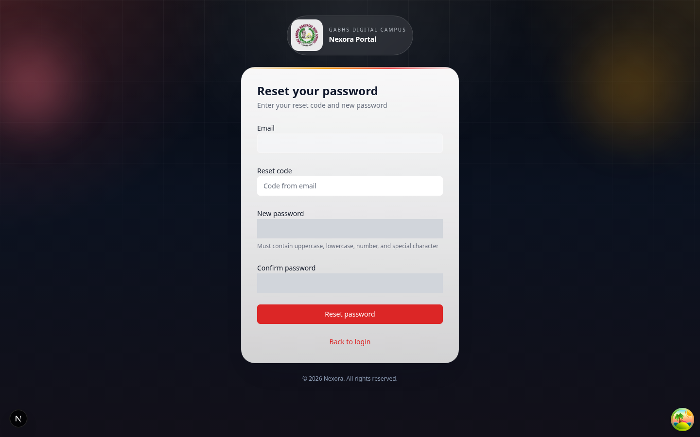

**Do this**

1. Open the Nexora address supplied by the school.
2. Open Reset Password from the visible navigation or its parent workspace.
3. Read the page heading and current state, choose the intended item, and use the primary action shown on screen.
4. Wait for the success state, then refresh once to confirm the saved result.

**Done when:** The expected page state or saved result remains correct after refresh.

**If stuck:** Check the account role, internet connection, selected school year/class, and visible error. Refresh once; do not repeat a write action blindly.

**Behind the screen:** `next-frontend/app/(auth)/reset-password/page.tsx` at application snapshot `211483f07b901299b48ae42eda318c7448f1cbfd`.

### Set Initial Password

**Role:** Everyone  
**Web path:** `/set-initial-password`  
**Purpose:** Set Initial Password rendered from the locked application snapshot

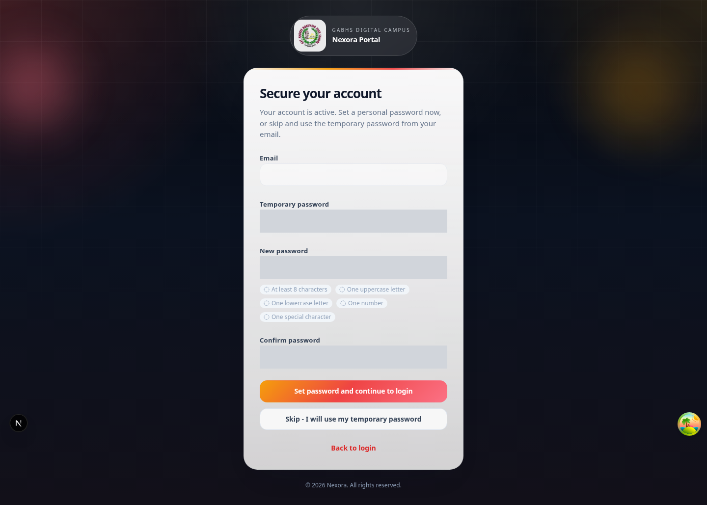

**Do this**

1. Open the Nexora address supplied by the school.
2. Open Set Initial Password from the visible navigation or its parent workspace.
3. Read the page heading and current state, choose the intended item, and use the primary action shown on screen.
4. Wait for the success state, then refresh once to confirm the saved result.

**Done when:** The expected page state or saved result remains correct after refresh.

**If stuck:** Check the account role, internet connection, selected school year/class, and visible error. Refresh once; do not repeat a write action blindly.

**Behind the screen:** `next-frontend/app/(auth)/set-initial-password/page.tsx` at application snapshot `211483f07b901299b48ae42eda318c7448f1cbfd`.

### System Maintenance

**Role:** Everyone  
**Web path:** `/system-maintenance`  
**Purpose:** System Maintenance rendered from the locked application snapshot

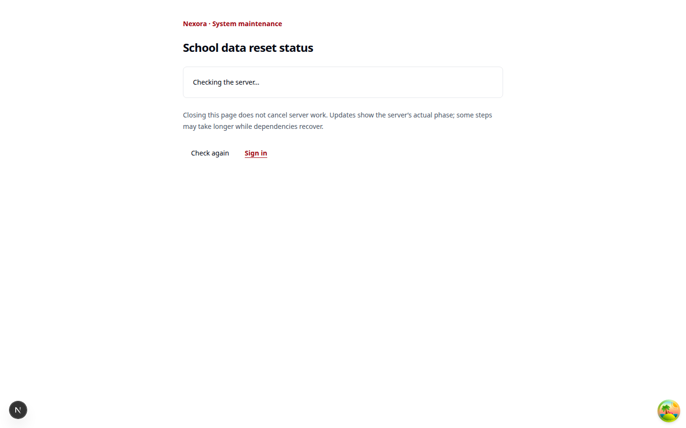

**Do this**

1. Open the Nexora address supplied by the school.
2. Open System Maintenance from the visible navigation or its parent workspace.
3. Preview the impact, read every blocker, reauthenticate, and confirm only when the evidence is correct.
4. Stop if the preview, blockers, or affected records differ from the intended scope.

**Done when:** The preview, confirmation, resulting state, and audit evidence agree.

**If stuck:** Stop. Save the blocker text and ask an administrator to verify policy and readiness before retrying.

**Behind the screen:** `next-frontend/app/system-maintenance/page.tsx` at application snapshot `211483f07b901299b48ae42eda318c7448f1cbfd`.

### Verify Email

**Role:** Everyone  
**Web path:** `/verify-email`  
**Purpose:** Verify Email rendered from the locked application snapshot

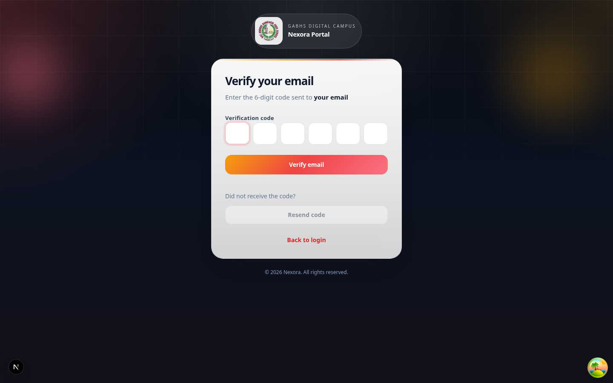

**Do this**

1. Open the Nexora address supplied by the school.
2. Open Verify Email from the visible navigation or its parent workspace.
3. Choose an approved class or source, ask one focused question, and review AI output before applying it.
4. Wait for the success state, then refresh once to confirm the saved result.

**Done when:** The expected page state or saved result remains correct after refresh.

**If stuck:** Check the account role, internet connection, selected school year/class, and visible error. Refresh once; do not repeat a write action blindly.

**Behind the screen:** `next-frontend/app/(auth)/verify-email/page.tsx` at application snapshot `211483f07b901299b48ae42eda318c7448f1cbfd`.

## Learner web screens

## Student workflows

### Student

**Role:** Learner  
**Web path:** `/dashboard/student`  
**Purpose:** Student rendered from the locked application snapshot

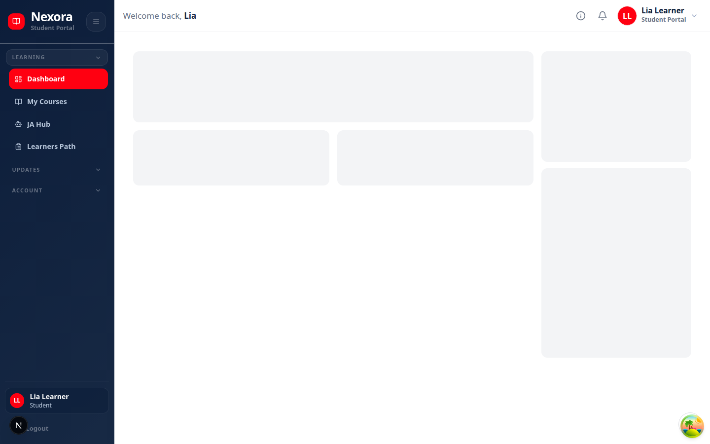

**Do this**

1. Sign in with an active student account.
2. Open Student from the visible navigation or its parent workspace.
3. Search for the correct person or class, open it, and use only the actions shown for your role.
4. Wait for the success state, then refresh once to confirm the saved result.

**Done when:** The expected page state or saved result remains correct after refresh.

**If stuck:** Check the account role, internet connection, selected school year/class, and visible error. Refresh once; do not repeat a write action blindly.

**Behind the screen:** `next-frontend/app/(dashboard)/dashboard/student/page.tsx` at application snapshot `211483f07b901299b48ae42eda318c7448f1cbfd`.

### Announcements

**Role:** Learner  
**Web path:** `/dashboard/student/announcements`  
**Purpose:** Announcements rendered from the locked application snapshot

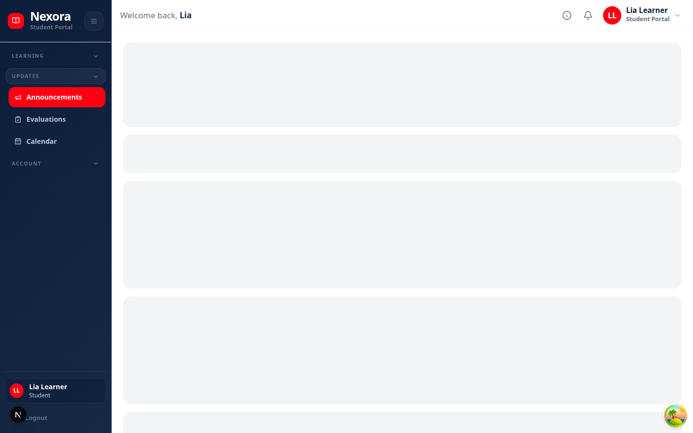

**Do this**

1. Sign in with an active student account.
2. Open Announcements from the visible navigation or its parent workspace.
3. Search for the correct person or class, open it, and use only the actions shown for your role.
4. Wait for the success state, then refresh once to confirm the saved result.

**Done when:** The expected page state or saved result remains correct after refresh.

**If stuck:** Check the account role, internet connection, selected school year/class, and visible error. Refresh once; do not repeat a write action blindly.

**Behind the screen:** `next-frontend/app/(dashboard)/dashboard/student/announcements/page.tsx` at application snapshot `211483f07b901299b48ae42eda318c7448f1cbfd`.

### Assessment History

**Role:** Learner  
**Web path:** `/dashboard/student/assessment-history`  
**Purpose:** Assessment History rendered from the locked application snapshot

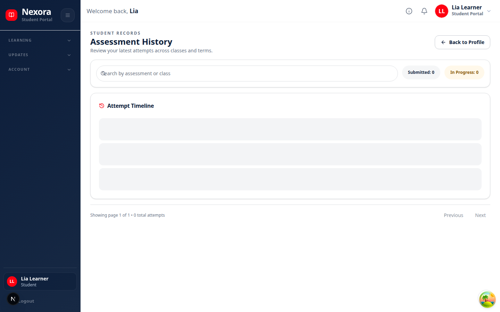

**Do this**

1. Sign in with an active student account.
2. Open Assessment History from the visible navigation or its parent workspace.
3. Choose the class and assessment state, open the intended item, then author, take, review, or grade as permitted.
4. Wait for the success state, then refresh once to confirm the saved result.

**Done when:** The expected page state or saved result remains correct after refresh.

**If stuck:** Check the account role, internet connection, selected school year/class, and visible error. Refresh once; do not repeat a write action blindly.

**Behind the screen:** `next-frontend/app/(dashboard)/dashboard/student/assessment-history/page.tsx` at application snapshot `211483f07b901299b48ae42eda318c7448f1cbfd`.

### Assessments

**Role:** Learner  
**Web path:** `/dashboard/student/assessments`  
**Purpose:** Assessments rendered from the locked application snapshot

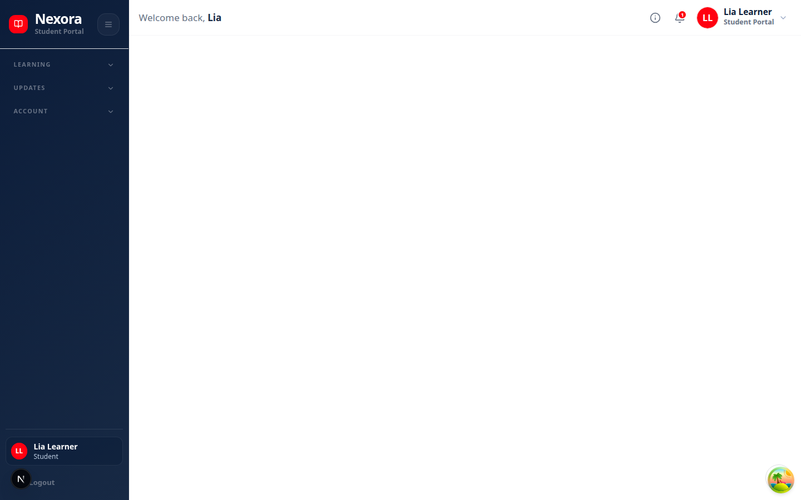

**Do this**

1. Sign in with an active student account.
2. Open Assessments from the visible navigation or its parent workspace.
3. Choose the class and assessment state, open the intended item, then author, take, review, or grade as permitted.
4. Wait for the success state, then refresh once to confirm the saved result.

**Done when:** The expected page state or saved result remains correct after refresh.

**If stuck:** Check the account role, internet connection, selected school year/class, and visible error. Refresh once; do not repeat a write action blindly.

**Behind the screen:** `next-frontend/app/(dashboard)/dashboard/student/assessments/page.tsx` at application snapshot `211483f07b901299b48ae42eda318c7448f1cbfd`.

### Assessments - selected item

**Role:** Learner  
**Web path:** `/dashboard/student/assessments/[id]`  
**Purpose:** Record detail rendered from the locked application snapshot

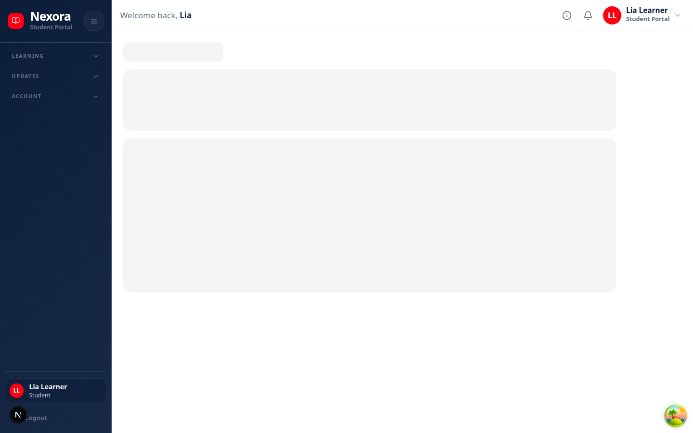

**Do this**

1. Sign in with an active student account.
2. Open Assessments - selected item from the visible navigation or its parent workspace.
3. Choose the class and assessment state, open the intended item, then author, take, review, or grade as permitted.
4. Wait for the success state, then refresh once to confirm the saved result.

**Done when:** The expected page state or saved result remains correct after refresh.

**If stuck:** Check the account role, internet connection, selected school year/class, and visible error. Refresh once; do not repeat a write action blindly.

**Behind the screen:** `next-frontend/app/(dashboard)/dashboard/student/assessments/[id]/page.tsx` at application snapshot `211483f07b901299b48ae42eda318c7448f1cbfd`.

### Results - selected item

**Role:** Learner  
**Web path:** `/dashboard/student/assessments/[id]/results/[attemptId]`  
**Purpose:** Record detail rendered from the locked application snapshot

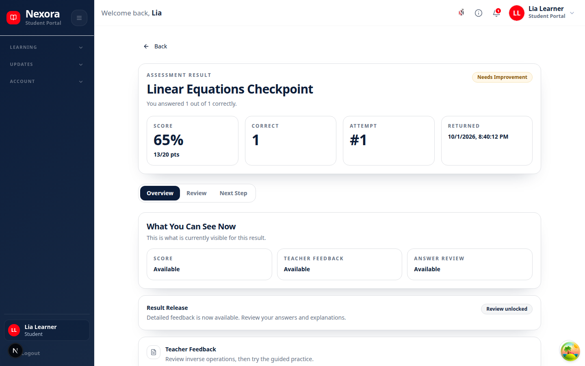

**Do this**

1. Sign in with an active student account.
2. Open Results - selected item from the visible navigation or its parent workspace.
3. Choose the class and assessment state, open the intended item, then author, take, review, or grade as permitted.
4. Wait for the success state, then refresh once to confirm the saved result.

**Done when:** The expected page state or saved result remains correct after refresh.

**If stuck:** Check the account role, internet connection, selected school year/class, and visible error. Refresh once; do not repeat a write action blindly.

**Behind the screen:** `next-frontend/app/(dashboard)/dashboard/student/assessments/[id]/results/[attemptId]/page.tsx` at application snapshot `211483f07b901299b48ae42eda318c7448f1cbfd`.

### Take

**Role:** Learner  
**Web path:** `/dashboard/student/assessments/[id]/take`  
**Purpose:** Take rendered from the locked application snapshot

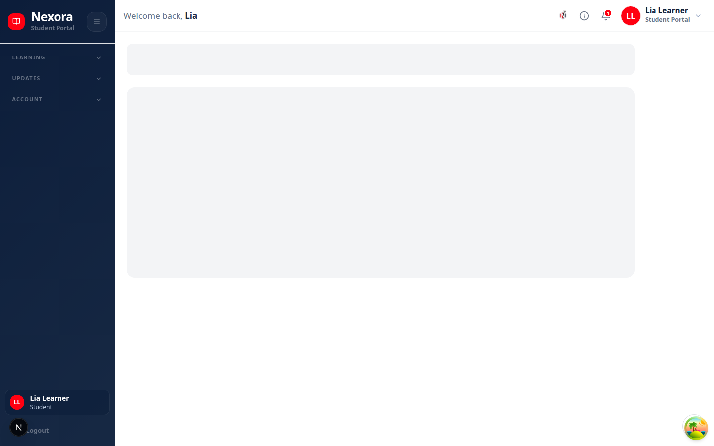

**Do this**

1. Sign in with an active student account.
2. Open Take from the visible navigation or its parent workspace.
3. Choose the class and assessment state, open the intended item, then author, take, review, or grade as permitted.
4. Wait for the success state, then refresh once to confirm the saved result.

**Done when:** The expected page state or saved result remains correct after refresh.

**If stuck:** Check the account role, internet connection, selected school year/class, and visible error. Refresh once; do not repeat a write action blindly.

**Behind the screen:** `next-frontend/app/(dashboard)/dashboard/student/assessments/[id]/take/page.tsx` at application snapshot `211483f07b901299b48ae42eda318c7448f1cbfd`.

### Calendar

**Role:** Learner  
**Web path:** `/dashboard/student/calendar`  
**Purpose:** Calendar rendered from the locked application snapshot

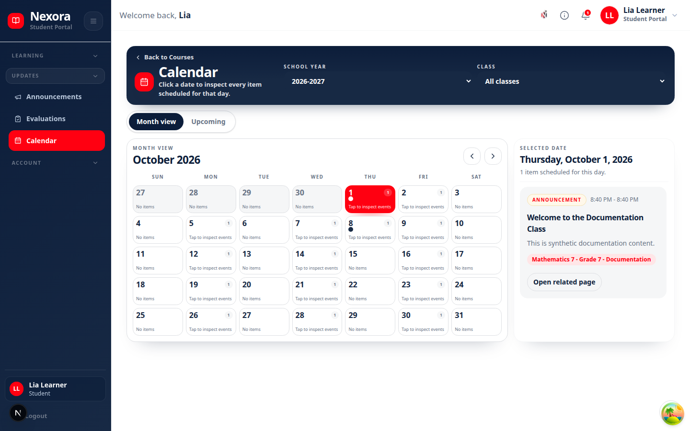

**Do this**

1. Sign in with an active student account.
2. Open Calendar from the visible navigation or its parent workspace.
3. Search for the correct person or class, open it, and use only the actions shown for your role.
4. Wait for the success state, then refresh once to confirm the saved result.

**Done when:** The expected page state or saved result remains correct after refresh.

**If stuck:** Check the account role, internet connection, selected school year/class, and visible error. Refresh once; do not repeat a write action blindly.

**Behind the screen:** `next-frontend/app/(dashboard)/dashboard/student/calendar/page.tsx` at application snapshot `211483f07b901299b48ae42eda318c7448f1cbfd`.

### Chatbot

**Role:** Learner  
**Web path:** `/dashboard/student/chatbot`  
**Purpose:** Chatbot rendered from the locked application snapshot

**Do this**

1. Sign in with an active student account.
2. Open Chatbot from the visible navigation or its parent workspace.
3. Search for the correct person or class, open it, and use only the actions shown for your role.
4. Wait for the success state, then refresh once to confirm the saved result.

**Done when:** The expected page state or saved result remains correct after refresh.

**If stuck:** Check the account role, internet connection, selected school year/class, and visible error. Refresh once; do not repeat a write action blindly.

**Behind the screen:** `next-frontend/app/(dashboard)/dashboard/student/chatbot/page.tsx` at application snapshot `211483f07b901299b48ae42eda318c7448f1cbfd`.

### Classes

**Role:** Learner  
**Web path:** `/dashboard/student/classes`  
**Purpose:** Classes rendered from the locked application snapshot

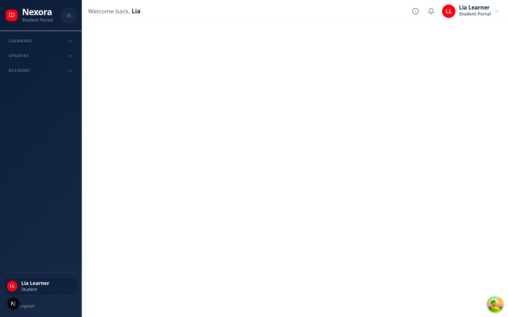

**Do this**

1. Sign in with an active student account.
2. Open Classes from the visible navigation or its parent workspace.
3. Search for the correct person or class, open it, and use only the actions shown for your role.
4. Wait for the success state, then refresh once to confirm the saved result.

**Done when:** The expected page state or saved result remains correct after refresh.

**If stuck:** Check the account role, internet connection, selected school year/class, and visible error. Refresh once; do not repeat a write action blindly.

**Behind the screen:** `next-frontend/app/(dashboard)/dashboard/student/classes/page.tsx` at application snapshot `211483f07b901299b48ae42eda318c7448f1cbfd`.

### Classes - selected item

**Role:** Learner  
**Web path:** `/dashboard/student/classes/[id]`  
**Purpose:** Record detail rendered from the locked application snapshot

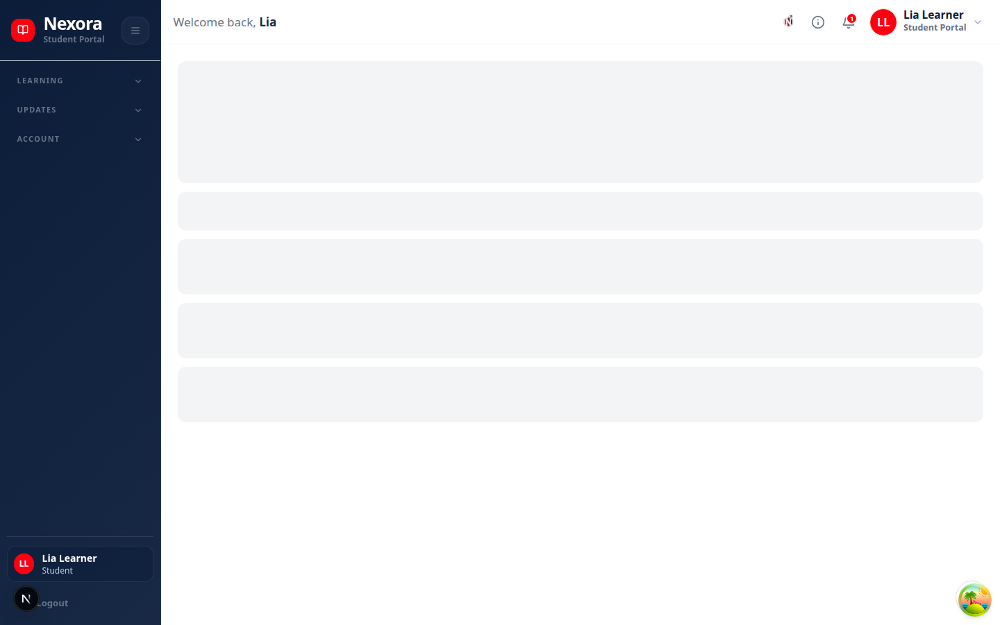

**Do this**

1. Sign in with an active student account.
2. Open Classes - selected item from the visible navigation or its parent workspace.
3. Search for the correct person or class, open it, and use only the actions shown for your role.
4. Wait for the success state, then refresh once to confirm the saved result.

**Done when:** The expected page state or saved result remains correct after refresh.

**If stuck:** Check the account role, internet connection, selected school year/class, and visible error. Refresh once; do not repeat a write action blindly.

**Behind the screen:** `next-frontend/app/(dashboard)/dashboard/student/classes/[id]/page.tsx` at application snapshot `211483f07b901299b48ae42eda318c7448f1cbfd`.

### Modules - selected item

**Role:** Learner  
**Web path:** `/dashboard/student/classes/[id]/modules/[moduleId]`  
**Purpose:** Record detail rendered from the locked application snapshot

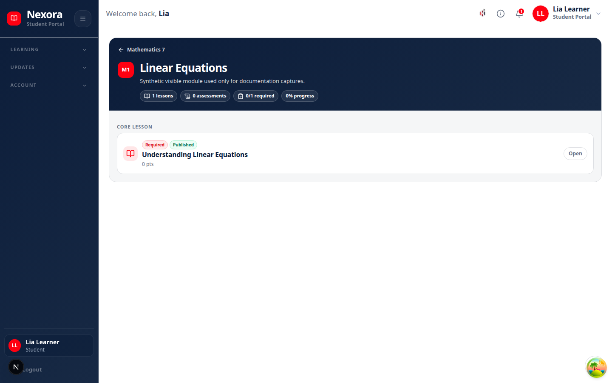

**Do this**

1. Sign in with an active student account.
2. Open Modules - selected item from the visible navigation or its parent workspace.
3. Search for the correct person or class, open it, and use only the actions shown for your role.
4. Wait for the success state, then refresh once to confirm the saved result.

**Done when:** The expected page state or saved result remains correct after refresh.

**If stuck:** Check the account role, internet connection, selected school year/class, and visible error. Refresh once; do not repeat a write action blindly.

**Behind the screen:** `next-frontend/app/(dashboard)/dashboard/student/classes/[id]/modules/[moduleId]/page.tsx` at application snapshot `211483f07b901299b48ae42eda318c7448f1cbfd`.

### Courses

**Role:** Learner  
**Web path:** `/dashboard/student/courses`  
**Purpose:** Courses rendered from the locked application snapshot

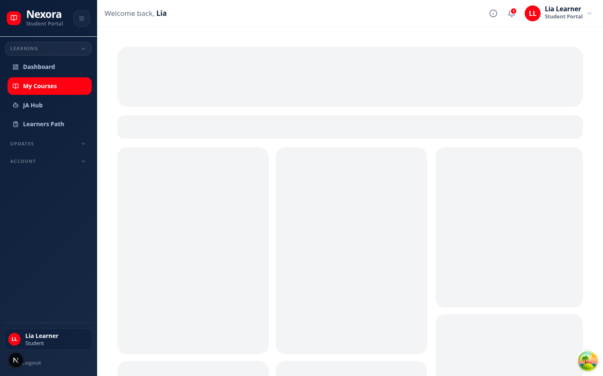

**Do this**

1. Sign in with an active student account.
2. Open Courses from the visible navigation or its parent workspace.
3. Search for the correct person or class, open it, and use only the actions shown for your role.
4. Wait for the success state, then refresh once to confirm the saved result.

**Done when:** The expected page state or saved result remains correct after refresh.

**If stuck:** Check the account role, internet connection, selected school year/class, and visible error. Refresh once; do not repeat a write action blindly.

**Behind the screen:** `next-frontend/app/(dashboard)/dashboard/student/courses/page.tsx` at application snapshot `211483f07b901299b48ae42eda318c7448f1cbfd`.

### Evaluations

**Role:** Learner  
**Web path:** `/dashboard/student/evaluations`  
**Purpose:** Evaluations rendered from the locked application snapshot

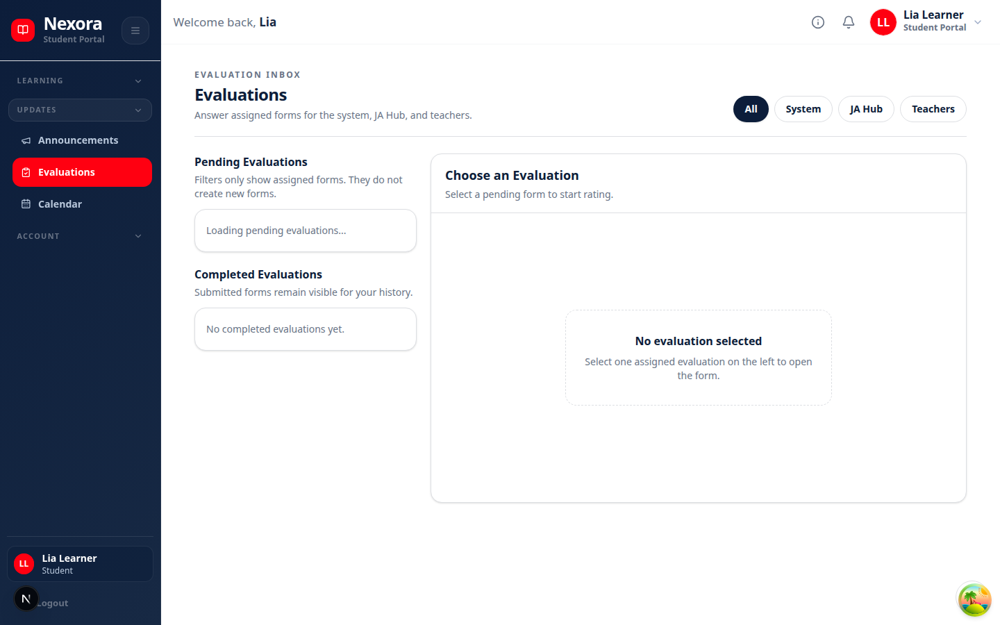

**Do this**

1. Sign in with an active student account.
2. Open Evaluations from the visible navigation or its parent workspace.
3. Search for the correct person or class, open it, and use only the actions shown for your role.
4. Wait for the success state, then refresh once to confirm the saved result.

**Done when:** The expected page state or saved result remains correct after refresh.

**If stuck:** Check the account role, internet connection, selected school year/class, and visible error. Refresh once; do not repeat a write action blindly.

**Behind the screen:** `next-frontend/app/(dashboard)/dashboard/student/evaluations/page.tsx` at application snapshot `211483f07b901299b48ae42eda318c7448f1cbfd`.

### Ja

**Role:** Learner  
**Web path:** `/dashboard/student/ja`  
**Purpose:** Ja rendered from the locked application snapshot

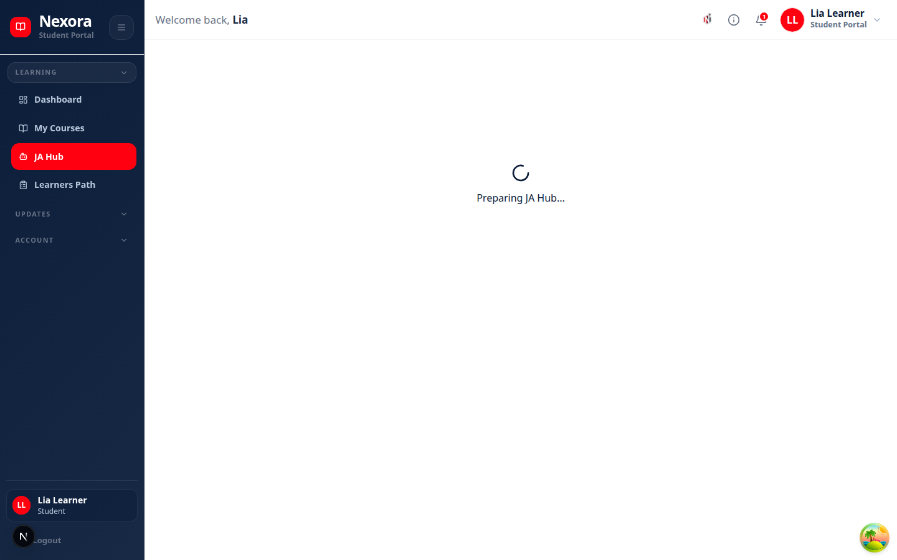

**Do this**

1. Sign in with an active student account.
2. Open Ja from the visible navigation or its parent workspace.
3. Search for the correct person or class, open it, and use only the actions shown for your role.
4. Wait for the success state, then refresh once to confirm the saved result.

**Done when:** The expected page state or saved result remains correct after refresh.

**If stuck:** Check the account role, internet connection, selected school year/class, and visible error. Refresh once; do not repeat a write action blindly.

**Behind the screen:** `next-frontend/app/(dashboard)/dashboard/student/ja/page.tsx` at application snapshot `211483f07b901299b48ae42eda318c7448f1cbfd`.

### Lessons

**Role:** Learner  
**Web path:** `/dashboard/student/lessons`  
**Purpose:** Lessons rendered from the locked application snapshot

**Do this**

1. Sign in with an active student account.
2. Open Lessons from the visible navigation or its parent workspace.
3. Search for the correct person or class, open it, and use only the actions shown for your role.
4. Wait for the success state, then refresh once to confirm the saved result.

**Done when:** The expected page state or saved result remains correct after refresh.

**If stuck:** Check the account role, internet connection, selected school year/class, and visible error. Refresh once; do not repeat a write action blindly.

**Behind the screen:** `next-frontend/app/(dashboard)/dashboard/student/lessons/page.tsx` at application snapshot `211483f07b901299b48ae42eda318c7448f1cbfd`.

### Lessons - selected item

**Role:** Learner  
**Web path:** `/dashboard/student/lessons/[id]`  
**Purpose:** Record detail rendered from the locked application snapshot

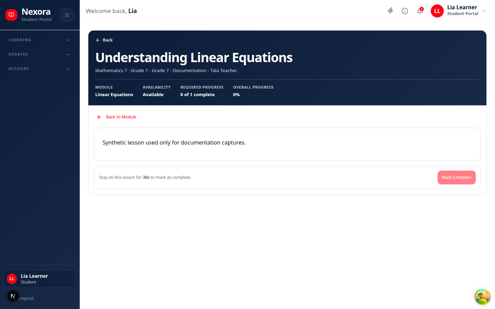

**Do this**

1. Sign in with an active student account.
2. Open Lessons - selected item from the visible navigation or its parent workspace.
3. Search for the correct person or class, open it, and use only the actions shown for your role.
4. Wait for the success state, then refresh once to confirm the saved result.

**Done when:** The expected page state or saved result remains correct after refresh.

**If stuck:** Check the account role, internet connection, selected school year/class, and visible error. Refresh once; do not repeat a write action blindly.

**Behind the screen:** `next-frontend/app/(dashboard)/dashboard/student/lessons/[id]/page.tsx` at application snapshot `211483f07b901299b48ae42eda318c7448f1cbfd`.

### Lxp

**Role:** Learner  
**Web path:** `/dashboard/student/lxp`  
**Purpose:** Lxp rendered from the locked application snapshot

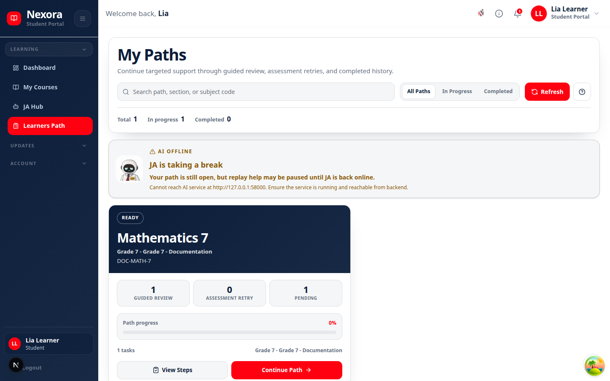

**Do this**

1. Sign in with an active student account.
2. Open Lxp from the visible navigation or its parent workspace.
3. Search for the correct person or class, open it, and use only the actions shown for your role.
4. Wait for the success state, then refresh once to confirm the saved result.

**Done when:** The expected page state or saved result remains correct after refresh.

**If stuck:** Check the account role, internet connection, selected school year/class, and visible error. Refresh once; do not repeat a write action blindly.

**Behind the screen:** `next-frontend/app/(dashboard)/dashboard/student/lxp/page.tsx` at application snapshot `211483f07b901299b48ae42eda318c7448f1cbfd`.

### Lxp - selected item

**Role:** Learner  
**Web path:** `/dashboard/student/lxp/[classId]`  
**Purpose:** Record detail rendered from the locked application snapshot

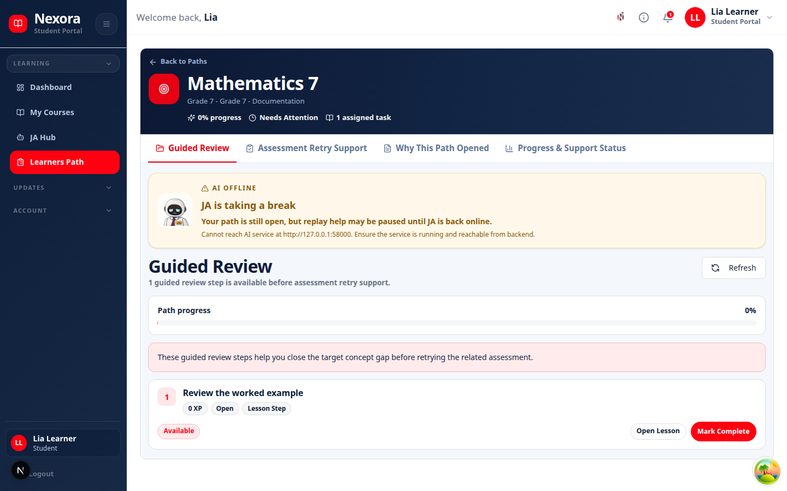

**Do this**

1. Sign in with an active student account.
2. Open Lxp - selected item from the visible navigation or its parent workspace.
3. Search for the correct person or class, open it, and use only the actions shown for your role.
4. Wait for the success state, then refresh once to confirm the saved result.

**Done when:** The expected page state or saved result remains correct after refresh.

**If stuck:** Check the account role, internet connection, selected school year/class, and visible error. Refresh once; do not repeat a write action blindly.

**Behind the screen:** `next-frontend/app/(dashboard)/dashboard/student/lxp/[classId]/page.tsx` at application snapshot `211483f07b901299b48ae42eda318c7448f1cbfd`.

### Generated Lessons - selected item

**Role:** Learner  
**Web path:** `/dashboard/student/lxp/[classId]/generated-lessons/[assignmentId]`  
**Purpose:** Record detail rendered from the locked application snapshot

**Do this**

1. Sign in with an active student account.
2. Open Generated Lessons - selected item from the visible navigation or its parent workspace.
3. Search for the correct person or class, open it, and use only the actions shown for your role.
4. Wait for the success state, then refresh once to confirm the saved result.

**Done when:** The expected page state or saved result remains correct after refresh.

**If stuck:** Check the account role, internet connection, selected school year/class, and visible error. Refresh once; do not repeat a write action blindly.

**Behind the screen:** `next-frontend/app/(dashboard)/dashboard/student/lxp/[classId]/generated-lessons/[assignmentId]/page.tsx` at application snapshot `211483f07b901299b48ae42eda318c7448f1cbfd`.

### Guided Assessment - selected item

**Role:** Learner  
**Web path:** `/dashboard/student/lxp/[classId]/guided-assessment/[assignmentId]`  
**Purpose:** Record detail rendered from the locked application snapshot

**Do this**

1. Sign in with an active student account.
2. Open Guided Assessment - selected item from the visible navigation or its parent workspace.
3. Choose the class and assessment state, open the intended item, then author, take, review, or grade as permitted.
4. Wait for the success state, then refresh once to confirm the saved result.

**Done when:** The expected page state or saved result remains correct after refresh.

**If stuck:** Check the account role, internet connection, selected school year/class, and visible error. Refresh once; do not repeat a write action blindly.

**Behind the screen:** `next-frontend/app/(dashboard)/dashboard/student/lxp/[classId]/guided-assessment/[assignmentId]/page.tsx` at application snapshot `211483f07b901299b48ae42eda318c7448f1cbfd`.

### Performance

**Role:** Learner  
**Web path:** `/dashboard/student/performance`  
**Purpose:** Performance rendered from the locked application snapshot

**Do this**

1. Sign in with an active student account.
2. Open Performance from the visible navigation or its parent workspace.
3. Choose the correct scope and filters, inspect the evidence, then export or record the result if needed.
4. Wait for the success state, then refresh once to confirm the saved result.

**Done when:** The expected page state or saved result remains correct after refresh.

**If stuck:** Check the account role, internet connection, selected school year/class, and visible error. Refresh once; do not repeat a write action blindly.

**Behind the screen:** `next-frontend/app/(dashboard)/dashboard/student/performance/page.tsx` at application snapshot `211483f07b901299b48ae42eda318c7448f1cbfd`.

### Profile

**Role:** Learner  
**Web path:** `/dashboard/student/profile`  
**Purpose:** Profile rendered from the locked application snapshot

**Do this**

1. Sign in with an active student account.
2. Open Profile from the visible navigation or its parent workspace.
3. Search for the correct person or class, open it, and use only the actions shown for your role.
4. Wait for the success state, then refresh once to confirm the saved result.

**Done when:** The expected page state or saved result remains correct after refresh.

**If stuck:** Check the account role, internet connection, selected school year/class, and visible error. Refresh once; do not repeat a write action blindly.

**Behind the screen:** `next-frontend/app/(dashboard)/dashboard/student/profile/page.tsx` at application snapshot `211483f07b901299b48ae42eda318c7448f1cbfd`.

### Transcript

**Role:** Learner  
**Web path:** `/dashboard/student/transcript`  
**Purpose:** Transcript rendered from the locked application snapshot

**Do this**

1. Sign in with an active student account.
2. Open Transcript from the visible navigation or its parent workspace.
3. Choose the correct scope and filters, inspect the evidence, then export or record the result if needed.
4. Wait for the success state, then refresh once to confirm the saved result.

**Done when:** The expected page state or saved result remains correct after refresh.

**If stuck:** Check the account role, internet connection, selected school year/class, and visible error. Refresh once; do not repeat a write action blindly.

**Behind the screen:** `next-frontend/app/(dashboard)/dashboard/student/transcript/page.tsx` at application snapshot `211483f07b901299b48ae42eda318c7448f1cbfd`.

## Teacher web screens

## Teacher workflows

### Teacher

**Role:** Teacher  
**Web path:** `/dashboard/teacher`  
**Purpose:** Teacher rendered from the locked application snapshot

**Do this**

1. Sign in with an active teacher account.
2. Open Teacher from the visible navigation or its parent workspace.
3. Search for the correct person or class, open it, and use only the actions shown for your role.
4. Wait for the success state, then refresh once to confirm the saved result.

**Done when:** The expected page state or saved result remains correct after refresh.

**If stuck:** Check the account role, internet connection, selected school year/class, and visible error. Refresh once; do not repeat a write action blindly.

**Behind the screen:** `next-frontend/app/(dashboard)/dashboard/teacher/page.tsx` at application snapshot `211483f07b901299b48ae42eda318c7448f1cbfd`.

### Announcements

**Role:** Teacher  
**Web path:** `/dashboard/teacher/announcements`  
**Purpose:** Announcements rendered from the locked application snapshot

**Do this**

1. Sign in with an active teacher account.
2. Open Announcements from the visible navigation or its parent workspace.
3. Search for the correct person or class, open it, and use only the actions shown for your role.
4. Wait for the success state, then refresh once to confirm the saved result.

**Done when:** The expected page state or saved result remains correct after refresh.

**If stuck:** Check the account role, internet connection, selected school year/class, and visible error. Refresh once; do not repeat a write action blindly.

**Behind the screen:** `next-frontend/app/(dashboard)/dashboard/teacher/announcements/page.tsx` at application snapshot `211483f07b901299b48ae42eda318c7448f1cbfd`.

### Assessments

**Role:** Teacher  
**Web path:** `/dashboard/teacher/assessments`  
**Purpose:** Assessments rendered from the locked application snapshot

**Do this**

1. Sign in with an active teacher account.
2. Open Assessments from the visible navigation or its parent workspace.
3. Choose the class and assessment state, open the intended item, then author, take, review, or grade as permitted.
4. Wait for the success state, then refresh once to confirm the saved result.

**Done when:** The expected page state or saved result remains correct after refresh.

**If stuck:** Check the account role, internet connection, selected school year/class, and visible error. Refresh once; do not repeat a write action blindly.

**Behind the screen:** `next-frontend/app/(dashboard)/dashboard/teacher/assessments/page.tsx` at application snapshot `211483f07b901299b48ae42eda318c7448f1cbfd`.

### Assessments - selected item

**Role:** Teacher  
**Web path:** `/dashboard/teacher/assessments/[id]`  
**Purpose:** Record detail rendered from the locked application snapshot

**Do this**

1. Sign in with an active teacher account.
2. Open Assessments - selected item from the visible navigation or its parent workspace.
3. Choose the class and assessment state, open the intended item, then author, take, review, or grade as permitted.
4. Wait for the success state, then refresh once to confirm the saved result.

**Done when:** The expected page state or saved result remains correct after refresh.

**If stuck:** Check the account role, internet connection, selected school year/class, and visible error. Refresh once; do not repeat a write action blindly.

**Behind the screen:** `next-frontend/app/(dashboard)/dashboard/teacher/assessments/[id]/page.tsx` at application snapshot `211483f07b901299b48ae42eda318c7448f1cbfd`.

### Edit

**Role:** Teacher  
**Web path:** `/dashboard/teacher/assessments/[id]/edit`  
**Purpose:** Edit rendered from the locked application snapshot

**Do this**

1. Sign in with an active teacher account.
2. Open Edit from the visible navigation or its parent workspace.
3. Complete every required field, review the summary, then save or publish once.
4. Wait for the success state, then refresh once to confirm the saved result.

**Done when:** The expected page state or saved result remains correct after refresh.

**If stuck:** Check the account role, internet connection, selected school year/class, and visible error. Refresh once; do not repeat a write action blindly.

**Behind the screen:** `next-frontend/app/(dashboard)/dashboard/teacher/assessments/[id]/edit/page.tsx` at application snapshot `211483f07b901299b48ae42eda318c7448f1cbfd`.

### Results - selected item

**Role:** Teacher  
**Web path:** `/dashboard/teacher/assessments/[id]/results/[attemptId]`  
**Purpose:** Record detail rendered from the locked application snapshot

**Do this**

1. Sign in with an active teacher account.
2. Open Results - selected item from the visible navigation or its parent workspace.
3. Choose the class and assessment state, open the intended item, then author, take, review, or grade as permitted.
4. Wait for the success state, then refresh once to confirm the saved result.

**Done when:** The expected page state or saved result remains correct after refresh.

**If stuck:** Check the account role, internet connection, selected school year/class, and visible error. Refresh once; do not repeat a write action blindly.

**Behind the screen:** `next-frontend/app/(dashboard)/dashboard/teacher/assessments/[id]/results/[attemptId]/page.tsx` at application snapshot `211483f07b901299b48ae42eda318c7448f1cbfd`.

### Calendar

**Role:** Teacher  
**Web path:** `/dashboard/teacher/calendar`  
**Purpose:** Calendar rendered from the locked application snapshot

**Do this**

1. Sign in with an active teacher account.
2. Open Calendar from the visible navigation or its parent workspace.
3. Search for the correct person or class, open it, and use only the actions shown for your role.
4. Wait for the success state, then refresh once to confirm the saved result.

**Done when:** The expected page state or saved result remains correct after refresh.

**If stuck:** Check the account role, internet connection, selected school year/class, and visible error. Refresh once; do not repeat a write action blindly.

**Behind the screen:** `next-frontend/app/(dashboard)/dashboard/teacher/calendar/page.tsx` at application snapshot `211483f07b901299b48ae42eda318c7448f1cbfd`.

### Class Record

**Role:** Teacher  
**Web path:** `/dashboard/teacher/class-record`  
**Purpose:** Class Record rendered from the locked application snapshot

**Do this**

1. Sign in with an active teacher account.
2. Open Class Record from the visible navigation or its parent workspace.
3. Choose the correct scope and filters, inspect the evidence, then export or record the result if needed.
4. Wait for the success state, then refresh once to confirm the saved result.

**Done when:** The expected page state or saved result remains correct after refresh.

**If stuck:** Check the account role, internet connection, selected school year/class, and visible error. Refresh once; do not repeat a write action blindly.

**Behind the screen:** `next-frontend/app/(dashboard)/dashboard/teacher/class-record/page.tsx` at application snapshot `211483f07b901299b48ae42eda318c7448f1cbfd`.

### Classes

**Role:** Teacher  
**Web path:** `/dashboard/teacher/classes`  
**Purpose:** Classes rendered from the locked application snapshot

**Do this**

1. Sign in with an active teacher account.
2. Open Classes from the visible navigation or its parent workspace.
3. Search for the correct person or class, open it, and use only the actions shown for your role.
4. Wait for the success state, then refresh once to confirm the saved result.

**Done when:** The expected page state or saved result remains correct after refresh.

**If stuck:** Check the account role, internet connection, selected school year/class, and visible error. Refresh once; do not repeat a write action blindly.

**Behind the screen:** `next-frontend/app/(dashboard)/dashboard/teacher/classes/page.tsx` at application snapshot `211483f07b901299b48ae42eda318c7448f1cbfd`.

### Classes - selected item

**Role:** Teacher  
**Web path:** `/dashboard/teacher/classes/[id]`  
**Purpose:** Record detail rendered from the locked application snapshot

**Do this**

1. Sign in with an active teacher account.
2. Open Classes - selected item from the visible navigation or its parent workspace.
3. Search for the correct person or class, open it, and use only the actions shown for your role.
4. Wait for the success state, then refresh once to confirm the saved result.

**Done when:** The expected page state or saved result remains correct after refresh.

**If stuck:** Check the account role, internet connection, selected school year/class, and visible error. Refresh once; do not repeat a write action blindly.

**Behind the screen:** `next-frontend/app/(dashboard)/dashboard/teacher/classes/[id]/page.tsx` at application snapshot `211483f07b901299b48ae42eda318c7448f1cbfd`.

### Ai Draft

**Role:** Teacher  
**Web path:** `/dashboard/teacher/classes/[id]/ai-draft`  
**Purpose:** Ai Draft rendered from the locked application snapshot

**Do this**

1. Sign in with an active teacher account.
2. Open Ai Draft from the visible navigation or its parent workspace.
3. Search for the correct person or class, open it, and use only the actions shown for your role.
4. Wait for the success state, then refresh once to confirm the saved result.

**Done when:** The expected page state or saved result remains correct after refresh.

**If stuck:** Check the account role, internet connection, selected school year/class, and visible error. Refresh once; do not repeat a write action blindly.

**Behind the screen:** `next-frontend/app/(dashboard)/dashboard/teacher/classes/[id]/ai-draft/page.tsx` at application snapshot `211483f07b901299b48ae42eda318c7448f1cbfd`.

### Modules - selected item

**Role:** Teacher  
**Web path:** `/dashboard/teacher/classes/[id]/modules/[moduleId]`  
**Purpose:** Record detail rendered from the locked application snapshot

**Do this**

1. Sign in with an active teacher account.
2. Open Modules - selected item from the visible navigation or its parent workspace.
3. Search for the correct person or class, open it, and use only the actions shown for your role.
4. Wait for the success state, then refresh once to confirm the saved result.

**Done when:** The expected page state or saved result remains correct after refresh.

**If stuck:** Check the account role, internet connection, selected school year/class, and visible error. Refresh once; do not repeat a write action blindly.

**Behind the screen:** `next-frontend/app/(dashboard)/dashboard/teacher/classes/[id]/modules/[moduleId]/page.tsx` at application snapshot `211483f07b901299b48ae42eda318c7448f1cbfd`.

### Files - selected item

**Role:** Teacher  
**Web path:** `/dashboard/teacher/classes/[id]/modules/[moduleId]/files/[fileId]`  
**Purpose:** Record detail rendered from the locked application snapshot

**Do this**

1. Sign in with an active teacher account.
2. Open Files - selected item from the visible navigation or its parent workspace.
3. Search for the correct person or class, open it, and use only the actions shown for your role.
4. Wait for the success state, then refresh once to confirm the saved result.

**Done when:** The expected page state or saved result remains correct after refresh.

**If stuck:** Check the account role, internet connection, selected school year/class, and visible error. Refresh once; do not repeat a write action blindly.

**Behind the screen:** `next-frontend/app/(dashboard)/dashboard/teacher/classes/[id]/modules/[moduleId]/files/[fileId]/page.tsx` at application snapshot `211483f07b901299b48ae42eda318c7448f1cbfd`.

### Students - selected item

**Role:** Teacher  
**Web path:** `/dashboard/teacher/classes/[id]/students/[studentId]`  
**Purpose:** Record detail rendered from the locked application snapshot

**Do this**

1. Sign in with an active teacher account.
2. Open Students - selected item from the visible navigation or its parent workspace.
3. Search for the correct person or class, open it, and use only the actions shown for your role.
4. Wait for the success state, then refresh once to confirm the saved result.

**Done when:** The expected page state or saved result remains correct after refresh.

**If stuck:** Check the account role, internet connection, selected school year/class, and visible error. Refresh once; do not repeat a write action blindly.

**Behind the screen:** `next-frontend/app/(dashboard)/dashboard/teacher/classes/[id]/students/[studentId]/page.tsx` at application snapshot `211483f07b901299b48ae42eda318c7448f1cbfd`.

### Add

**Role:** Teacher  
**Web path:** `/dashboard/teacher/classes/[id]/students/add`  
**Purpose:** Add rendered from the locked application snapshot

**Do this**

1. Sign in with an active teacher account.
2. Open Add from the visible navigation or its parent workspace.
3. Complete every required field, review the summary, then save or publish once.
4. Wait for the success state, then refresh once to confirm the saved result.

**Done when:** The expected page state or saved result remains correct after refresh.

**If stuck:** Check the account role, internet connection, selected school year/class, and visible error. Refresh once; do not repeat a write action blindly.

**Behind the screen:** `next-frontend/app/(dashboard)/dashboard/teacher/classes/[id]/students/add/page.tsx` at application snapshot `211483f07b901299b48ae42eda318c7448f1cbfd`.

### Dashboard

**Role:** Teacher  
**Web path:** `/dashboard/teacher/dashboard`  
**Purpose:** Dashboard rendered from the locked application snapshot

**Do this**

1. Sign in with an active teacher account.
2. Open Dashboard from the visible navigation or its parent workspace.
3. Search for the correct person or class, open it, and use only the actions shown for your role.
4. Wait for the success state, then refresh once to confirm the saved result.

**Done when:** The expected page state or saved result remains correct after refresh.

**If stuck:** Check the account role, internet connection, selected school year/class, and visible error. Refresh once; do not repeat a write action blindly.

**Behind the screen:** `next-frontend/app/(dashboard)/dashboard/teacher/dashboard/page.tsx` at application snapshot `211483f07b901299b48ae42eda318c7448f1cbfd`.

### Evaluations

**Role:** Teacher  
**Web path:** `/dashboard/teacher/evaluations`  
**Purpose:** Evaluations rendered from the locked application snapshot

**Do this**

1. Sign in with an active teacher account.
2. Open Evaluations from the visible navigation or its parent workspace.
3. Search for the correct person or class, open it, and use only the actions shown for your role.
4. Wait for the success state, then refresh once to confirm the saved result.

**Done when:** The expected page state or saved result remains correct after refresh.

**If stuck:** Check the account role, internet connection, selected school year/class, and visible error. Refresh once; do not repeat a write action blindly.

**Behind the screen:** `next-frontend/app/(dashboard)/dashboard/teacher/evaluations/page.tsx` at application snapshot `211483f07b901299b48ae42eda318c7448f1cbfd`.

### Extractions - selected item

**Role:** Teacher  
**Web path:** `/dashboard/teacher/extractions/[id]`  
**Purpose:** Record detail rendered from the locked application snapshot

**Do this**

1. Sign in with an active teacher account.
2. Open Extractions - selected item from the visible navigation or its parent workspace.
3. Search for the correct person or class, open it, and use only the actions shown for your role.
4. Wait for the success state, then refresh once to confirm the saved result.

**Done when:** The expected page state or saved result remains correct after refresh.

**If stuck:** Check the account role, internet connection, selected school year/class, and visible error. Refresh once; do not repeat a write action blindly.

**Behind the screen:** `next-frontend/app/(dashboard)/dashboard/teacher/extractions/[id]/page.tsx` at application snapshot `211483f07b901299b48ae42eda318c7448f1cbfd`.

### Interventions

**Role:** Teacher  
**Web path:** `/dashboard/teacher/interventions`  
**Purpose:** Interventions rendered from the locked application snapshot

**Do this**

1. Sign in with an active teacher account.
2. Open Interventions from the visible navigation or its parent workspace.
3. Search for the correct person or class, open it, and use only the actions shown for your role.
4. Wait for the success state, then refresh once to confirm the saved result.

**Done when:** The expected page state or saved result remains correct after refresh.

**If stuck:** Check the account role, internet connection, selected school year/class, and visible error. Refresh once; do not repeat a write action blindly.

**Behind the screen:** `next-frontend/app/(dashboard)/dashboard/teacher/interventions/page.tsx` at application snapshot `211483f07b901299b48ae42eda318c7448f1cbfd`.

### Interventions - selected item

**Role:** Teacher  
**Web path:** `/dashboard/teacher/interventions/[caseId]`  
**Purpose:** Record detail rendered from the locked application snapshot

**Do this**

1. Sign in with an active teacher account.
2. Open Interventions - selected item from the visible navigation or its parent workspace.
3. Search for the correct person or class, open it, and use only the actions shown for your role.
4. Wait for the success state, then refresh once to confirm the saved result.

**Done when:** The expected page state or saved result remains correct after refresh.

**If stuck:** Check the account role, internet connection, selected school year/class, and visible error. Refresh once; do not repeat a write action blindly.

**Behind the screen:** `next-frontend/app/(dashboard)/dashboard/teacher/interventions/[caseId]/page.tsx` at application snapshot `211483f07b901299b48ae42eda318c7448f1cbfd`.

### Lessons

**Role:** Teacher  
**Web path:** `/dashboard/teacher/lessons`  
**Purpose:** Lessons rendered from the locked application snapshot

**Do this**

1. Sign in with an active teacher account.
2. Open Lessons from the visible navigation or its parent workspace.
3. Search for the correct person or class, open it, and use only the actions shown for your role.
4. Wait for the success state, then refresh once to confirm the saved result.

**Done when:** The expected page state or saved result remains correct after refresh.

**If stuck:** Check the account role, internet connection, selected school year/class, and visible error. Refresh once; do not repeat a write action blindly.

**Behind the screen:** `next-frontend/app/(dashboard)/dashboard/teacher/lessons/page.tsx` at application snapshot `211483f07b901299b48ae42eda318c7448f1cbfd`.

### Edit

**Role:** Teacher  
**Web path:** `/dashboard/teacher/lessons/[id]/edit`  
**Purpose:** Edit rendered from the locked application snapshot

**Do this**

1. Sign in with an active teacher account.
2. Open Edit from the visible navigation or its parent workspace.
3. Complete every required field, review the summary, then save or publish once.
4. Wait for the success state, then refresh once to confirm the saved result.

**Done when:** The expected page state or saved result remains correct after refresh.

**If stuck:** Check the account role, internet connection, selected school year/class, and visible error. Refresh once; do not repeat a write action blindly.

**Behind the screen:** `next-frontend/app/(dashboard)/dashboard/teacher/lessons/[id]/edit/page.tsx` at application snapshot `211483f07b901299b48ae42eda318c7448f1cbfd`.

### View

**Role:** Teacher  
**Web path:** `/dashboard/teacher/lessons/[id]/view`  
**Purpose:** View rendered from the locked application snapshot

**Do this**

1. Sign in with an active teacher account.
2. Open View from the visible navigation or its parent workspace.
3. Search for the correct person or class, open it, and use only the actions shown for your role.
4. Wait for the success state, then refresh once to confirm the saved result.

**Done when:** The expected page state or saved result remains correct after refresh.

**If stuck:** Check the account role, internet connection, selected school year/class, and visible error. Refresh once; do not repeat a write action blindly.

**Behind the screen:** `next-frontend/app/(dashboard)/dashboard/teacher/lessons/[id]/view/page.tsx` at application snapshot `211483f07b901299b48ae42eda318c7448f1cbfd`.

### Library

**Role:** Teacher  
**Web path:** `/dashboard/teacher/library`  
**Purpose:** Library rendered from the locked application snapshot

**Do this**

1. Sign in with an active teacher account.
2. Open Library from the visible navigation or its parent workspace.
3. Search for the correct person or class, open it, and use only the actions shown for your role.
4. Wait for the success state, then refresh once to confirm the saved result.

**Done when:** The expected page state or saved result remains correct after refresh.

**If stuck:** Check the account role, internet connection, selected school year/class, and visible error. Refresh once; do not repeat a write action blindly.

**Behind the screen:** `next-frontend/app/(dashboard)/dashboard/teacher/library/page.tsx` at application snapshot `211483f07b901299b48ae42eda318c7448f1cbfd`.

### Modules

**Role:** Teacher  
**Web path:** `/dashboard/teacher/modules`  
**Purpose:** Modules rendered from the locked application snapshot

**Do this**

1. Sign in with an active teacher account.
2. Open Modules from the visible navigation or its parent workspace.
3. Search for the correct person or class, open it, and use only the actions shown for your role.
4. Wait for the success state, then refresh once to confirm the saved result.

**Done when:** The expected page state or saved result remains correct after refresh.

**If stuck:** Check the account role, internet connection, selected school year/class, and visible error. Refresh once; do not repeat a write action blindly.

**Behind the screen:** `next-frontend/app/(dashboard)/dashboard/teacher/modules/page.tsx` at application snapshot `211483f07b901299b48ae42eda318c7448f1cbfd`.

### Performance

**Role:** Teacher  
**Web path:** `/dashboard/teacher/performance`  
**Purpose:** Performance rendered from the locked application snapshot

**Do this**

1. Sign in with an active teacher account.
2. Open Performance from the visible navigation or its parent workspace.
3. Choose the correct scope and filters, inspect the evidence, then export or record the result if needed.
4. Wait for the success state, then refresh once to confirm the saved result.

**Done when:** The expected page state or saved result remains correct after refresh.

**If stuck:** Check the account role, internet connection, selected school year/class, and visible error. Refresh once; do not repeat a write action blindly.

**Behind the screen:** `next-frontend/app/(dashboard)/dashboard/teacher/performance/page.tsx` at application snapshot `211483f07b901299b48ae42eda318c7448f1cbfd`.

### Profile

**Role:** Teacher  
**Web path:** `/dashboard/teacher/profile`  
**Purpose:** Profile rendered from the locked application snapshot

**Do this**

1. Sign in with an active teacher account.
2. Open Profile from the visible navigation or its parent workspace.
3. Search for the correct person or class, open it, and use only the actions shown for your role.
4. Wait for the success state, then refresh once to confirm the saved result.

**Done when:** The expected page state or saved result remains correct after refresh.

**If stuck:** Check the account role, internet connection, selected school year/class, and visible error. Refresh once; do not repeat a write action blindly.

**Behind the screen:** `next-frontend/app/(dashboard)/dashboard/teacher/profile/page.tsx` at application snapshot `211483f07b901299b48ae42eda318c7448f1cbfd`.

### Reports

**Role:** Teacher  
**Web path:** `/dashboard/teacher/reports`  
**Purpose:** Reports rendered from the locked application snapshot

**Do this**

1. Sign in with an active teacher account.
2. Open Reports from the visible navigation or its parent workspace.
3. Choose the correct scope and filters, inspect the evidence, then export or record the result if needed.
4. Wait for the success state, then refresh once to confirm the saved result.

**Done when:** The expected page state or saved result remains correct after refresh.

**If stuck:** Check the account role, internet connection, selected school year/class, and visible error. Refresh once; do not repeat a write action blindly.

**Behind the screen:** `next-frontend/app/(dashboard)/dashboard/teacher/reports/page.tsx` at application snapshot `211483f07b901299b48ae42eda318c7448f1cbfd`.

### Sections

**Role:** Teacher  
**Web path:** `/dashboard/teacher/sections`  
**Purpose:** Sections rendered from the locked application snapshot

**Do this**

1. Sign in with an active teacher account.
2. Open Sections from the visible navigation or its parent workspace.
3. Search for the correct person or class, open it, and use only the actions shown for your role.
4. Wait for the success state, then refresh once to confirm the saved result.

**Done when:** The expected page state or saved result remains correct after refresh.

**If stuck:** Check the account role, internet connection, selected school year/class, and visible error. Refresh once; do not repeat a write action blindly.

**Behind the screen:** `next-frontend/app/(dashboard)/dashboard/teacher/sections/page.tsx` at application snapshot `211483f07b901299b48ae42eda318c7448f1cbfd`.

### Roster

**Role:** Teacher  
**Web path:** `/dashboard/teacher/sections/[id]/roster`  
**Purpose:** Roster rendered from the locked application snapshot

**Do this**

1. Sign in with an active teacher account.
2. Open Roster from the visible navigation or its parent workspace.
3. Search for the correct person or class, open it, and use only the actions shown for your role.
4. Wait for the success state, then refresh once to confirm the saved result.

**Done when:** The expected page state or saved result remains correct after refresh.

**If stuck:** Check the account role, internet connection, selected school year/class, and visible error. Refresh once; do not repeat a write action blindly.

**Behind the screen:** `next-frontend/app/(dashboard)/dashboard/teacher/sections/[id]/roster/page.tsx` at application snapshot `211483f07b901299b48ae42eda318c7448f1cbfd`.

### Students - selected item

**Role:** Teacher  
**Web path:** `/dashboard/teacher/sections/[id]/students/[studentId]`  
**Purpose:** Record detail rendered from the locked application snapshot

**Do this**

1. Sign in with an active teacher account.
2. Open Students - selected item from the visible navigation or its parent workspace.
3. Search for the correct person or class, open it, and use only the actions shown for your role.
4. Wait for the success state, then refresh once to confirm the saved result.

**Done when:** The expected page state or saved result remains correct after refresh.

**If stuck:** Check the account role, internet connection, selected school year/class, and visible error. Refresh once; do not repeat a write action blindly.

**Behind the screen:** `next-frontend/app/(dashboard)/dashboard/teacher/sections/[id]/students/[studentId]/page.tsx` at application snapshot `211483f07b901299b48ae42eda318c7448f1cbfd`.

### Add

**Role:** Teacher  
**Web path:** `/dashboard/teacher/sections/[id]/students/add`  
**Purpose:** Add rendered from the locked application snapshot

**Do this**

1. Sign in with an active teacher account.
2. Open Add from the visible navigation or its parent workspace.
3. Complete every required field, review the summary, then save or publish once.
4. Wait for the success state, then refresh once to confirm the saved result.

**Done when:** The expected page state or saved result remains correct after refresh.

**If stuck:** Check the account role, internet connection, selected school year/class, and visible error. Refresh once; do not repeat a write action blindly.

**Behind the screen:** `next-frontend/app/(dashboard)/dashboard/teacher/sections/[id]/students/add/page.tsx` at application snapshot `211483f07b901299b48ae42eda318c7448f1cbfd`.

## Administrator web screens

## Admin workflows

### Admin

**Role:** Administrator  
**Web path:** `/dashboard/admin`  
**Purpose:** Admin rendered from the locked application snapshot

**Do this**

1. Sign in with an active admin account.
2. Open Admin from the visible navigation or its parent workspace.
3. Read the page heading and current state, choose the intended item, and use the primary action shown on screen.
4. Wait for the success state, then refresh once to confirm the saved result.

**Done when:** The expected page state or saved result remains correct after refresh.

**If stuck:** Check the account role, internet connection, selected school year/class, and visible error. Refresh once; do not repeat a write action blindly.

**Behind the screen:** `next-frontend/app/(dashboard)/dashboard/admin/page.tsx` at application snapshot `211483f07b901299b48ae42eda318c7448f1cbfd`.

### Academic Records - selected item

**Role:** Administrator  
**Web path:** `/dashboard/admin/academic-records/[classId]`  
**Purpose:** Record detail rendered from the locked application snapshot

**Do this**

1. Sign in with an active admin account.
2. Open Academic Records - selected item from the visible navigation or its parent workspace.
3. Choose the correct scope and filters, inspect the evidence, then export or record the result if needed.
4. Wait for the success state, then refresh once to confirm the saved result.

**Done when:** The expected page state or saved result remains correct after refresh.

**If stuck:** Check the account role, internet connection, selected school year/class, and visible error. Refresh once; do not repeat a write action blindly.

**Behind the screen:** `next-frontend/app/(dashboard)/dashboard/admin/academic-records/[classId]/page.tsx` at application snapshot `211483f07b901299b48ae42eda318c7448f1cbfd`.

### Access Students

**Role:** Administrator  
**Web path:** `/dashboard/admin/access-students`  
**Purpose:** Access Students rendered from the locked application snapshot

**Do this**

1. Sign in with an active admin account.
2. Open Access Students from the visible navigation or its parent workspace.
3. Search for the correct person or class, open it, and use only the actions shown for your role.
4. Wait for the success state, then refresh once to confirm the saved result.

**Done when:** The expected page state or saved result remains correct after refresh.

**If stuck:** Check the account role, internet connection, selected school year/class, and visible error. Refresh once; do not repeat a write action blindly.

**Behind the screen:** `next-frontend/app/(dashboard)/dashboard/admin/access-students/page.tsx` at application snapshot `211483f07b901299b48ae42eda318c7448f1cbfd`.

### Announcements

**Role:** Administrator  
**Web path:** `/dashboard/admin/announcements`  
**Purpose:** Announcements rendered from the locked application snapshot

**Do this**

1. Sign in with an active admin account.
2. Open Announcements from the visible navigation or its parent workspace.
3. Choose the relevant date or audience, open the item, and verify its schedule or publication state.
4. Wait for the success state, then refresh once to confirm the saved result.

**Done when:** The expected page state or saved result remains correct after refresh.

**If stuck:** Check the account role, internet connection, selected school year/class, and visible error. Refresh once; do not repeat a write action blindly.

**Behind the screen:** `next-frontend/app/(dashboard)/dashboard/admin/announcements/page.tsx` at application snapshot `211483f07b901299b48ae42eda318c7448f1cbfd`.

### Audit

**Role:** Administrator  
**Web path:** `/dashboard/admin/audit`  
**Purpose:** Audit rendered from the locked application snapshot

**Do this**

1. Sign in with an active admin account.
2. Open Audit from the visible navigation or its parent workspace.
3. Choose the correct scope and filters, inspect the evidence, then export or record the result if needed.
4. Wait for the success state, then refresh once to confirm the saved result.

**Done when:** The expected page state or saved result remains correct after refresh.

**If stuck:** Check the account role, internet connection, selected school year/class, and visible error. Refresh once; do not repeat a write action blindly.

**Behind the screen:** `next-frontend/app/(dashboard)/dashboard/admin/audit/page.tsx` at application snapshot `211483f07b901299b48ae42eda318c7448f1cbfd`.

### Calendar

**Role:** Administrator  
**Web path:** `/dashboard/admin/calendar`  
**Purpose:** Calendar rendered from the locked application snapshot

**Do this**

1. Sign in with an active admin account.
2. Open Calendar from the visible navigation or its parent workspace.
3. Choose the relevant date or audience, open the item, and verify its schedule or publication state.
4. Wait for the success state, then refresh once to confirm the saved result.

**Done when:** The expected page state or saved result remains correct after refresh.

**If stuck:** Check the account role, internet connection, selected school year/class, and visible error. Refresh once; do not repeat a write action blindly.

**Behind the screen:** `next-frontend/app/(dashboard)/dashboard/admin/calendar/page.tsx` at application snapshot `211483f07b901299b48ae42eda318c7448f1cbfd`.

### Chatbot

**Role:** Administrator  
**Web path:** `/dashboard/admin/chatbot`  
**Purpose:** Chatbot rendered from the locked application snapshot

**Do this**

1. Sign in with an active admin account.
2. Open Chatbot from the visible navigation or its parent workspace.
3. Choose an approved class or source, ask one focused question, and review AI output before applying it.
4. Wait for the success state, then refresh once to confirm the saved result.

**Done when:** The expected page state or saved result remains correct after refresh.

**If stuck:** Check the account role, internet connection, selected school year/class, and visible error. Refresh once; do not repeat a write action blindly.

**Behind the screen:** `next-frontend/app/(dashboard)/dashboard/admin/chatbot/page.tsx` at application snapshot `211483f07b901299b48ae42eda318c7448f1cbfd`.

### Class Record

**Role:** Administrator  
**Web path:** `/dashboard/admin/class-record`  
**Purpose:** Class Record rendered from the locked application snapshot

**Do this**

1. Sign in with an active admin account.
2. Open Class Record from the visible navigation or its parent workspace.
3. Choose the correct scope and filters, inspect the evidence, then export or record the result if needed.
4. Wait for the success state, then refresh once to confirm the saved result.

**Done when:** The expected page state or saved result remains correct after refresh.

**If stuck:** Check the account role, internet connection, selected school year/class, and visible error. Refresh once; do not repeat a write action blindly.

**Behind the screen:** `next-frontend/app/(dashboard)/dashboard/admin/class-record/page.tsx` at application snapshot `211483f07b901299b48ae42eda318c7448f1cbfd`.

### Class Templates

**Role:** Administrator  
**Web path:** `/dashboard/admin/class-templates`  
**Purpose:** Class Templates rendered from the locked application snapshot

**Do this**

1. Sign in with an active admin account.
2. Open Class Templates from the visible navigation or its parent workspace.
3. Search for the correct person or class, open it, and use only the actions shown for your role.
4. Wait for the success state, then refresh once to confirm the saved result.

**Done when:** The expected page state or saved result remains correct after refresh.

**If stuck:** Check the account role, internet connection, selected school year/class, and visible error. Refresh once; do not repeat a write action blindly.

**Behind the screen:** `next-frontend/app/(dashboard)/dashboard/admin/class-templates/page.tsx` at application snapshot `211483f07b901299b48ae42eda318c7448f1cbfd`.

### Class Templates - selected item

**Role:** Administrator  
**Web path:** `/dashboard/admin/class-templates/[id]`  
**Purpose:** Record detail rendered from the locked application snapshot

**Do this**

1. Sign in with an active admin account.
2. Open Class Templates - selected item from the visible navigation or its parent workspace.
3. Search for the correct person or class, open it, and use only the actions shown for your role.
4. Wait for the success state, then refresh once to confirm the saved result.

**Done when:** The expected page state or saved result remains correct after refresh.

**If stuck:** Check the account role, internet connection, selected school year/class, and visible error. Refresh once; do not repeat a write action blindly.

**Behind the screen:** `next-frontend/app/(dashboard)/dashboard/admin/class-templates/[id]/page.tsx` at application snapshot `211483f07b901299b48ae42eda318c7448f1cbfd`.

### Edit

**Role:** Administrator  
**Web path:** `/dashboard/admin/class-templates/[id]/announcements/[announcementKey]/edit`  
**Purpose:** Edit rendered from the locked application snapshot

**Do this**

1. Sign in with an active admin account.
2. Open Edit from the visible navigation or its parent workspace.
3. Complete every required field, review the summary, then save or publish once.
4. Wait for the success state, then refresh once to confirm the saved result.

**Done when:** The expected page state or saved result remains correct after refresh.

**If stuck:** Check the account role, internet connection, selected school year/class, and visible error. Refresh once; do not repeat a write action blindly.

**Behind the screen:** `next-frontend/app/(dashboard)/dashboard/admin/class-templates/[id]/announcements/[announcementKey]/edit/page.tsx` at application snapshot `211483f07b901299b48ae42eda318c7448f1cbfd`.

### New

**Role:** Administrator  
**Web path:** `/dashboard/admin/class-templates/[id]/announcements/new`  
**Purpose:** New rendered from the locked application snapshot

**Do this**

1. Sign in with an active admin account.
2. Open New from the visible navigation or its parent workspace.
3. Complete every required field, review the summary, then save or publish once.
4. Wait for the success state, then refresh once to confirm the saved result.

**Done when:** The expected page state or saved result remains correct after refresh.

**If stuck:** Check the account role, internet connection, selected school year/class, and visible error. Refresh once; do not repeat a write action blindly.

**Behind the screen:** `next-frontend/app/(dashboard)/dashboard/admin/class-templates/[id]/announcements/new/page.tsx` at application snapshot `211483f07b901299b48ae42eda318c7448f1cbfd`.

### Edit

**Role:** Administrator  
**Web path:** `/dashboard/admin/class-templates/[id]/assessments/[assessmentKey]/edit`  
**Purpose:** Edit rendered from the locked application snapshot

**Do this**

1. Sign in with an active admin account.
2. Open Edit from the visible navigation or its parent workspace.
3. Complete every required field, review the summary, then save or publish once.
4. Wait for the success state, then refresh once to confirm the saved result.

**Done when:** The expected page state or saved result remains correct after refresh.

**If stuck:** Check the account role, internet connection, selected school year/class, and visible error. Refresh once; do not repeat a write action blindly.

**Behind the screen:** `next-frontend/app/(dashboard)/dashboard/admin/class-templates/[id]/assessments/[assessmentKey]/edit/page.tsx` at application snapshot `211483f07b901299b48ae42eda318c7448f1cbfd`.

### Edit

**Role:** Administrator  
**Web path:** `/dashboard/admin/class-templates/[id]/lessons/[lessonKey]/edit`  
**Purpose:** Edit rendered from the locked application snapshot

**Do this**

1. Sign in with an active admin account.
2. Open Edit from the visible navigation or its parent workspace.
3. Complete every required field, review the summary, then save or publish once.
4. Wait for the success state, then refresh once to confirm the saved result.

**Done when:** The expected page state or saved result remains correct after refresh.

**If stuck:** Check the account role, internet connection, selected school year/class, and visible error. Refresh once; do not repeat a write action blindly.

**Behind the screen:** `next-frontend/app/(dashboard)/dashboard/admin/class-templates/[id]/lessons/[lessonKey]/edit/page.tsx` at application snapshot `211483f07b901299b48ae42eda318c7448f1cbfd`.

### Modules - selected item

**Role:** Administrator  
**Web path:** `/dashboard/admin/class-templates/[id]/modules/[moduleKey]`  
**Purpose:** Record detail rendered from the locked application snapshot

**Do this**

1. Sign in with an active admin account.
2. Open Modules - selected item from the visible navigation or its parent workspace.
3. Search for the correct person or class, open it, and use only the actions shown for your role.
4. Wait for the success state, then refresh once to confirm the saved result.

**Done when:** The expected page state or saved result remains correct after refresh.

**If stuck:** Check the account role, internet connection, selected school year/class, and visible error. Refresh once; do not repeat a write action blindly.

**Behind the screen:** `next-frontend/app/(dashboard)/dashboard/admin/class-templates/[id]/modules/[moduleKey]/page.tsx` at application snapshot `211483f07b901299b48ae42eda318c7448f1cbfd`.

### Classes

**Role:** Administrator  
**Web path:** `/dashboard/admin/classes`  
**Purpose:** Classes rendered from the locked application snapshot

**Do this**

1. Sign in with an active admin account.
2. Open Classes from the visible navigation or its parent workspace.
3. Search for the correct person or class, open it, and use only the actions shown for your role.
4. Wait for the success state, then refresh once to confirm the saved result.

**Done when:** The expected page state or saved result remains correct after refresh.

**If stuck:** Check the account role, internet connection, selected school year/class, and visible error. Refresh once; do not repeat a write action blindly.

**Behind the screen:** `next-frontend/app/(dashboard)/dashboard/admin/classes/page.tsx` at application snapshot `211483f07b901299b48ae42eda318c7448f1cbfd`.

### Classes - selected item

**Role:** Administrator  
**Web path:** `/dashboard/admin/classes/[id]`  
**Purpose:** Record detail rendered from the locked application snapshot

**Do this**

1. Sign in with an active admin account.
2. Open Classes - selected item from the visible navigation or its parent workspace.
3. Search for the correct person or class, open it, and use only the actions shown for your role.
4. Wait for the success state, then refresh once to confirm the saved result.

**Done when:** The expected page state or saved result remains correct after refresh.

**If stuck:** Check the account role, internet connection, selected school year/class, and visible error. Refresh once; do not repeat a write action blindly.

**Behind the screen:** `next-frontend/app/(dashboard)/dashboard/admin/classes/[id]/page.tsx` at application snapshot `211483f07b901299b48ae42eda318c7448f1cbfd`.

### Edit

**Role:** Administrator  
**Web path:** `/dashboard/admin/classes/[id]/edit`  
**Purpose:** Edit rendered from the locked application snapshot

**Do this**

1. Sign in with an active admin account.
2. Open Edit from the visible navigation or its parent workspace.
3. Complete every required field, review the summary, then save or publish once.
4. Wait for the success state, then refresh once to confirm the saved result.

**Done when:** The expected page state or saved result remains correct after refresh.

**If stuck:** Check the account role, internet connection, selected school year/class, and visible error. Refresh once; do not repeat a write action blindly.

**Behind the screen:** `next-frontend/app/(dashboard)/dashboard/admin/classes/[id]/edit/page.tsx` at application snapshot `211483f07b901299b48ae42eda318c7448f1cbfd`.

### Add

**Role:** Administrator  
**Web path:** `/dashboard/admin/classes/[id]/students/add`  
**Purpose:** Add rendered from the locked application snapshot

**Do this**

1. Sign in with an active admin account.
2. Open Add from the visible navigation or its parent workspace.
3. Complete every required field, review the summary, then save or publish once.
4. Wait for the success state, then refresh once to confirm the saved result.

**Done when:** The expected page state or saved result remains correct after refresh.

**If stuck:** Check the account role, internet connection, selected school year/class, and visible error. Refresh once; do not repeat a write action blindly.

**Behind the screen:** `next-frontend/app/(dashboard)/dashboard/admin/classes/[id]/students/add/page.tsx` at application snapshot `211483f07b901299b48ae42eda318c7448f1cbfd`.

### New

**Role:** Administrator  
**Web path:** `/dashboard/admin/classes/new`  
**Purpose:** New rendered from the locked application snapshot

**Do this**

1. Sign in with an active admin account.
2. Open New from the visible navigation or its parent workspace.
3. Complete every required field, review the summary, then save or publish once.
4. Wait for the success state, then refresh once to confirm the saved result.

**Done when:** The expected page state or saved result remains correct after refresh.

**If stuck:** Check the account role, internet connection, selected school year/class, and visible error. Refresh once; do not repeat a write action blindly.

**Behind the screen:** `next-frontend/app/(dashboard)/dashboard/admin/classes/new/page.tsx` at application snapshot `211483f07b901299b48ae42eda318c7448f1cbfd`.

### Diagnostics

**Role:** Administrator  
**Web path:** `/dashboard/admin/diagnostics`  
**Purpose:** Diagnostics rendered from the locked application snapshot

**Do this**

1. Sign in with an active admin account.
2. Open Diagnostics from the visible navigation or its parent workspace.
3. Read the page heading and current state, choose the intended item, and use the primary action shown on screen.
4. Wait for the success state, then refresh once to confirm the saved result.

**Done when:** The expected page state or saved result remains correct after refresh.

**If stuck:** Check the account role, internet connection, selected school year/class, and visible error. Refresh once; do not repeat a write action blindly.

**Behind the screen:** `next-frontend/app/(dashboard)/dashboard/admin/diagnostics/page.tsx` at application snapshot `211483f07b901299b48ae42eda318c7448f1cbfd`.

### Evaluations

**Role:** Administrator  
**Web path:** `/dashboard/admin/evaluations`  
**Purpose:** Evaluations rendered from the locked application snapshot

**Do this**

1. Sign in with an active admin account.
2. Open Evaluations from the visible navigation or its parent workspace.
3. Read the page heading and current state, choose the intended item, and use the primary action shown on screen.
4. Wait for the success state, then refresh once to confirm the saved result.

**Done when:** The expected page state or saved result remains correct after refresh.

**If stuck:** Check the account role, internet connection, selected school year/class, and visible error. Refresh once; do not repeat a write action blindly.

**Behind the screen:** `next-frontend/app/(dashboard)/dashboard/admin/evaluations/page.tsx` at application snapshot `211483f07b901299b48ae42eda318c7448f1cbfd`.

### Library

**Role:** Administrator  
**Web path:** `/dashboard/admin/library`  
**Purpose:** Library rendered from the locked application snapshot

**Do this**

1. Sign in with an active admin account.
2. Open Library from the visible navigation or its parent workspace.
3. Read the page heading and current state, choose the intended item, and use the primary action shown on screen.
4. Wait for the success state, then refresh once to confirm the saved result.

**Done when:** The expected page state or saved result remains correct after refresh.

**If stuck:** Check the account role, internet connection, selected school year/class, and visible error. Refresh once; do not repeat a write action blindly.

**Behind the screen:** `next-frontend/app/(dashboard)/dashboard/admin/library/page.tsx` at application snapshot `211483f07b901299b48ae42eda318c7448f1cbfd`.

### Profile

**Role:** Administrator  
**Web path:** `/dashboard/admin/profile`  
**Purpose:** Profile rendered from the locked application snapshot

**Do this**

1. Sign in with an active admin account.
2. Open Profile from the visible navigation or its parent workspace.
3. Read the page heading and current state, choose the intended item, and use the primary action shown on screen.
4. Wait for the success state, then refresh once to confirm the saved result.

**Done when:** The expected page state or saved result remains correct after refresh.

**If stuck:** Check the account role, internet connection, selected school year/class, and visible error. Refresh once; do not repeat a write action blindly.

**Behind the screen:** `next-frontend/app/(dashboard)/dashboard/admin/profile/page.tsx` at application snapshot `211483f07b901299b48ae42eda318c7448f1cbfd`.

### Reports

**Role:** Administrator  
**Web path:** `/dashboard/admin/reports`  
**Purpose:** Reports rendered from the locked application snapshot

**Do this**

1. Sign in with an active admin account.
2. Open Reports from the visible navigation or its parent workspace.
3. Choose the correct scope and filters, inspect the evidence, then export or record the result if needed.
4. Wait for the success state, then refresh once to confirm the saved result.

**Done when:** The expected page state or saved result remains correct after refresh.

**If stuck:** Check the account role, internet connection, selected school year/class, and visible error. Refresh once; do not repeat a write action blindly.

**Behind the screen:** `next-frontend/app/(dashboard)/dashboard/admin/reports/page.tsx` at application snapshot `211483f07b901299b48ae42eda318c7448f1cbfd`.

### Roster Import

**Role:** Administrator  
**Web path:** `/dashboard/admin/roster-import`  
**Purpose:** Roster Import rendered from the locked application snapshot

**Do this**

1. Sign in with an active admin account.
2. Open Roster Import from the visible navigation or its parent workspace.
3. Complete every required field, review the summary, then save or publish once.
4. Wait for the success state, then refresh once to confirm the saved result.

**Done when:** The expected page state or saved result remains correct after refresh.

**If stuck:** Check the account role, internet connection, selected school year/class, and visible error. Refresh once; do not repeat a write action blindly.

**Behind the screen:** `next-frontend/app/(dashboard)/dashboard/admin/roster-import/page.tsx` at application snapshot `211483f07b901299b48ae42eda318c7448f1cbfd`.

### Sections

**Role:** Administrator  
**Web path:** `/dashboard/admin/sections`  
**Purpose:** Sections rendered from the locked application snapshot

**Do this**

1. Sign in with an active admin account.
2. Open Sections from the visible navigation or its parent workspace.
3. Search for the correct person or class, open it, and use only the actions shown for your role.
4. Wait for the success state, then refresh once to confirm the saved result.

**Done when:** The expected page state or saved result remains correct after refresh.

**If stuck:** Check the account role, internet connection, selected school year/class, and visible error. Refresh once; do not repeat a write action blindly.

**Behind the screen:** `next-frontend/app/(dashboard)/dashboard/admin/sections/page.tsx` at application snapshot `211483f07b901299b48ae42eda318c7448f1cbfd`.

### Edit

**Role:** Administrator  
**Web path:** `/dashboard/admin/sections/[id]/edit`  
**Purpose:** Edit rendered from the locked application snapshot

**Do this**

1. Sign in with an active admin account.
2. Open Edit from the visible navigation or its parent workspace.
3. Complete every required field, review the summary, then save or publish once.
4. Wait for the success state, then refresh once to confirm the saved result.

**Done when:** The expected page state or saved result remains correct after refresh.

**If stuck:** Check the account role, internet connection, selected school year/class, and visible error. Refresh once; do not repeat a write action blindly.

**Behind the screen:** `next-frontend/app/(dashboard)/dashboard/admin/sections/[id]/edit/page.tsx` at application snapshot `211483f07b901299b48ae42eda318c7448f1cbfd`.

### Roster

**Role:** Administrator  
**Web path:** `/dashboard/admin/sections/[id]/roster`  
**Purpose:** Roster rendered from the locked application snapshot

**Do this**

1. Sign in with an active admin account.
2. Open Roster from the visible navigation or its parent workspace.
3. Search for the correct person or class, open it, and use only the actions shown for your role.
4. Wait for the success state, then refresh once to confirm the saved result.

**Done when:** The expected page state or saved result remains correct after refresh.

**If stuck:** Check the account role, internet connection, selected school year/class, and visible error. Refresh once; do not repeat a write action blindly.

**Behind the screen:** `next-frontend/app/(dashboard)/dashboard/admin/sections/[id]/roster/page.tsx` at application snapshot `211483f07b901299b48ae42eda318c7448f1cbfd`.

### Students

**Role:** Administrator  
**Web path:** `/dashboard/admin/sections/[id]/students`  
**Purpose:** Students rendered from the locked application snapshot

**Do this**

1. Sign in with an active admin account.
2. Open Students from the visible navigation or its parent workspace.
3. Search for the correct person or class, open it, and use only the actions shown for your role.
4. Wait for the success state, then refresh once to confirm the saved result.

**Done when:** The expected page state or saved result remains correct after refresh.

**If stuck:** Check the account role, internet connection, selected school year/class, and visible error. Refresh once; do not repeat a write action blindly.

**Behind the screen:** `next-frontend/app/(dashboard)/dashboard/admin/sections/[id]/students/page.tsx` at application snapshot `211483f07b901299b48ae42eda318c7448f1cbfd`.

### Add

**Role:** Administrator  
**Web path:** `/dashboard/admin/sections/[id]/students/add`  
**Purpose:** Add rendered from the locked application snapshot

**Do this**

1. Sign in with an active admin account.
2. Open Add from the visible navigation or its parent workspace.
3. Complete every required field, review the summary, then save or publish once.
4. Wait for the success state, then refresh once to confirm the saved result.

**Done when:** The expected page state or saved result remains correct after refresh.

**If stuck:** Check the account role, internet connection, selected school year/class, and visible error. Refresh once; do not repeat a write action blindly.

**Behind the screen:** `next-frontend/app/(dashboard)/dashboard/admin/sections/[id]/students/add/page.tsx` at application snapshot `211483f07b901299b48ae42eda318c7448f1cbfd`.

### New

**Role:** Administrator  
**Web path:** `/dashboard/admin/sections/new`  
**Purpose:** New rendered from the locked application snapshot

**Do this**

1. Sign in with an active admin account.
2. Open New from the visible navigation or its parent workspace.
3. Complete every required field, review the summary, then save or publish once.
4. Wait for the success state, then refresh once to confirm the saved result.

**Done when:** The expected page state or saved result remains correct after refresh.

**If stuck:** Check the account role, internet connection, selected school year/class, and visible error. Refresh once; do not repeat a write action blindly.

**Behind the screen:** `next-frontend/app/(dashboard)/dashboard/admin/sections/new/page.tsx` at application snapshot `211483f07b901299b48ae42eda318c7448f1cbfd`.

### System Settings

**Role:** Administrator  
**Web path:** `/dashboard/admin/system-settings`  
**Purpose:** System Settings rendered from the locked application snapshot

**Do this**

1. Sign in with an active admin account.
2. Open System Settings from the visible navigation or its parent workspace.
3. Read the page heading and current state, choose the intended item, and use the primary action shown on screen.
4. Wait for the success state, then refresh once to confirm the saved result.

**Done when:** The expected page state or saved result remains correct after refresh.

**If stuck:** Check the account role, internet connection, selected school year/class, and visible error. Refresh once; do not repeat a write action blindly.

**Behind the screen:** `next-frontend/app/(dashboard)/dashboard/admin/system-settings/page.tsx` at application snapshot `211483f07b901299b48ae42eda318c7448f1cbfd`.

### Academic Year

**Role:** Administrator  
**Web path:** `/dashboard/admin/system-settings/academic-year`  
**Purpose:** Academic Year rendered from the locked application snapshot

**Do this**

1. Sign in with an active admin account.
2. Open Academic Year from the visible navigation or its parent workspace.
3. Read the page heading and current state, choose the intended item, and use the primary action shown on screen.
4. Wait for the success state, then refresh once to confirm the saved result.

**Done when:** The expected page state or saved result remains correct after refresh.

**If stuck:** Check the account role, internet connection, selected school year/class, and visible error. Refresh once; do not repeat a write action blindly.

**Behind the screen:** `next-frontend/app/(dashboard)/dashboard/admin/system-settings/academic-year/page.tsx` at application snapshot `211483f07b901299b48ae42eda318c7448f1cbfd`.

### Assessments Grading

**Role:** Administrator  
**Web path:** `/dashboard/admin/system-settings/assessments-grading`  
**Purpose:** Assessments Grading rendered from the locked application snapshot

**Do this**

1. Sign in with an active admin account.
2. Open Assessments Grading from the visible navigation or its parent workspace.
3. Choose the class and assessment state, open the intended item, then author, take, review, or grade as permitted.
4. Wait for the success state, then refresh once to confirm the saved result.

**Done when:** The expected page state or saved result remains correct after refresh.

**If stuck:** Check the account role, internet connection, selected school year/class, and visible error. Refresh once; do not repeat a write action blindly.

**Behind the screen:** `next-frontend/app/(dashboard)/dashboard/admin/system-settings/assessments-grading/page.tsx` at application snapshot `211483f07b901299b48ae42eda318c7448f1cbfd`.

### Audit Recovery

**Role:** Administrator  
**Web path:** `/dashboard/admin/system-settings/audit-recovery`  
**Purpose:** Audit Recovery rendered from the locked application snapshot

**Do this**

1. Sign in with an active admin account.
2. Open Audit Recovery from the visible navigation or its parent workspace.
3. Choose the correct scope and filters, inspect the evidence, then export or record the result if needed.
4. Wait for the success state, then refresh once to confirm the saved result.

**Done when:** The expected page state or saved result remains correct after refresh.

**If stuck:** Check the account role, internet connection, selected school year/class, and visible error. Refresh once; do not repeat a write action blindly.

**Behind the screen:** `next-frontend/app/(dashboard)/dashboard/admin/system-settings/audit-recovery/page.tsx` at application snapshot `211483f07b901299b48ae42eda318c7448f1cbfd`.

### Demo Mode

**Role:** Administrator  
**Web path:** `/dashboard/admin/system-settings/demo-mode`  
**Purpose:** Demo Mode rendered from the locked application snapshot

**Do this**

1. Sign in with an active admin account.
2. Open Demo Mode from the visible navigation or its parent workspace.
3. Read the page heading and current state, choose the intended item, and use the primary action shown on screen.
4. Wait for the success state, then refresh once to confirm the saved result.

**Done when:** The expected page state or saved result remains correct after refresh.

**If stuck:** Check the account role, internet connection, selected school year/class, and visible error. Refresh once; do not repeat a write action blindly.

**Behind the screen:** `next-frontend/app/(dashboard)/dashboard/admin/system-settings/demo-mode/page.tsx` at application snapshot `211483f07b901299b48ae42eda318c7448f1cbfd`.

### Learner Completion

**Role:** Administrator  
**Web path:** `/dashboard/admin/system-settings/learner-completion`  
**Purpose:** Learner Completion rendered from the locked application snapshot

**Do this**

1. Sign in with an active admin account.
2. Open Learner Completion from the visible navigation or its parent workspace.
3. Read the page heading and current state, choose the intended item, and use the primary action shown on screen.
4. Wait for the success state, then refresh once to confirm the saved result.

**Done when:** The expected page state or saved result remains correct after refresh.

**If stuck:** Check the account role, internet connection, selected school year/class, and visible error. Refresh once; do not repeat a write action blindly.

**Behind the screen:** `next-frontend/app/(dashboard)/dashboard/admin/system-settings/learner-completion/page.tsx` at application snapshot `211483f07b901299b48ae42eda318c7448f1cbfd`.

### Maintenance Access

**Role:** Administrator  
**Web path:** `/dashboard/admin/system-settings/maintenance-access`  
**Purpose:** Maintenance Access rendered from the locked application snapshot

**Do this**

1. Sign in with an active admin account.
2. Open Maintenance Access from the visible navigation or its parent workspace.
3. Preview the impact, read every blocker, reauthenticate, and confirm only when the evidence is correct.
4. Stop if the preview, blockers, or affected records differ from the intended scope.

**Done when:** The preview, confirmation, resulting state, and audit evidence agree.

**If stuck:** Stop. Save the blocker text and ask an administrator to verify policy and readiness before retrying.

**Behind the screen:** `next-frontend/app/(dashboard)/dashboard/admin/system-settings/maintenance-access/page.tsx` at application snapshot `211483f07b901299b48ae42eda318c7448f1cbfd`.

### Reset School Data

**Role:** Administrator  
**Web path:** `/dashboard/admin/system-settings/reset-school-data`  
**Purpose:** Reset School Data rendered from the locked application snapshot

**Do this**

1. Sign in with an active admin account.
2. Open Reset School Data from the visible navigation or its parent workspace.
3. Read the page heading and current state, choose the intended item, and use the primary action shown on screen.
4. Wait for the success state, then refresh once to confirm the saved result.

**Done when:** The expected page state or saved result remains correct after refresh.

**If stuck:** Check the account role, internet connection, selected school year/class, and visible error. Refresh once; do not repeat a write action blindly.

**Behind the screen:** `next-frontend/app/(dashboard)/dashboard/admin/system-settings/reset-school-data/page.tsx` at application snapshot `211483f07b901299b48ae42eda318c7448f1cbfd`.

### Year Transition

**Role:** Administrator  
**Web path:** `/dashboard/admin/system-settings/year-transition`  
**Purpose:** Year Transition rendered from the locked application snapshot

**Do this**

1. Sign in with an active admin account.
2. Open Year Transition from the visible navigation or its parent workspace.
3. Preview the impact, read every blocker, reauthenticate, and confirm only when the evidence is correct.
4. Stop if the preview, blockers, or affected records differ from the intended scope.

**Done when:** The preview, confirmation, resulting state, and audit evidence agree.

**If stuck:** Stop. Save the blocker text and ask an administrator to verify policy and readiness before retrying.

**Behind the screen:** `next-frontend/app/(dashboard)/dashboard/admin/system-settings/year-transition/page.tsx` at application snapshot `211483f07b901299b48ae42eda318c7448f1cbfd`.

### User Reports

**Role:** Administrator  
**Web path:** `/dashboard/admin/user-reports`  
**Purpose:** User Reports rendered from the locked application snapshot

**Do this**

1. Sign in with an active admin account.
2. Open User Reports from the visible navigation or its parent workspace.
3. Choose the correct scope and filters, inspect the evidence, then export or record the result if needed.
4. Wait for the success state, then refresh once to confirm the saved result.

**Done when:** The expected page state or saved result remains correct after refresh.

**If stuck:** Check the account role, internet connection, selected school year/class, and visible error. Refresh once; do not repeat a write action blindly.

**Behind the screen:** `next-frontend/app/(dashboard)/dashboard/admin/user-reports/page.tsx` at application snapshot `211483f07b901299b48ae42eda318c7448f1cbfd`.

### Users

**Role:** Administrator  
**Web path:** `/dashboard/admin/users`  
**Purpose:** Users rendered from the locked application snapshot

**Do this**

1. Sign in with an active admin account.
2. Open Users from the visible navigation or its parent workspace.
3. Search for the correct person or class, open it, and use only the actions shown for your role.
4. Wait for the success state, then refresh once to confirm the saved result.

**Done when:** The expected page state or saved result remains correct after refresh.

**If stuck:** Check the account role, internet connection, selected school year/class, and visible error. Refresh once; do not repeat a write action blindly.

**Behind the screen:** `next-frontend/app/(dashboard)/dashboard/admin/users/page.tsx` at application snapshot `211483f07b901299b48ae42eda318c7448f1cbfd`.

### Users - selected item

**Role:** Administrator  
**Web path:** `/dashboard/admin/users/[id]`  
**Purpose:** Record detail rendered from the locked application snapshot

**Do this**

1. Sign in with an active admin account.
2. Open Users - selected item from the visible navigation or its parent workspace.
3. Search for the correct person or class, open it, and use only the actions shown for your role.
4. Wait for the success state, then refresh once to confirm the saved result.

**Done when:** The expected page state or saved result remains correct after refresh.

**If stuck:** Check the account role, internet connection, selected school year/class, and visible error. Refresh once; do not repeat a write action blindly.

**Behind the screen:** `next-frontend/app/(dashboard)/dashboard/admin/users/[id]/page.tsx` at application snapshot `211483f07b901299b48ae42eda318c7448f1cbfd`.

### Create

**Role:** Administrator  
**Web path:** `/dashboard/admin/users/create`  
**Purpose:** Create rendered from the locked application snapshot

**Do this**

1. Sign in with an active admin account.
2. Open Create from the visible navigation or its parent workspace.
3. Complete every required field, review the summary, then save or publish once.
4. Wait for the success state, then refresh once to confirm the saved result.

**Done when:** The expected page state or saved result remains correct after refresh.

**If stuck:** Check the account role, internet connection, selected school year/class, and visible error. Refresh once; do not repeat a write action blindly.

**Behind the screen:** `next-frontend/app/(dashboard)/dashboard/admin/users/create/page.tsx` at application snapshot `211483f07b901299b48ae42eda318c7448f1cbfd`.

